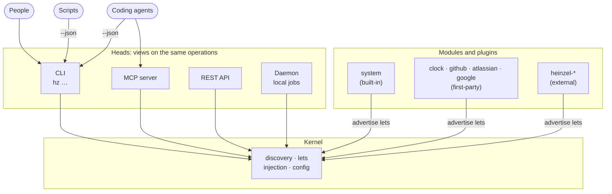

# 🧝 Heinzelmännchen

<!-- badges:start -->
[](https://github.com/helmut-hoffer-von-ankershoffen/heinzel/actions/workflows/ci.yml)
[](https://github.com/helmut-hoffer-von-ankershoffen/heinzel/tree/python-coverage-comment-action-data)
[](https://github.com/helmut-hoffer-von-ankershoffen/heinzel/actions/workflows/codeql.yml)
[](https://scorecard.dev/viewer/?uri=github.com/helmut-hoffer-von-ankershoffen/heinzel)
[](https://github.com/helmut-hoffer-von-ankershoffen/heinzel/releases)
[](pyproject.toml)
[](docs/CODING_STANDARDS.md#python)
[](https://github.com/astral-sh/ruff)
[](https://github.com/astral-sh/uv)
[](LICENSE)
<!-- badges:end -->

**Heinzelmännchen are open-source helpers that keep product development teams running.** They draft the busywork of
running a team — status, tracker updates, agendas, reports — in the background, and people approve it. Like the
[Heinzelmännchen of Cologne](https://en.wikipedia.org/wiki/Heinzelm%C3%A4nnchen), who finished the town's work at
night. Why it exists and where it is going: [INTENT.md](INTENT.md).

This release is the foundation — kernel, heads, plugins and release automation; the first team workflows arrive in
0.x ([roadmap](INTENT.md#where-we-are)).


**What you can do today:**

- **Write an operation once, use it everywhere.** A typed Python function is a `hz` command, an MCP tool for coding
  agents and a REST endpoint at once — with help text, validation and `--json`.
- **Extend it with plugins.** `hz system plugin add github` adds a [first-party plugin](#first-party-plugins);
  `hz system plugin new` scaffolds your own `heinzel-*` repository with tests, CI/CD and agent setup.
- **Run it with confidence.** `hz system doctor` checks every module's health, `hz system config` manages layered
  settings, `hz system update` updates in place and keeps your plugins.

You talk to them with **`hz`**, a small modulith: the kernel discovers *modules* and the *lets* they advertise — typed
declarations of operations, services, settings and health checks — and *heads* expose them.

## Install

You need [uv](https://docs.astral.sh/uv/) (`brew install uv`). Then:

<!-- docs-test -->
```bash
uv tool install git+https://github.com/helmut-hoffer-von-ankershoffen/heinzel
```

Pin a release with `@vX.Y.Z`; `hz system update` updates in place (`--source <spec>` moves to another version),
keeping plugins. Shell completion: `hz --install-completion`.

**From Claude Code**, add the plugin and let `/hz-init` do everything — install, plugins, configuration, agent
skills:

```text
/plugin marketplace add helmut-hoffer-von-ankershoffen/heinzel
/plugin install heinzel@heinzel
/hz-init
```

Other agents: `hz system agent install` copies the skills into the directories set in `[system.agent] skill_dirs`.

**Uninstall** with `/hz-uninstall` from Claude Code, or:

<!-- docs-test -->
```bash
hz system agent uninstall             # remove the skills from your agents
uv tool uninstall heinzel      # remove Heinzelmännchen and its plugins
```

Your configuration files stay; `hz system config show` lists them before you uninstall.

## Use

<!-- docs-test -->
```bash
hz --version
hz system info                 # versions, settings, modules, what plugins report
hz system doctor               # every module's health checks; exits 1 if anything is down
hz system modules              # every module and submodule with the lets it advertises
hz system changelog            # release notes of the installed version
hz system config show          # configuration files, settings in effect, their environment variables
hz system config set hz.log_level INFO
hz system release              # is there a newer release? (asks GitHub now; hz checks hourly on its own)
hz system update               # update, keeping plugins
hz system plugin add clock     # a first-party plugin
hz clock                       # its command: the time for everyone on the team
hz system agent install               # install the skills for coding agents
```

Every operation takes `--json` (or `--format json`; `HZ_OUTPUT_FORMAT=json` makes it the default) for scripts and
agents; the long-running `serve` commands are the exception. Exit codes: `0` success, `1` an error with a readable message, `2` a usage error, `78` invalid
configuration. All commands: [docs/CLI_REFERENCE.md](docs/CLI_REFERENCE.md).

How the pieces fit — more in [ARCHITECTURE.md](docs/ARCHITECTURE.md):



## What's inside

Every module is a set of operations, and every operation is a `hz` command, an MCP tool (`hz system serve mcp`)
and a REST endpoint (`hz system serve api`) at once. Coding agents use whichever suits them: the CLI with `--json`,
or the MCP tools. Modules can also advertise jobs that
`hz system daemon install` runs in the background on a schedule, under launchd or systemd, unattended and with your
rights; `hz system daemon pause` and `uninstall` stop them (see [SECURITY.md](SECURITY.md)). Built in today:

<!-- modules:start -->
- [`atlassian`](docs/MODULES.md#atlassian) — Read Jira issues and Confluence pages through acli: the tracker and documents capabilities. *First-party plugin: `hz system plugin add atlassian`.*
- [`clock`](docs/MODULES.md#clock) — What time it is for everyone on the team. *First-party plugin: `hz system plugin add clock`.*
- [`github`](docs/MODULES.md#github) — Read pull requests and issues from GitHub: the code-host and tracker capabilities. *First-party plugin: `hz system plugin add github`.*
- [`google`](docs/MODULES.md#google) — Read Google Docs, Sheets, Drive, Calendar and Gmail: the documents, calendar and mail capabilities. *First-party plugin: `hz system plugin add google`.*
- [`org`](docs/MODULES.md#org) — Your profile, and the team, org and company you work with.
- [`system`](docs/MODULES.md#system) — Inspect, configure, diagnose and update Heinzelmännchen itself.
- [`system.agent`](docs/MODULES.md#systemagent) — Install the Heinzelmännchen skills for coding agents.
- [`system.capability`](docs/MODULES.md#systemcapability) — Show which adapters serve which capabilities, and who reads and writes what.
- [`system.changelog`](docs/MODULES.md#systemchangelog) — Release notes of the installed version.
- [`system.config`](docs/MODULES.md#systemconfig) — Show, get, set and initialize configuration.
- [`system.credential`](docs/MODULES.md#systemcredential) — Store and check the credentials modules need, in the OS keychain.
- [`system.daemon`](docs/MODULES.md#systemdaemon) — Run modules' jobs in the background, supervised by launchd or systemd.
- [`system.directory`](docs/MODULES.md#systemdirectory) — Guess reporting lines from recurring 1:1s in your calendar, for setup to confirm.
- [`system.doctor`](docs/MODULES.md#systemdoctor) — Check that Heinzelmännchen and its modules are healthy.
- [`system.plugin`](docs/MODULES.md#systemplugin) — Find, add, remove, list and scaffold plugins.
- [`system.runner`](docs/MODULES.md#systemrunner) — Run bounded agent sessions with Claude Code or a configured command.
- [`workflow`](docs/MODULES.md#workflow) — Workflow contracts: Markdown files an agent drafts from, by hand or on your daemon's schedule (`hz workflow new` starts one).
<!-- modules:end -->

Details for each, in every head: [docs/MODULES.md](docs/MODULES.md). Plugins add their own modules.

### First-party plugins

Maintained and released with the core, from [plugins/](plugins), at the same version; none is installed by default,
so you only get the integrations you use. `hz system plugin add <name>` installs the one matching your `hz`, and
`hz system plugin search` lists them first.

| Plugin | What it does | Install |
| --- | --- | --- |
| [heinzel-clock](plugins/heinzel-clock) | What time it is for everyone on the team | `hz system plugin add clock` |
| [heinzel-github](plugins/heinzel-github) | Pull requests and issues from GitHub: the `code-host` and `tracker` capabilities | `hz system plugin add github` |
| [heinzel-atlassian](plugins/heinzel-atlassian) | Jira issues and Confluence pages: the `tracker` and `documents` capabilities | `hz system plugin add atlassian` |
| [heinzel-google](plugins/heinzel-google) | Google Docs, Sheets, Drive, Calendar and Gmail through the Google Workspace CLI: the `documents`, `calendar` and `mail` capabilities | `hz system plugin add google` |

Zoom and Slack adapters are planned as first-party plugins too. Community and company plugins live
in their own `heinzel-*` repositories, scaffolded with `hz system plugin new`.

Workflows are Markdown files, not code: a `<name>.prose.md` contract in your workflows directory (or your team's
state repository) names the capabilities it reads, the inputs to fetch and the agent's limits, and its body says what
the draft must achieve. Drafts are saved locally; nothing is published by itself.

```bash
hz workflow new weekly-digest             # a starter contract, valid as written, with comments; creates the directory
hz workflow check                         # every problem by file and line
hz workflow show weekly-digest            # what it requires, what is bound, whether it is ready, what to run next
hz workflow run weekly-digest --dry-run   # the packet the agent would get; nothing is spent
hz workflow run weekly-digest             # draft it now; then `hz workflow drafts`
```

Give it a `schedule:` and the daemon runs it. The journey from nothing to a scheduled team contract, and the contract
reference: [docs/WORKFLOWS.md](docs/WORKFLOWS.md). Decisions: [ADR 0021](docs/adr/0021-workflow-contracts.md).

## Configure

Settings come from, lowest precedence first: defaults, the site file, your user file
(`~/Library/Application Support/hz/config.toml` on macOS, `~/.config/hz/config.toml` on Linux; `HZ_CONFIG_HOME`
moves it), the nearest `hz.toml` in the working directory or above (share it in a team repository), the file in
`$HZ_CONFIG`, and environment variables.

```toml
[hz]
log_level = "INFO"
disabled_modules = []

[example]               # each module has its own table
greeting = "Moin"
```

`hz setup` asks for every module's settings and credentials, wizard style, in a terminal (`hz clock setup` for
one module). `hz system config set example.greeting Moin` edits your user file (`--scope project` the project's `hz.toml`),
`hz system config init` writes a commented starter file. Environment variables: `HZ_<SETTING>` for the kernel
(`HZ_LOG_LEVEL=DEBUG`), `HZ_<MODULE>__<SETTING>` for modules (`HZ_EXAMPLE__GREETING=Hi`). Every setting:
[docs/CONFIGURATION.md](docs/CONFIGURATION.md).

## Extend

A module is a package that declares `module = Module(name, summary)`; operations are typed functions; services and
settings are injected by type (put injected parameters first):

```python
from typing import Annotated

from pydantic import Field

from heinzel import Module, ModuleSettings

module = Module("greet", "Greet people.")


@module.settings
class GreetSettings(ModuleSettings):
    greeting: str = Field(default="Hello", description="How to greet.")


@module.operation
def hello(settings: GreetSettings, name: Annotated[str, Field(description="Who to greet.")] = "world") -> str:
    """Greet someone."""
    return f"{settings.greeting}, {name}!"
```

A module can also declare a setup step, `@module.setup`, that asks its questions through an injected `Prompter`
and becomes `hz greet setup` and part of `hz setup`
([ADR 0032](docs/adr/0032-modules-declare-interactive-setup-steps.md)).

That is `hz greet hello --name Ada` in the CLI, with `--json`, help text, argument validation and
`HZ_GREET__GREETING` — and the same operation is an MCP tool and a REST endpoint. Scaffold a plugin repository
with all the tooling, CI/CD and agent setup: `hz system plugin new ../heinzel-mine`. A complete plugin to copy from:
[plugins/heinzel-clock](plugins/heinzel-clock) (one module, settings, an operation, a health check and a setup step). See
[ARCHITECTURE.md](docs/ARCHITECTURE.md).

## Contribute

You need git, make and [uv](https://docs.astral.sh/uv/); `make setup` installs everything else.
[CONTRIBUTING.md](CONTRIBUTING.md) takes you from a clone to a merged pull request; [AGENTS.md](AGENTS.md) is the guide for coding agents;
[docs/CODING_STANDARDS.md](docs/CODING_STANDARDS.md) the rules; [docs/adr/](docs/adr/) the decisions.
Security issues: [SECURITY.md](SECURITY.md).
