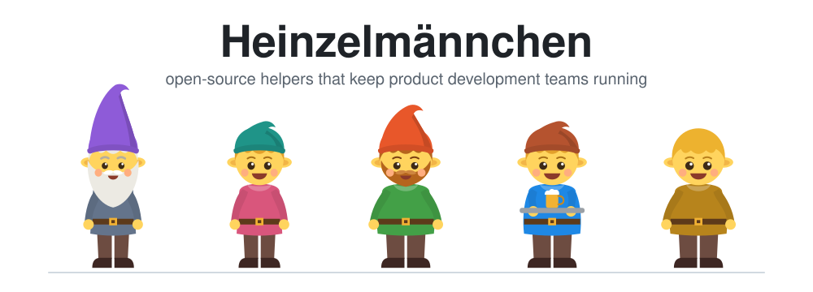
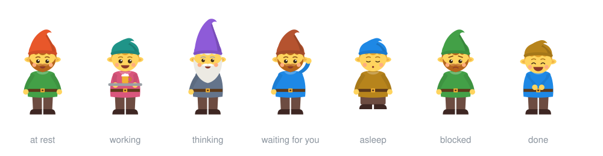
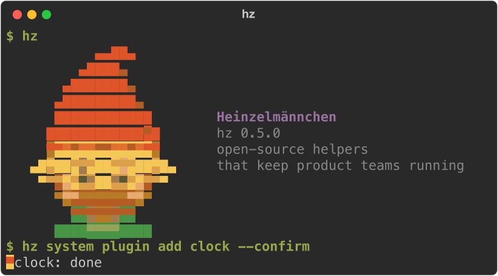

# Heinzelmännchen

<!-- badges:start -->
[](https://github.com/helmut-hoffer-von-ankershoffen/heinzel/actions/workflows/ci.yml)
[](https://github.com/helmut-hoffer-von-ankershoffen/heinzel/tree/python-coverage-comment-action-data)
[](https://github.com/helmut-hoffer-von-ankershoffen/heinzel/actions/workflows/codeql.yml)
[](https://scorecard.dev/viewer/?uri=github.com/helmut-hoffer-von-ankershoffen/heinzel)
[](https://www.bestpractices.dev/en/projects/15863/passing)
[](https://pypi.org/project/heinzel/)
[](pyproject.toml)
[](docs/CODING_STANDARDS.md#python)
[](https://astral.sh)
[](LICENSE)
<!-- badges:end -->

[**Install & explore →**](https://helmut.hoffer-von-ankershoffen.me/heinzel/) · [Plugin catalog](https://helmut.hoffer-von-ankershoffen.me/heinzel/CATALOG/) · [Build a plugin](docs/PLUGIN_AUTHORING.md)

<p align="center">
  <picture>
    <source media="(prefers-color-scheme: dark)" srcset="docs/assets/hero-dark.svg">
    
  </picture>
</p>

**Heinzelmännchen are helpers accelerating product teams.** They draft the busywork of
running a team — status, tracker updates, agendas, reports — in the background, and people approve it. Like the
[Heinzelmännchen of Cologne](https://en.wikipedia.org/wiki/Heinzelm%C3%A4nnchen), who finished the town's work at
night. Why it exists and where it is going: [INTENT.md](INTENT.md). It is built on open source, and we are
grateful: [thank you](#standing-on-the-shoulders-of-giants) to everyone in [ATTRIBUTIONS.md](ATTRIBUTIONS.md).



**Meet the Heinzelmännchen.** In the web app each one shows what it is up to: **working** on a draft, **thinking** it
over, **waiting for you** to approve, **asleep** when there is nothing to do, **blocked** until you fix something,
**done** with a happy smile. In `hz` a small one greets you, walks along during long work and marks a finished line.
They are garnish, never a replacement for words: `hz system config set hz.playful false` (or Settings → General) turns
them all off, and they stay away from JSON, pipes, CI and `NO_COLOR` anyway.

This release is the foundation — kernel, heads, plugins and release automation; the first team workflows arrive in
0.x ([roadmap](INTENT.md#where-we-are)).

<picture>
  <source srcset="docs/assets/demo.png" media="(prefers-reduced-motion: reduce)" />
  
</picture>

[Video](docs/assets/demo.mp4) · [Still](docs/assets/demo.png)

**What you can do today:**

-  **Write an operation once, use it
  everywhere.** A typed Python function is a `hz` command, an MCP tool for coding agents and a REST endpoint at once —
  with help text, validation and `--json`.
- **Extend it with plugins.** `hz system plugin add github --confirm` adds a [first-party plugin](#first-party-plugins);
  `hz system plugin new` scaffolds your own `heinzel-*` repository with tests, CI/CD and agent setup.
-  **Run it with confidence.**
  `hz system doctor` checks every module's health, `hz system config` manages layered settings, `hz system update`
  updates in place and keeps your plugins.

You talk to them with **`hz`**, a small modulith: the kernel discovers *modules* and the *lets* they advertise — typed
declarations of operations, services, settings and health checks — and *heads* expose them.

## Get started

Two task-first guides take you top to bottom: [Bootstrap your team](docs/guides/manager.md) for the manager who
installs hz, creates the team repository, gets the first weekly report drafted and invites the team, and
[Join your team](docs/guides/joining.md) for the engineer or product manager with the line from their manager.

## Install

Supported on **macOS and Linux**. Windows may work, but is not supported.
If you already have [uv](https://docs.astral.sh/uv/), run:

<!-- install:start -->
<!-- docs-test -->
```sh
uvx heinzel@latest
```
<!-- install:end -->

**Need uv installed for you?** Use the guided installer instead:

<!-- install-script:start -->
```sh
curl -LsSf https://helmut.hoffer-von-ankershoffen.me/heinzel/install.sh | sh
```
<!-- install-script:end -->

It reuses uv when available, otherwise runs [Astral's official installer](https://docs.astral.sh/uv/getting-started/installation/).
It then runs the same app launcher. No administrator access or separate Python installation is needed.
You can [inspect the script](https://github.com/helmut-hoffer-von-ankershoffen/heinzel/blob/main/docs/install.sh) first.

The first run installs the verified standard app with all default plugins and opens the workspace.
Later runs open the installed app. Ctrl-C stops the foreground session; background operation stays optional.
The fresh standard-app installation uses a uv-managed Python and ignores `UV_PYTHON` for that installation step.
Remove a system-only uv Python preference before installing; if Python downloads are disabled, first install a
compatible uv-managed Python. Refreshes keep the app's verified existing interpreter.
On Linux, standard installation needs an accessible systemd user manager in your user session.
For a minimal core with no plugins use
`uv tool install heinzel`. The installer selects the newest published standard app and verifies its artifacts;
`hz system update` then moves core to the latest PyPI
release in place, keeping plugins (`--source <spec>` moves to another source or ref). It follows releases
(`--channel main` or setting `update_channel` for the newest commit of `main`); pinned to another branch or a commit,
it says which `--source` moves it. Updates and plugin changes verify the current uv receipt and its linked entrypoints
before selecting the tool and executable directories. If entrypoints are copied, missing or cannot be verified, use
uv directly with the intended tool and executable directories explicitly selected. An unresolved symlink in the
executable directory stops these changes until it is repaired; recovery may reuse an unchanged link verified for the
original tool. This preflight cannot prevent another process from changing the directory between the check and uv's write. Shell completion: `hz --install-completion`.

**From Claude Code**, add the plugin and let `/hz-init` do everything — install, plugins, configuration, agent
skills:

```text
/plugin marketplace add helmut-hoffer-von-ankershoffen/heinzel
/plugin install heinzel@heinzel
/hz-init
```

Other agents: `hz system agent install` copies the skills into the directories set in `[system.agent] skill_dirs`.

**Uninstall** with `/hz-uninstall` from Claude Code, or:

<!-- docs-test -->
```bash
hz system daemon uninstall            # remove the background service, if installed
hz system agent uninstall             # remove the skills from your agents
uv tool uninstall heinzel      # remove Heinzelmännchen and its plugins
```

Your configuration files stay; `hz system config show` lists them before you uninstall.

## Use

`hz --command-tree` prints every enabled command, argument, option and operation input/output schema as JSON,
including expert commands and plugin commands. It runs no operation and leaves your expert-mode setting unchanged.
The [CLI reference](docs/CLI_REFERENCE.md) is generated from the same executable command tree; CI checks for drift.



On a colour terminal `hz` greets you with a small Heinzelmännchen and a walking one keeps you company during long
work. `hz system config set hz.playful false` (see [Configure](#configure)), `NO_COLOR`, CI, a pipe or `--json` keep
the output plain.

<!-- docs-test -->
```bash
hz --version
hz system info                 # versions, settings, modules, what plugins report
hz system doctor               # every module's health checks; exits 1 if anything is down
hz system modules              # every module and submodule with the lets it advertises
hz system changelog            # release notes of the installed version
hz system changelog --newer    # what the releases newer than yours bring, before you update
hz system config show          # configuration files, settings in effect, their environment variables
hz system config set hz.log_level INFO
hz system release              # is there a newer release? (asks GitHub now; hz checks hourly on its own)
hz system update               # update, keeping plugins
hz system agent install               # install the skills for coding agents
```

Every operation takes `--json` (or `--format json`; `HZ_OUTPUT_FORMAT=json` makes it the default) for scripts and
agents; the long-running `serve` commands are the exception. Exit codes: `0` success, `1` an error with a readable message, `2` a usage error, `78` invalid
configuration; `hz ui` exits `0` when Ctrl-C stops it, an interrupted `hz setup` `130`. All commands: [docs/CLI_REFERENCE.md](docs/CLI_REFERENCE.md).

`hz --help` lists the everyday commands; `hz system expert on` lists every command in help, shell completion and the
web app, and `hz system expert off` goes back. Commands for experts run either way, and MCP and REST always offer
them all ([ADR 0041](docs/adr/0041-expert-mode-newcomers-see-the-everyday-commands.md)).

How the pieces fit — more in [ARCHITECTURE.md](docs/ARCHITECTURE.md):


Doctor lists the hostname of the machine running hz. The footer's System resources panel shows that hostname
alongside its CPU, memory and load readings.

## What's inside

Every module is a set of operations, and every operation is a `hz` command, an MCP tool (`hz system serve mcp`)
and a REST endpoint (`hz system serve api`) at once. Coding agents use whichever suits them: the CLI with `--json`,
or the MCP tools. People who'd rather click run `hz ui`: a web app on localhost, for this session only, with a
navigation tree of settings, contracts, your team, inventory and the doctor's fixes, and a chat with your agent runner
that says what it may cost before it runs. Modules can also advertise jobs that
`hz system daemon install` runs in the background on a schedule, under launchd or systemd, unattended and with your
rights; `hz system daemon pause` and `uninstall` stop them (see [SECURITY.md](SECURITY.md)). Built in today:

<!-- modules:start -->
- [`ai`](docs/MODULES.md#ai) — How hz reaches AI, and what it spends: tokens and cost per run.
- [`ai.access`](docs/MODULES.md#aiaccess) — Pick how hz reaches AI: Claude Code, your company's gateway, or an option a plugin adds.
- [`graph`](docs/MODULES.md#graph) — Are your team's promises kept? Artifacts and Heinzelmännchen, and where the flow waits.
- [`heinzel`](docs/MODULES.md#heinzel) — Your Heinzelmännchen: durable agents that keep your team's documents true.
- [`org`](docs/MODULES.md#org) — Your profile, and the team, org and company you work with.
- [`report`](docs/MODULES.md#report) — Telemetry: log what a Heinzelmännchen did, for your team's graph (`hz report published <id> <url>`).
- [`system`](docs/MODULES.md#system) — Inspect, configure, diagnose and update Heinzelmännchen itself.
- [`system.agent`](docs/MODULES.md#systemagent) — Install the Heinzelmännchen skills for coding agents.
- [`system.capability`](docs/MODULES.md#systemcapability) — Show which adapters serve which capabilities, and who reads and writes what.
- [`system.changelog`](docs/MODULES.md#systemchangelog) — Release notes of the installed version and of newer releases.
- [`system.claude`](docs/MODULES.md#systemclaude) — See the MCP servers and skills you already set up for Claude, without using any of them.
- [`system.config`](docs/MODULES.md#systemconfig) — Show, get, set and initialize configuration.
- [`system.connector`](docs/MODULES.md#systemconnector) — Show whether each connector is signed in and serves something, and test one live.
- [`system.credential`](docs/MODULES.md#systemcredential) — Store and check the credentials modules need, in the OS keychain.
- [`system.daemon`](docs/MODULES.md#systemdaemon) — Run modules' jobs in the background, supervised by launchd or systemd.
- [`system.directory`](docs/MODULES.md#systemdirectory) — Guess reporting lines from recurring 1:1s in your calendar, for setup to confirm.
- [`system.doctor`](docs/MODULES.md#systemdoctor) — Check that Heinzelmännchen and its modules are healthy.
- [`system.expert`](docs/MODULES.md#systemexpert) — Expert mode: list every command, or just the everyday ones.
- [`system.layer`](docs/MODULES.md#systemlayer) — Show the layer plugins installed and the stack you are in, general to specific.
- [`system.notify`](docs/MODULES.md#systemnotify) — Pop up what deserves your attention: in the web app while it is open, else natively.
- [`system.plugin`](docs/MODULES.md#systemplugin) — Find, add, remove, enable, disable, list and scaffold plugins.
- [`system.plugin.docs`](docs/MODULES.md#systemplugindocs) — Document installed plugins: what each brings, as a model and as Markdown pages.
- [`system.runner`](docs/MODULES.md#systemrunner) — Run bounded agent sessions with Claude Code or a configured command.
- [`system.runner.chat`](docs/MODULES.md#systemrunnerchat) — Chat with the agent runner about where you are; it acts through hz once you confirm.
- [`system.skill`](docs/MODULES.md#systemskill) — List the skills plugins ship for AI, and hand chosen ones to Claude Code.
- [`system.sound`](docs/MODULES.md#systemsound) — Pick the web app's soundscape: off or one an installed plugin offers.
- [`system.state`](docs/MODULES.md#systemstate) — Note how hz is used on this machine and push it to your own state repository.
- [`system.theme`](docs/MODULES.md#systemtheme) — Pick how the web app looks: the built-in theme or one a plugin offers.
- [`system.ui`](docs/MODULES.md#systemui) — List what modules add to the web app: status items, header actions and Today widgets.
- [`team`](docs/MODULES.md#team) — Your team's repository: create one (`hz team new`), join one by its URL (`hz team join`), add people to it.
<!-- modules:end -->

Details for each, in every head: [docs/MODULES.md](docs/MODULES.md). Plugins add their own modules.

### First-party plugins

Maintained in [heinzel-plugins](https://github.com/helmut-hoffer-von-ankershoffen/heinzel-plugins/tree/main/plugins),
with independent versions, checks and releases. The standard installation includes Clock, Resource, Tailscale and
the Heinzelmännchen theme. Sharing remains off until explicitly configured, and sound starts only after Play.
A minimal core installation includes no plugins.
`hz system plugin add <name>` shows the compatible distribution and `--confirm` installs it;
`hz system plugin search` discovers the catalog from repository metadata.

| Plugin | What it does | Install |
| --- | --- | --- |
| [heinzel-clock](https://github.com/helmut-hoffer-von-ankershoffen/heinzel-plugins/tree/main/plugins/heinzel-clock) | What time it is for everyone on the team | `hz system plugin add clock --confirm` |
| [heinzel-resource](https://github.com/helmut-hoffer-von-ankershoffen/heinzel-plugins/tree/main/plugins/heinzel-resource) | CPU, memory and load meters and a Today widget | `hz system plugin add resource --confirm` |
| [heinzel-tailscale](https://github.com/helmut-hoffer-von-ankershoffen/heinzel-plugins/tree/main/plugins/heinzel-tailscale) | Opt-in private sharing over Tailscale | `hz system plugin add tailscale --confirm` |
| [heinzel-theme](https://github.com/helmut-hoffer-von-ankershoffen/heinzel-plugins/tree/main/plugins/heinzel-theme) | Heinzelmännchen theme and its three soundscapes | `hz system plugin add theme --confirm` |
| [heinzel-github](https://github.com/helmut-hoffer-von-ankershoffen/heinzel-plugins/tree/main/plugins/heinzel-github) | Pull requests and issues from GitHub: the `code-host` and `tracker` capabilities | `hz system plugin add github --confirm` |
| [heinzel-atlassian](https://github.com/helmut-hoffer-von-ankershoffen/heinzel-plugins/tree/main/plugins/heinzel-atlassian) | Jira issues and Confluence pages: the `tracker` and `documents` capabilities | `hz system plugin add atlassian --confirm` |
| [heinzel-google](https://github.com/helmut-hoffer-von-ankershoffen/heinzel-plugins/tree/main/plugins/heinzel-google) | Google Docs, Sheets, Drive, Calendar and Gmail through the Google Workspace CLI: the `documents`, `calendar` and `mail` capabilities | `hz system plugin add google --confirm` |
| [heinzel-zoom](https://github.com/helmut-hoffer-von-ankershoffen/heinzel-plugins/tree/main/plugins/heinzel-zoom) | Meetings from Zoom's meeting-summary emails, read through the bound `mail` adapter: the `meetings` capability | `hz system plugin add zoom --confirm` |

Slack adapters are planned as first-party plugins too.

### Community plugins

Weather and the Example reference plugin have moved from heinzel-contrib to heinzel-plugins. Each is independently
tested against a built core artifact:

| Plugin | What it does | Install |
| --- | --- | --- |
| [heinzel-weather](https://github.com/helmut-hoffer-von-ankershoffen/heinzel-plugins/tree/main/plugins/heinzel-weather) | Weather from Open-Meteo, with no key: footer item, page, Today widget, notices and a dressed-for-the-weather avatar | `hz system plugin add weather --confirm` |
| [heinzel-example](https://github.com/helmut-hoffer-von-ankershoffen/heinzel-plugins/tree/main/plugins/heinzel-example) | How a plugin is built: the template's example | `hz system plugin add example --confirm` |

Company plugins live in their own `heinzel-*` repositories, scaffolded with `hz system plugin new`.

Workflows are Markdown files, not code: a `<name>.prose.md` contract in your workflows directory (or your team's
state repository) names the capabilities it reads, the inputs to fetch and the agent's limits, and its body says what
the draft must achieve. Drafts are saved locally; nothing is published by itself.

```bash
hz heinzel new weekly-digest             # a starter contract, valid as written, with comments; creates the directory
hz heinzel check                         # every problem by file and line
hz heinzel show weekly-digest            # what it requires, what is bound, whether it is ready, what to run next
hz heinzel wake weekly-digest --dry-run   # the packet the agent would get; nothing is spent
hz heinzel wake weekly-digest             # draft it now; then `hz heinzel drafts`
```

Give it a `schedule:` and the daemon runs it. The journey from nothing to a scheduled team contract, and the contract
reference: [docs/HEINZELMAENNCHEN.md](docs/HEINZELMAENNCHEN.md). Decisions: [ADR 0021](docs/adr/0021-workflow-contracts.md).

## Configure

Settings come from, lowest precedence first: defaults, the site file, your user file
(`~/Library/Application Support/hz/config.toml` on macOS, `~/.config/hz/config.toml` on Linux; `HZ_CONFIG_HOME`
moves it), the nearest `hz.toml` in the working directory or above (share it in a team repository), the file in
`$HZ_CONFIG`, and environment variables.

```toml
[hz]
log_level = "INFO"
disabled_modules = []

[example]               # each module has its own table
greeting = "Moin"
```

Joining a team is one line, the same for everyone, posted in its chat. It finds out who you are from your `gh` and
`gws` logins, joins the team and sets up what is missing (`hz join` prints the line for the next person):

```bash
uvx heinzel@latest join <team repository>
# from a coding agent, without a terminal:
uvx heinzel@latest join <team repository> \
  --role engineer --yes --json
```

`hz setup` asks for whatever is still missing, wizard style, and continues where the last run stopped: `hz setup clock`
for one module, `--restart` to go through every step again, `--answers answers.toml` without a terminal, and
`hz setup --print-answers > answers.toml` to write that file from a finished setup.

`hz system config set example.greeting Moin` edits your user file (`--scope project` the project's `hz.toml`),
`hz system config init` writes a commented starter file, `hz system config reveal user` shows that file in Finder,
Explorer or your desktop's file manager (`site`, `project` for the others). Environment variables: `HZ_<SETTING>` for the kernel
(`HZ_LOG_LEVEL=DEBUG`), `HZ_<MODULE>__<SETTING>` for modules (`HZ_EXAMPLE__GREETING=Hi`). Every setting:
[docs/CONFIGURATION.md](docs/CONFIGURATION.md).

## Extend

A module is a package that declares `module = Module(name, summary)`; operations are typed functions; services and
settings are injected by type (put injected parameters first):

```python
from typing import Annotated

from pydantic import Field

from heinzel import Module, ModuleSettings

module = Module("greet", "Greet people.")


@module.settings
class GreetSettings(ModuleSettings):
    greeting: str = Field(default="Hello", description="How to greet.")


@module.operation
def hello(settings: GreetSettings, name: Annotated[str, Field(description="Who to greet.")] = "world") -> str:
    """Greet someone."""
    return f"{settings.greeting}, {name}!"
```

A module can also declare a setup step, `@module.setup`, that asks its questions through an injected `Prompter`
and runs as `hz setup greet` and as part of `hz setup`
([ADR 0032](docs/adr/0032-modules-declare-interactive-setup-steps.md)).

That is `hz greet hello --name Ada` in the CLI, with `--json`, help text, argument validation and
`HZ_GREET__GREETING` — and the same operation is an MCP tool and a REST endpoint. Scaffold a plugin repository
with a minimal operation, behavior test and owning delivery commands: `hz system plugin new ../heinzel-mine`.
The [author guide](docs/PLUGIN_AUTHORING.md) covers separate public/private repositories, dependencies, testing and
publishing; `--preset contributions` adds the complete UI and notification example. A complete plugin to learn from:
[plugins/heinzel-clock](https://github.com/helmut-hoffer-von-ankershoffen/heinzel-plugins/tree/main/plugins/heinzel-clock) (one module, settings, an operation, a health check and a setup step). See
[ARCHITECTURE.md](docs/ARCHITECTURE.md).

## Standing on the shoulders of giants

`hz` is a thin layer on a lot of brilliant open-source work, and we are deeply grateful to everyone who writes,
maintains and shares it. **Thank you.** Among many others: [Typer](https://typer.tiangolo.com) and
[Rich](https://github.com/Textualize/rich) for the CLI; [FastAPI](https://fastapi.tiangolo.com),
[Starlette](https://www.starlette.io) and [Uvicorn](https://www.uvicorn.org) for the API;
[Pydantic](https://docs.pydantic.dev) for every typed model; the
[MCP Python SDK](https://github.com/modelcontextprotocol/python-sdk) for the MCP head;
[pluggy](https://pluggy.readthedocs.io) for plugins and [uv](https://docs.astral.sh/uv/) for installing them. The web
app runs on [React](https://react.dev), [React Flow](https://reactflow.dev), [xterm.js](https://xtermjs.org) and
[TanStack Query](https://tanstack.com/query), built with [Vite](https://vite.dev) and styled with
[Tailwind CSS](https://tailwindcss.com).

[ATTRIBUTIONS.md](ATTRIBUTIONS.md) lists every package `hz` ships, with its license, homepage and license text.

## Contribute

You need git, make and [uv](https://docs.astral.sh/uv/); `make setup` installs everything else.
[CONTRIBUTING.md](CONTRIBUTING.md) takes you from a clone to a merged pull request; [AGENTS.md](AGENTS.md) is the guide for coding agents;
[docs/CODING_STANDARDS.md](docs/CODING_STANDARDS.md) the rules; [docs/adr/](docs/adr/) the decisions.
Bugs and ideas: [open an issue](https://github.com/helmut-hoffer-von-ankershoffen/heinzel/issues/new/choose);
security issues privately, as [SECURITY.md](SECURITY.md) describes.

## License

Heinzelmännchen is free and open-source software under the [MIT license](LICENSE). The packages it ships keep their
own licenses, listed in [ATTRIBUTIONS.md](ATTRIBUTIONS.md).

Presence and adoption stay local by default. Opt in to a personal state repository with `hz system config set system.state.personal <repository>`, then inspect `hz system state status` ([state repository design](docs/adr/0081-state-repositories-one-writer-per-branch-the-daemon-pushes.md)).
