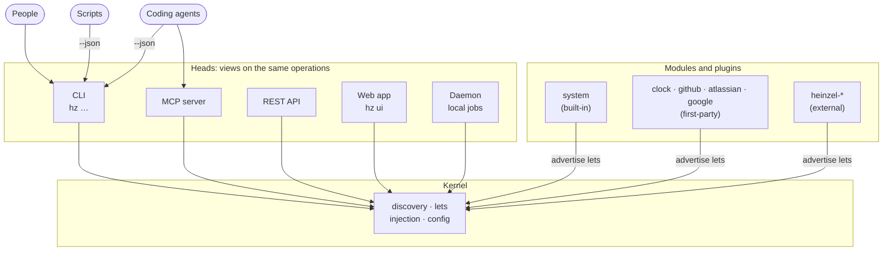

# 🧝 Heinzelmännchen

<!-- badges:start -->
[](https://github.com/helmut-hoffer-von-ankershoffen/heinzel/actions/workflows/ci.yml)
[](https://github.com/helmut-hoffer-von-ankershoffen/heinzel/tree/python-coverage-comment-action-data)
[](https://github.com/helmut-hoffer-von-ankershoffen/heinzel/actions/workflows/codeql.yml)
[](https://scorecard.dev/viewer/?uri=github.com/helmut-hoffer-von-ankershoffen/heinzel)
[](https://www.bestpractices.dev/en/projects/15863/passing)
[](https://github.com/helmut-hoffer-von-ankershoffen/heinzel/releases)
[](pyproject.toml)
[](docs/CODING_STANDARDS.md#python)
[](https://astral.sh)
[](LICENSE)
<!-- badges:end -->

**Heinzelmännchen are open-source helpers that keep product development teams running.** They draft the busywork of
running a team — status, tracker updates, agendas, reports — in the background, and people approve it. Like the
[Heinzelmännchen of Cologne](https://en.wikipedia.org/wiki/Heinzelm%C3%A4nnchen), who finished the town's work at
night. Why it exists and where it is going: [INTENT.md](INTENT.md). It is built on open source, and we are
grateful: [thank you](#standing-on-the-shoulders-of-giants) to everyone in [ATTRIBUTIONS.md](ATTRIBUTIONS.md).

This release is the foundation — kernel, heads, plugins and release automation; the first team workflows arrive in
0.x ([roadmap](INTENT.md#where-we-are)).


**What you can do today:**

- **Write an operation once, use it everywhere.** A typed Python function is a `hz` command, an MCP tool for coding
  agents and a REST endpoint at once — with help text, validation and `--json`.
- **Extend it with plugins.** `hz system plugin add github --confirm` adds a [first-party plugin](#first-party-plugins);
  `hz system plugin new` scaffolds your own `heinzel-*` repository with tests, CI/CD and agent setup.
- **Run it with confidence.** `hz system doctor` checks every module's health, `hz system config` manages layered
  settings, `hz system update` updates in place and keeps your plugins.

You talk to them with **`hz`**, a small modulith: the kernel discovers *modules* and the *lets* they advertise — typed
declarations of operations, services, settings and health checks — and *heads* expose them.

## Get started

Two task-first guides take you top to bottom: [Bootstrap your team](docs/guides/manager.md) for the manager who
installs hz, creates the team repository, gets the first weekly report drafted and invites the team, and
[Join your team](docs/guides/joining.md) for the engineer or product manager with the line from their manager.

## Install

You need [uv](https://docs.astral.sh/uv/) (`brew install uv`). Then:

<!-- docs-test -->
```bash
uv tool install git+https://github.com/helmut-hoffer-von-ankershoffen/heinzel
```

Pin a release with `@vX.Y.Z`; `hz system update` then moves to the latest release in place, keeping plugins
(`--source <spec>` moves to another version). Pinned to a branch or a commit, it says which `--source` moves it. Shell completion: `hz --install-completion`.

**From Claude Code**, add the plugin and let `/hz-init` do everything — install, plugins, configuration, agent
skills:

```text
/plugin marketplace add helmut-hoffer-von-ankershoffen/heinzel
/plugin install heinzel@heinzel
/hz-init
```

Other agents: `hz system agent install` copies the skills into the directories set in `[system.agent] skill_dirs`.

**Uninstall** with `/hz-uninstall` from Claude Code, or:

<!-- docs-test -->
```bash
hz system agent uninstall             # remove the skills from your agents
uv tool uninstall heinzel      # remove Heinzelmännchen and its plugins
```

Your configuration files stay; `hz system config show` lists them before you uninstall.

## Use

<!-- docs-test -->
```bash
hz --version
hz system info                 # versions, settings, modules, what plugins report
hz system doctor               # every module's health checks; exits 1 if anything is down
hz system modules              # every module and submodule with the lets it advertises
hz system changelog            # release notes of the installed version
hz system changelog --newer    # what the releases newer than yours bring, before you update
hz system config show          # configuration files, settings in effect, their environment variables
hz system config set hz.log_level INFO
hz system release              # is there a newer release? (asks GitHub now; hz checks hourly on its own)
hz system update               # update, keeping plugins
hz system plugin add clock --confirm     # a first-party plugin
hz clock                       # its command: the time for everyone on the team
hz system agent install               # install the skills for coding agents
```

Every operation takes `--json` (or `--format json`; `HZ_OUTPUT_FORMAT=json` makes it the default) for scripts and
agents; the long-running `serve` commands are the exception. Exit codes: `0` success, `1` an error with a readable message, `2` a usage error, `78` invalid
configuration; `hz ui` exits `0` when Ctrl-C stops it, an interrupted `hz setup` `130`. All commands: [docs/CLI_REFERENCE.md](docs/CLI_REFERENCE.md).

`hz --help` lists the everyday commands; `hz system expert on` lists every command in help, shell completion and the
web app, and `hz system expert off` goes back. Commands for experts run either way, and MCP and REST always offer
them all ([ADR 0041](docs/adr/0041-expert-mode-newcomers-see-the-everyday-commands.md)).

How the pieces fit — more in [ARCHITECTURE.md](docs/ARCHITECTURE.md):



## What's inside

Every module is a set of operations, and every operation is a `hz` command, an MCP tool (`hz system serve mcp`)
and a REST endpoint (`hz system serve api`) at once. Coding agents use whichever suits them: the CLI with `--json`,
or the MCP tools. People who'd rather click run `hz ui`: a web app on localhost, for this session only, with a
navigation tree of settings, contracts, your team, inventory and the doctor's fixes, and a chat with your agent runner
that says what it may cost before it runs. Modules can also advertise jobs that
`hz system daemon install` runs in the background on a schedule, under launchd or systemd, unattended and with your
rights; `hz system daemon pause` and `uninstall` stop them (see [SECURITY.md](SECURITY.md)). Built in today:

<!-- modules:start -->
- [`ai`](docs/MODULES.md#ai) — How hz reaches AI: the AI access in use, its status and a live test.
- [`ai.access`](docs/MODULES.md#aiaccess) — Pick how hz reaches AI: Claude Code, your company's gateway, or an option a plugin adds.
- [`atlassian`](docs/MODULES.md#atlassian) — Read Jira issues and Confluence pages through acli: the tracker and documents capabilities. *First-party plugin: `hz system plugin add atlassian --confirm`.*
- [`clock`](docs/MODULES.md#clock) — What time it is for everyone on the team. *First-party plugin: `hz system plugin add clock --confirm`.*
- [`github`](docs/MODULES.md#github) — Read pull requests and issues from GitHub: the code-host and tracker capabilities. *First-party plugin: `hz system plugin add github --confirm`.*
- [`google`](docs/MODULES.md#google) — Read Google Docs, Sheets, Drive, Calendar and Gmail: the documents, calendar and mail capabilities. *First-party plugin: `hz system plugin add google --confirm`.*
- [`graph`](docs/MODULES.md#graph) — Are your team's promises kept? Artifacts and Heinzelmännchen, and where the flow waits.
- [`org`](docs/MODULES.md#org) — Your profile, and the team, org and company you work with.
- [`report`](docs/MODULES.md#report) — Telemetry: log what a Heinzelmännchen did, for your team's graph (`hz report published <id> <url>`).
- [`system`](docs/MODULES.md#system) — Inspect, configure, diagnose and update Heinzelmännchen itself.
- [`system.agent`](docs/MODULES.md#systemagent) — Install the Heinzelmännchen skills for coding agents.
- [`system.capability`](docs/MODULES.md#systemcapability) — Show which adapters serve which capabilities, and who reads and writes what.
- [`system.changelog`](docs/MODULES.md#systemchangelog) — Release notes of the installed version and of newer releases.
- [`system.config`](docs/MODULES.md#systemconfig) — Show, get, set and initialize configuration.
- [`system.connector`](docs/MODULES.md#systemconnector) — Show whether each connector is signed in and serves something, and test one live.
- [`system.credential`](docs/MODULES.md#systemcredential) — Store and check the credentials modules need, in the OS keychain.
- [`system.daemon`](docs/MODULES.md#systemdaemon) — Run modules' jobs in the background, supervised by launchd or systemd.
- [`system.directory`](docs/MODULES.md#systemdirectory) — Guess reporting lines from recurring 1:1s in your calendar, for setup to confirm.
- [`system.doctor`](docs/MODULES.md#systemdoctor) — Check that Heinzelmännchen and its modules are healthy.
- [`system.expert`](docs/MODULES.md#systemexpert) — Expert mode: list every command, or just the everyday ones.
- [`system.layer`](docs/MODULES.md#systemlayer) — Show the layer plugins installed and the stack you are in, general to specific.
- [`system.notify`](docs/MODULES.md#systemnotify) — Pop up what deserves your attention: in the web app while it is open, else natively.
- [`system.plugin`](docs/MODULES.md#systemplugin) — Find, add, remove, enable, disable, list and scaffold plugins.
- [`system.runner`](docs/MODULES.md#systemrunner) — Run bounded agent sessions with Claude Code or a configured command.
- [`system.runner.chat`](docs/MODULES.md#systemrunnerchat) — Chat with the agent runner about where you are; it acts through hz once you confirm.
- [`system.theme`](docs/MODULES.md#systemtheme) — Pick how the web app looks: the built-in theme or one a plugin offers.
- [`team`](docs/MODULES.md#team) — Your team's repository: create one (`hz team new`), join one by its URL (`hz team join`), add people to it.
- [`workflow`](docs/MODULES.md#workflow) — Workflow contracts: Markdown files an agent drafts from, by hand or on your daemon's schedule (`hz workflow new` starts one).
- [`zoom`](docs/MODULES.md#zoom) — Read meetings from Zoom's meeting-summary emails: the meetings capability. *First-party plugin: `hz system plugin add zoom --confirm`.*
<!-- modules:end -->

Details for each, in every head: [docs/MODULES.md](docs/MODULES.md). Plugins add their own modules.

### First-party plugins

Maintained and released with the core, from [plugins/](plugins), at the same version; none is installed by default,
so you only get the integrations you use. `hz system plugin add <name>` shows the one matching your `hz` and `--confirm` installs it, and
`hz system plugin search` lists them first.

| Plugin | What it does | Install |
| --- | --- | --- |
| [heinzel-clock](plugins/heinzel-clock) | What time it is for everyone on the team | `hz system plugin add clock --confirm` |
| [heinzel-github](plugins/heinzel-github) | Pull requests and issues from GitHub: the `code-host` and `tracker` capabilities | `hz system plugin add github --confirm` |
| [heinzel-atlassian](plugins/heinzel-atlassian) | Jira issues and Confluence pages: the `tracker` and `documents` capabilities | `hz system plugin add atlassian --confirm` |
| [heinzel-google](plugins/heinzel-google) | Google Docs, Sheets, Drive, Calendar and Gmail through the Google Workspace CLI: the `documents`, `calendar` and `mail` capabilities | `hz system plugin add google --confirm` |
| [heinzel-zoom](plugins/heinzel-zoom) | Meetings from Zoom's meeting-summary emails, read through the bound `mail` adapter: the `meetings` capability | `hz system plugin add zoom --confirm` |

Slack adapters are planned as first-party plugins too.

### Community plugins

Plugins useful to many but not to everyone live in [heinzel-contrib](https://github.com/helmut-hoffer-von-ankershoffen/heinzel-contrib), one distribution per plugin in
`plugins/heinzel-<name>/`, built to the core's standards and tested against it:

| Plugin | What it does | Install |
| --- | --- | --- |
| [heinzel-weather](https://github.com/helmut-hoffer-von-ankershoffen/heinzel-contrib/tree/main/plugins/heinzel-weather) | Weather from OpenWeather: now, the next hours and days, and a notice when it turns | `hz system plugin add "heinzel-weather @ git+https://github.com/helmut-hoffer-von-ankershoffen/heinzel-contrib#subdirectory=plugins/heinzel-weather" --confirm` |
| [heinzel-example](https://github.com/helmut-hoffer-von-ankershoffen/heinzel-contrib/tree/main/plugins/heinzel-example) | How a plugin is built: the template's example | `hz system plugin add "heinzel-example @ git+https://github.com/helmut-hoffer-von-ankershoffen/heinzel-contrib#subdirectory=plugins/heinzel-example" --confirm` |

Company plugins live in their own `heinzel-*` repositories, scaffolded with `hz system plugin new`.

Workflows are Markdown files, not code: a `<name>.prose.md` contract in your workflows directory (or your team's
state repository) names the capabilities it reads, the inputs to fetch and the agent's limits, and its body says what
the draft must achieve. Drafts are saved locally; nothing is published by itself.

```bash
hz workflow new weekly-digest             # a starter contract, valid as written, with comments; creates the directory
hz workflow check                         # every problem by file and line
hz workflow show weekly-digest            # what it requires, what is bound, whether it is ready, what to run next
hz workflow run weekly-digest --dry-run   # the packet the agent would get; nothing is spent
hz workflow run weekly-digest             # draft it now; then `hz workflow drafts`
```

Give it a `schedule:` and the daemon runs it. The journey from nothing to a scheduled team contract, and the contract
reference: [docs/WORKFLOWS.md](docs/WORKFLOWS.md). Decisions: [ADR 0021](docs/adr/0021-workflow-contracts.md).

## Configure

Settings come from, lowest precedence first: defaults, the site file, your user file
(`~/Library/Application Support/hz/config.toml` on macOS, `~/.config/hz/config.toml` on Linux; `HZ_CONFIG_HOME`
moves it), the nearest `hz.toml` in the working directory or above (share it in a team repository), the file in
`$HZ_CONFIG`, and environment variables.

```toml
[hz]
log_level = "INFO"
disabled_modules = []

[example]               # each module has its own table
greeting = "Moin"
```

Joining a team is one line, the same for everyone, posted in its chat. It finds out who you are from your `gh` and
`gws` logins, joins the team and sets up what is missing (`hz join` prints the line for the next person):

```bash
uvx --from git+https://github.com/helmut-hoffer-von-ankershoffen/heinzel heinzel join <team repository>
# from a coding agent, without a terminal:
uvx --from git+https://github.com/helmut-hoffer-von-ankershoffen/heinzel heinzel join <team repository> \
  --role engineer --yes --json
```

`hz setup` asks for whatever is still missing, wizard style, and continues where the last run stopped: `hz setup clock`
for one module, `--restart` to go through every step again, `--answers answers.toml` without a terminal, and
`hz setup --print-answers > answers.toml` to write that file from a finished setup.

`hz system config set example.greeting Moin` edits your user file (`--scope project` the project's `hz.toml`),
`hz system config init` writes a commented starter file, `hz system config reveal user` shows that file in Finder,
Explorer or your desktop's file manager (`site`, `project` for the others). Environment variables: `HZ_<SETTING>` for the kernel
(`HZ_LOG_LEVEL=DEBUG`), `HZ_<MODULE>__<SETTING>` for modules (`HZ_EXAMPLE__GREETING=Hi`). Every setting:
[docs/CONFIGURATION.md](docs/CONFIGURATION.md).

## Extend

A module is a package that declares `module = Module(name, summary)`; operations are typed functions; services and
settings are injected by type (put injected parameters first):

```python
from typing import Annotated

from pydantic import Field

from heinzel import Module, ModuleSettings

module = Module("greet", "Greet people.")


@module.settings
class GreetSettings(ModuleSettings):
    greeting: str = Field(default="Hello", description="How to greet.")


@module.operation
def hello(settings: GreetSettings, name: Annotated[str, Field(description="Who to greet.")] = "world") -> str:
    """Greet someone."""
    return f"{settings.greeting}, {name}!"
```

A module can also declare a setup step, `@module.setup`, that asks its questions through an injected `Prompter`
and runs as `hz setup greet` and as part of `hz setup`
([ADR 0032](docs/adr/0032-modules-declare-interactive-setup-steps.md)).

That is `hz greet hello --name Ada` in the CLI, with `--json`, help text, argument validation and
`HZ_GREET__GREETING` — and the same operation is an MCP tool and a REST endpoint. Scaffold a plugin repository
with all the tooling, CI/CD and agent setup: `hz system plugin new ../heinzel-mine`. A complete plugin to copy from:
[plugins/heinzel-clock](plugins/heinzel-clock) (one module, settings, an operation, a health check and a setup step). See
[ARCHITECTURE.md](docs/ARCHITECTURE.md).

## Standing on the shoulders of giants

`hz` is a thin layer on a lot of brilliant open-source work, and we are deeply grateful to everyone who writes,
maintains and shares it. **Thank you.** Among many others: [Typer](https://typer.tiangolo.com) and
[Rich](https://github.com/Textualize/rich) for the CLI; [FastAPI](https://fastapi.tiangolo.com),
[Starlette](https://www.starlette.io) and [Uvicorn](https://www.uvicorn.org) for the API;
[Pydantic](https://docs.pydantic.dev) for every typed model; the
[MCP Python SDK](https://github.com/modelcontextprotocol/python-sdk) for the MCP head;
[pluggy](https://pluggy.readthedocs.io) for plugins and [uv](https://docs.astral.sh/uv/) for installing them. The web
app runs on [React](https://react.dev), [React Flow](https://reactflow.dev), [xterm.js](https://xtermjs.org) and
[TanStack Query](https://tanstack.com/query), built with [Vite](https://vite.dev) and styled with
[Tailwind CSS](https://tailwindcss.com).

[ATTRIBUTIONS.md](ATTRIBUTIONS.md) lists every package `hz` ships, with its license, homepage and license text.

## Contribute

You need git, make and [uv](https://docs.astral.sh/uv/); `make setup` installs everything else.
[CONTRIBUTING.md](CONTRIBUTING.md) takes you from a clone to a merged pull request; [AGENTS.md](AGENTS.md) is the guide for coding agents;
[docs/CODING_STANDARDS.md](docs/CODING_STANDARDS.md) the rules; [docs/adr/](docs/adr/) the decisions.
Security issues: [SECURITY.md](SECURITY.md).
