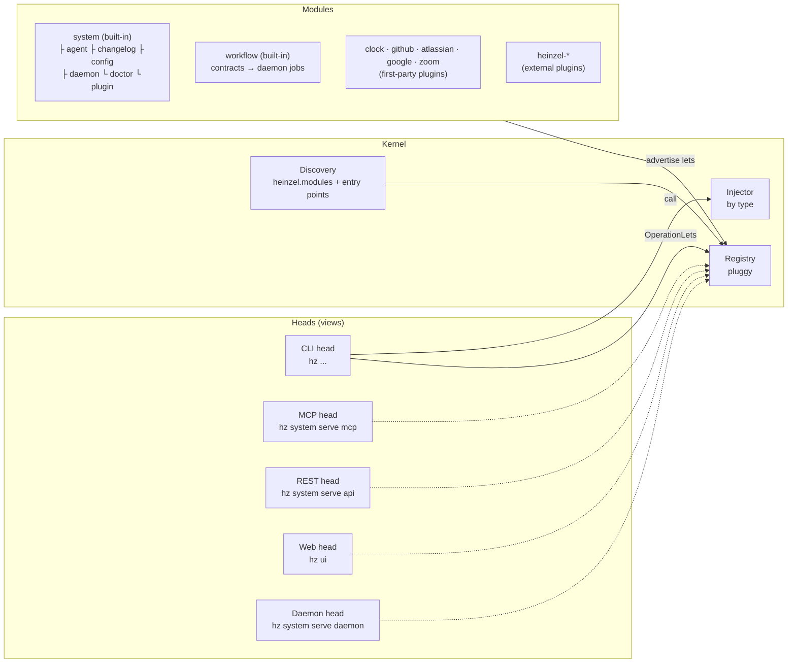

# Architecture

Heinzelmännchen is a **multi-headed modulith**: one process, one kernel, many modules, several heads.



## Concepts

**Module.** A package whose `__init__.py` declares `module = Module(name, summary)`. Packages below it that declare
their own `module` are its **submodules**: `heinzel.modules.system.changelog` is the submodule `system.changelog`.
Built-in modules live in `heinzel.modules`; plugins point an entry point in the `heinzel.modules` group at their root
package, and the kernel walks it the same way.

**Let.** A typed declaration a module advertises. The kernel stores lets without interpreting them; each head picks
the kinds it understands.

| Let | Declared with | Used by |
| --- | --- | --- |
| `OperationLet` | `@module.operation` | every head: CLI command, MCP tool, REST endpoint |
| `ServiceLet` | `module.service(Type)` | the injector: provides `Type` wherever it is asked for |
| `SettingsLet` | `@module.settings` on a `ModuleSettings` class | the injector: settings from the module's TOML table and `HZ_<MODULE>__*` |
| `InfoLet` | `@module.info` | `hz system info` |
| `HealthLet` | `@module.health` returning `Check`s | `hz system doctor` |
| `CredentialLet` | `module.credential(name, purpose=...)` | `Credentials` (injected) and `hz system credential` with its doctor check ([ADR 0030](adr/0030-credentials-live-in-the-os-keychain.md)) |
| `SetupLet` | `@module.setup(required=False)`, asking through an injected `Prompter` and writing through `ConfigEditor` and `Credentials` | the CLI head: `hz setup [MODULE]` ([ADR 0032](adr/0032-modules-declare-interactive-setup-steps.md)) |
| `PlaybookLet` | `module.playbook(summary, assets=..., templates=..., defaults=...)`: asset types with discovery hints, template contracts, recommended settings | `workflow`: `hz workflow playbooks`, `discover`, `new --template`; the setup step it declares ([ADR 0037](adr/0037-plugins-bring-playbooks.md)) |
| `LayerLet` | `module.layer(parent=..., site=..., roles=...)`: the plugin sits in a company's tree, under its parent layer and at a site layer | the kernel: `Kernel.layers()` checks the tree, `Kernel.layer_stack()` stacks your layers general to specific, afresh on every call; `system.layer`: `hz system layer list`, `show`, doctor ([ADR 0040](adr/0040-layers-and-playbooks-are-plugins.md)) |
| `JobLet` | `@module.job(schedule="0 9 * * MON")` | `hz system daemon tick`, run by launchd or systemd ([ADR 0020](adr/0020-daemon-head.md)) |
| `ProviderLet` | `@module.provides("tracker", modes={"read"}, hosts=[...])` on an adapter class; `hosts=` takes a function of the module's settings when they decide the hosts | the kernel's capability bindings and `hz system capability` ([ADR 0028](adr/0028-integrations-are-capability-adapters.md)) |
| `RequirementLet` | `Module(..., requires=["tracker:read"])` (read only); operations and jobs take `requires=[...]`, and a read-only operation that degrades without its own takes `optional=True` | the kernel's capability handles and the doctor check of `hz system capability` ([ADR 0028](adr/0028-integrations-are-capability-adapters.md)) |

New kinds of lets (watchers) extend Heinzelmännchen without changing existing heads; see
[ADR 0010](adr/0010-towards-a-reactive-workflow-engine.md). Workflow contracts are data, not lets: the `workflow`
module reads them and provides `CompiledJobs`, which the kernel compiles afresh whenever the daemon lists its jobs and
runs beside the declared `JobLet`s; each compiled job reads through `Kernel.handle_for` as the requester its contract
declares ([ADR 0021](adr/0021-workflow-contracts.md)).

**Kernel.** Discovers modules, registers them with a pluggy plugin manager (blocking disabled ones), hands out lets
by kind with their owning module, and injects dependencies by type: `Kernel`, `Settings`, `Config`, every type a
`ServiceLet` provides and every `SettingsLet` model, plus `Installation` (the uv tool environment) and `Progress`
(head-provided progress reporting: operations never print). Services are singletons per kernel and may depend on other services.
A capability protocol (`Tracker`, `Documents`, `Chat`, `Meetings`, `Calendar`, `Mail`, `Directory`, ...) is injected as a handle
on the adapter bound in `[capabilities]`, limited to the modes the asking operation, job or module declared; `write`
reaches only publish operations (`read_only=False`); adapters pass every string they return through `clean_text`.
Several adapters may provide one capability and the binding picks one; an adapter may build on another capability
(meetings from summary emails, through `mail`) ([ADR 0028](adr/0028-integrations-are-capability-adapters.md)).
The org chart is the capability `directory`: a plugin's directory of record when one is bound, otherwise the core's
`one-on-ones` adapter (`system.directory`), which guesses reporting lines from recurring 1:1s in the bound calendar
and marks each as a guess (with no calendar bound the draft is empty and says why); setup steps and roster
drafting call `draft_reporting_lines`. Agent sessions are the
capability `agent-runner`; core ships its Claude Code and generic command adapters in `system.runner`
([ADR 0029](adr/0029-agent-runners-are-capability-adapters.md)). The team graph is the capability `team-graph`,
served by the core's `hz-graph` adapter (`graph`), so a contract (the graph keeper) can read it; `graph` builds it
from the kernel's `TeamPromises` (provided by `workflow`) and `TelemetryLog` (provided by `telemetry`, command
`hz report`), whose entries are `TelemetryEntry` ([ADR 0054](adr/0054-observability-is-whether-each-team-promise-is-kept.md)).

**Head.** A view that boots the kernel and exposes operations ([ADR 0019](adr/0019-mcp-and-rest-heads.md)). All heads
share one exposure rule (`heinzel.heads._exposure`): the same path, public parameters and `heads=` restrictions. The
**MCP head** makes each operation a tool (`system_doctor`), the **REST head** an endpoint (`GET /system/doctor`,
OpenAPI at `/docs`). The **web head** (`hz ui`, `heinzel.heads.web`) serves a
React app (`web/`, built into the package) at `/` and the API head's endpoints for head `web` under `/api`, on
localhost only, behind a token made per process and sent as `Authorization: Bearer`; every response carries a strict
CSP. Operations hidden from the unauthenticated REST head because they read your profile or your systems list `web`
in `heads=`; nothing that spends money is exposed but `hz system runner ask` and the chat (`hz chat send`), which have
their own caps (ADR 0039, "a web head: a React app served by the API head", proposed). The web head also streams any of
its operations as server-sent events at `/api/stream/<path>` (`heinzel.heads._stream`): what the operation emits
through `Progress.emitter()`, then its result. The chat (`system.runner.chat`, ADR 0045, proposed) runs the agent
runner with hz's operations as tools from the MCP head in chat mode (`hz system serve mcp --chat <session>`, stdio
only): read operations run, every other one goes to the kernel's `ActionGate` as a proposal that only the person's
`hz chat confirm`, on the CLI and web heads only, runs. The typed client in `web/src/api/` is
generated from the OpenAPI document by `make fix` and checked by `make check`. The **daemon head** (`hz system serve daemon`) calls the `hz system daemon tick` operation in
a foreground loop; installed, launchd or systemd start that tick every few minutes instead
([ADR 0020](adr/0020-daemon-head.md)). The CLI head turns a module into a command group and
an operation into a command; parameters without defaults become arguments, others options, and
`Field(description=...)` becomes help text. Every operation's command gets `--json`. A module whose only operation
shares its name and has no submodules collapses into a single command (`hz system changelog`); beside other
operations, the one named like its module is what the group does by itself (`hz system expert`, next to `hz system
expert on`), in every head.

**Expert mode.** Every operation declares its `audience`: `everyday` (`@module.operation(audience="everyday")`) or
`expert`, the default. Outside expert mode (`[hz] expert`, user scope; `hz system expert on|off`) the CLI's help and
shell completion and the web app's navigation and search list only everyday operations, and `hz --help` ends with how
many are hidden. Hidden is never disabled: every command runs and answers `--help`, and MCP and REST list every
operation ([ADR 0041](adr/0041-expert-mode-newcomers-see-the-everyday-commands.md)).

**Configuration.** Layered TOML files (site, user, project `hz.toml`, `$HZ_CONFIG`) under environment variables;
the `[hz]` table holds kernel settings, `[capabilities]` the capability bindings, `[<module>]` tables module settings
([ADR 0012](adr/0012-layered-configuration.md)). Settings that decide what runs or where data goes (the bindings, the
agent runners' executables and tools) are ignored in a project `hz.toml`, and doctor names any it sets
([ADR 0028](adr/0028-integrations-are-capability-adapters.md)).

## The command tree

The top level belongs to the team's work: every module a plugin brings (and future built-in workflow modules) sits
there. Everything about Heinzelmännchen itself lives under one administrative namespace, `hz system`
([ADR 0018](adr/0018-one-administrative-namespace.md)), except `hz setup`, which runs every module's setup step
([ADR 0032](adr/0032-modules-declare-interactive-setup-steps.md)), and `hz join`, the invite line that joins a team:

```
hz --version
hz join URL                                join a team: who you are, the team, what is still missing (CLI only)
hz setup [MODULE]                          every module's setup step, or one module's, wizard style (CLI only)
hz ui                                      the web app on localhost, opened in your browser
hz system info | modules | doctor | changelog | release | update
hz system expert [on | off]                every command in help, or just the everyday ones (ADR 0041)
hz system config  show | get | set | unset | init
hz system plugin  list | add | remove | new | docs show | docs build
hz system layer   list | show
hz system agent   skills | install | uninstall
hz system daemon  install | uninstall | status | logs | tick | pause | resume | jobs
hz system notify  list | ack | test | install
hz system serve   mcp | api | daemon
hz report <verb> | sync                    what a Heinzelmännchen did, for the team graph (ADR 0054)
hz graph                                  are the team's promises kept, and where the flow waits
hz <module> …     work: plugin modules and built-in workflow modules
```

The **kernel** is the core: a library without commands. **system** is the one module that ships with the core
distribution and can't be disabled; it operates the kernel. Every other module is built like a plugin.

## Built-in modules

Generated, so it can't drift: [MODULES.md](MODULES.md) lists every module with its operations in every head, its
settings and its health checks.

## Flow of a command

1. `hz system info` starts `heinzel.heads.cli:main`, which calls `heinzel.kernel.boot()`.
2. Boot loads the configuration files and the kernel settings; discovery walks `heinzel.modules` and every `heinzel.modules` entry point; broken plugins are reported, not fatal.
3. The kernel registers modules (minus `HZ_DISABLED_MODULES`) and their `ServiceLet`s.
4. The CLI head builds the Typer tree from `OperationLet`s.
5. Typer parses arguments; the head calls `kernel.call(operation, **arguments)`, which injects `SystemService`.
6. The result (a pydantic model) is rendered by the module's `render=` hint, or printed as JSON with `--json`.

## Plugins

A plugin is a Python distribution with `[project.entry-points."heinzel.modules"]` pointing at its root package. It
depends on `hz` and imports only its public API (`from heinzel import Module, HeinzelError, ...`). `hz system plugin add <spec>`
shows what it would install, pinned to a release or commit, and with `--confirm` reinstalls the `uv tool` environment
with `--with <requirement>`, so plugins survive `uv tool upgrade heinzel`
([ADR 0006](adr/0006-plugins-installed-through-the-uv-tool-receipt.md),
[ADR 0047](adr/0047-plugins-are-managed-from-the-web-app-after-a-confirmation.md)); it takes PyPI and https git
sources only, and `hz system plugin develop <path>` adds a local checkout. New plugins are scaffolded with
`hz system plugin new`, from the copier template in this repository
([ADR 0007](adr/0007-plugins-scaffolded-with-copier.md)).

Every plugin, first-party or external, is named the same way
([ADR 0025](adr/0025-plugin-distributions-are-named-heinzel-name.md)): distribution and repository `heinzel-<name>`,
root package `heinzel_<name>`, entry point `<name>` in the `heinzel.modules` group. `hz system plugin add <name>`
resolves the name of a first-party plugin. First-party plugins (`plugins/`: clock and the GitHub, Atlassian,
Google and Zoom adapters) are released with the core but never installed by default; the core imports none of them
([ADR 0017](adr/0017-first-party-plugins-in-the-core-repository.md),
[ADR 0028](adr/0028-integrations-are-capability-adapters.md)).

## Layering

Enforced by [import-linter](https://import-linter.readthedocs.io) (`make lint`):

- `heinzel.kernel` must not import `heinzel.heads` or `heinzel.modules`.
- `heinzel.modules` must not import `heinzel.heads`.
- `heinzel.heads` must not import `heinzel.modules` — heads only know what the kernel discovered.
