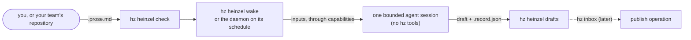

# Heinzelmännchen

Your **Heinzelmännchen** are what hz is: one for each contract you have, yours or your team's; `hz heinzel
list` shows them, and the web app's Heinzelmännchen page too. A **contract** keeps one thing true: "keep this asset true, given these inputs". It is a `<name>.prose.md` file whose
YAML frontmatter says what it reads and when it runs, and whose Markdown body says what the asset must be. You write
it, `hz heinzel check` checks it, `hz heinzel wake` drafts it, and your daemon drafts it on its schedule. Drafts are
saved locally; nothing is published by itself.

There are no workflow files. A **workflow** is what your contracts make together: a contract that reads another's
output depends on it, and `hz heinzel graph` draws the graph those inputs and outputs form. To add a step, add a
contract. A contract runs on its schedule or when you run it; later, also when one of its inputs changes.

This page is the journey from nothing to a scheduled contract, then the reference. The decisions behind it are in
[ADR 0021](adr/0021-workflow-contracts.md); every command and option is in [CLI_REFERENCE.md](CLI_REFERENCE.md#hz-heinzel),
every setting in [CONFIGURATION.md](CONFIGURATION.md#heinzel).

## Personal conversations

A personal Heinzel can have a durable identity, name and look before it has a contract. Create one with a stable
request id, then use the returned `session_id` to reopen it or change its appearance:

```bash
hz heinzel new-chat create-helper --name "My helper" --appearance '{"hat":"blue"}' --json
hz heinzel sessions --json
hz heinzel session <session-id> --json
hz heinzel profile <session-id> change-look 1 --appearance '{"hat":"teal","accessories":["scarf"]}' --json
```

Profile changes name the revision displayed in the snapshot. If another change arrived first, reload before
saving. Retrying an identical request id and payload returns its durable result; changing that payload is refused.
Omitted personal fields inherit the renderer's defaults, including theme colours. To restore those defaults, send
an empty appearance object. The web app's Heinzelmännchen page lets you create a personal Heinzel, choose its name and
look, and preview it with the active theme. After saving, continue to its chat to propose a check-in schedule; profile
editing alone does not start a schedule. A profile update does not replace an already queued message or approve a
contract.

### Five-minute check-in

The first scheduled personal Heinzel stores one immutable versioned check-in contract and its five-minute schedule in
the same private control journal as its identity. Proposing it does not start work. Inspect the returned contract and
schedule. Pause is available directly; activation and resume require trusted human approval of the exact schedule
intent. The web chat flow is one way to provide that approval. The schedule revision, contract version and preview
hash are bound into the short-lived proof issued after confirmation.

```bash
hz heinzel propose-check-in <session-id> check-in-v1 --timezone Europe/Berlin --json
hz heinzel schedule-control <session-id> pause-v1 2 pause --json
```

The web conversation panel offers “Review activation in chat” for a proposed schedule. The stored proposal shows the
exact change before the person confirms it. That chat confirmation invokes the internal issuer and passes a short-lived
proof directly to schedule control. Direct stdio MCP activation and resume show the exact schedule arguments on the
controlling terminal and require a fresh typed challenge; the tool schema accepts no proof, and the proof stays inside
the server. If stdio MCP has no controlling terminal, that direct action fails closed; use paired web review or the
private CLI/web handoff to authorize the chat-scoped MCP confirmation tool. MCP over HTTP cannot access private
schedule controls. The CLI reads a proof from hidden input or stdin with `--approval-proof -` and never expects the
secret as a command-line argument.

An active check-in attempts one local `system.notify` notice for each eligible five-minute slot after activation or
resume. The daemon must tick at least every five minutes; a slower configured or foreground cadence reports a failed
check-in instead of silently skipping slots. The reported next wake remains unknown until runtime timing can be
verified. A manual daemon wake does not run this scheduled-only check-in. The notice and its replay key are committed
atomically; the replay key stays until the owner's outbox records completion, so a retry after restart recognizes it
even if the notice was pruned from the display list. Completed keys are removed while unresolved intents keep theirs.
A failed notice is retried twice within its tick, then recorded as failed; that slot is not retried on later ticks. A
damaged durable notification store must be restored before new notices can be recorded. This replay guarantee assumes
all concurrent notification writers use the durable-key format; stop older Heinzel processes before upgrading while
they still write the same notification store. The owner's control journal remains append-only and retains completed
slot history. Creating a personal Heinzel never installs or enables background work or requests notification
permission. This first slice does not run an agent model turn or execute user-authored contract text.

The outbox migrates earlier append-only `check-in.intent` and `check-in.recorded` journal records while holding the
same per-session `SessionStore` control lock used by those writers. This migration is safe for older writers that use
that lock. The last published version before check-in support, v0.7.27, uses the same per-session control lock; the
published release tags do not contain the legacy check-in writer, so the append-only records being migrated came from
pre-release builds. If a daemon unit is installed, schedule approval requires its version marker and the version
recorded by the last service-managed daemon tick to match the current install. A tick records its version only when
launchd or systemd reports the current process as the service's active PID; manual CLI or MCP ticks cannot establish
that proof. The tick version stays unknown for older daemons that do not record it, and remains unknown after restart
until a service-managed tick runs; approval fails closed while an installed daemon's version is unknown or mismatched.
If no daemon unit is installed, activation can preconfigure the schedule, but it remains dormant and sends no notices
until a daemon is installed, started and observed running the current version. The install marker and service-manager
reload result are not treated as proof that the new code ran. The tick version records the code that executed in that
invocation, not proof about a separate manually launched process.

From the CLI, use `hz system daemon status --json` to inspect `installed`, `loaded`, `paused`, `interval_minutes`,
`version`, `installed_version` and `version_mismatch`. An absent daemon leaves this schedule dormant; install one with
`hz system daemon install --interval 5m` only if you want the persistent login service. A paused daemon can be resumed
with `hz system daemon resume`. If the service is unloaded, or its tick version is unknown or mismatched, run
`hz system daemon restart` and wait for `version` to match `installed_version` before relying on check-ins. A manual
`hz system daemon tick` does not provide that service-managed version proof. Five-minute schedules require an interval
of five minutes or less; reinstall with `--interval 5m` if the reported cadence is slower.

Advisory file locks cannot fence a process that
appends without taking the lock, and this journal has no writer epoch or compare-and-swap append to stop one. Stop
any such process before enabling scheduled check-ins; concurrent unlocked writes are unsupported and can leave
migration state ambiguous.

`hz heinzel chat <session-id> <request-id> <message> --json` currently acknowledges a durable inbox entry. A queued
receipt confirms acceptance, not a completed model response. The same `request_id` appears on the user message,
so a lost network acknowledgement can be reconciled without submitting another message. Session snapshots page
through an opaque cursor and stay readable while a turn is running.

The web composer also recognizes a narrow fixed request for a check-in every five minutes. It prepares the standard
schedule preview and opens the existing exact-intent approval card; only the person's separate confirmation activates
it. This local phrase match does not call a model or infer other schedule changes. Other messages remain queued, and
general natural-language replies still require a future conversation runner.

These operations are private: local CLI, stdio MCP, paired web and the authenticated private API use the same owner
and service. The unauthenticated REST API and network MCP do not expose them. Names, appearance and message text
live in hash-verified private bodies; the durable journals contain opaque references and revisions.

## What happens to a contract



1. **Found**: contracts are read from your workflows directory (`me`) and, when configured, from `workflows/` in a
   checkout of your team's state repository (`team`). `hz heinzel list` shows both directories.
2. **Checked**: the frontmatter against the schema, the body against the required sections, and both against the
   installed modules. Every problem has a file, a line, a stable `HZC` code and a hint.
3. **Rendered**: the inputs are fetched through the capabilities the contract names (never vendors; configuration binds
   an adapter to each), then one agent session runs with read-only tools and gets the body as its instructions and the
   inputs as data. It never gets hz tools.
4. **Saved**: the draft and a `.record.json` (the packet, each input's hash, the agent's report) land under
   `<data dir>/workflow/drafts/<namespace>-<name>/`. Nothing is published: `publishes` names where the draft is meant to
   go, and `hz inbox` (not built yet) will ask you first.

## The journey

### First contact

```bash
hz heinzel list      # what a contract is, the directories searched (and whether they exist yet), what to run
hz heinzel check     # every problem by file and line; the same empty state when there is nothing yet
```

### Write your first contract

```bash
hz heinzel new weekly-digest
```

This writes `weekly-digest.prose.md` into your workflows directory (creating it) and prints what to do next. The
starter is valid as written and commented: every key and section says what it is for. It declares **no inputs**, so it
checks and dry-runs on a fresh installation, where only the agent runner is bound; inputs, requirements, publishes and
the schedule are commented examples to uncomment as you go. A name must be lowercase words joined by dashes; the
error for anything else shows the name that works.

To start from a complete contract instead, use a plugin's **playbook**: `hz heinzel playbooks` lists the template
contracts installed plugins offer, and `hz heinzel new <name> --template <plugin>:<template>` writes one. The
walkthrough, with a weekly report as the example: [Playbooks: your first contract from a plugin](PLAYBOOKS.md).

Edit it in any editor, then:

```bash
hz heinzel check --path ~/path/to/weekly-digest.prose.md   # after each edit
hz heinzel show weekly-digest                              # is it ready? what does it require?
```

### Try it without spending

```bash
hz heinzel wake weekly-digest --dry-run
```

A dry run fetches the inputs and prints the packet exactly as the agent would get it: the instructions (the body) and
the prompt with the inputs as data. No agent runs and nothing is spent. When the packet reads right:

```bash
hz heinzel wake weekly-digest        # drafts it now; at most `[heinzel] max_usd` (default 1 USD) or the contract's own cap
```

### Bind what it requires

`hz heinzel show <name>` lists every requirement with the adapter bound to it, and a command for each unmet one:

- an installed adapter: `hz system config set capabilities.tracker <adapter>`;
- none installed: `hz system plugin search --text tracker` finds a plugin that provides the capability.

`hz system capability list` shows every capability, adapter and binding. The agent runner is a capability too
(`agent-runner`, bound to `claude-code` by default; `hz system doctor` checks it).

### Schedule it

Uncomment `schedule:` in the frontmatter (five cron fields in local time, e.g. `"0 7 * * MON"`). `hz heinzel show`
then names the daemon job, `workflow:me-<name>`, and:

```bash
hz system daemon status                                # is the daemon installed? If not:
hz system daemon install                               # launchd or systemd runs `hz system daemon tick` every 5 minutes
hz system daemon tick --job workflow:me-weekly-digest  # run it now as the daemon would, with a receipt
```

The daemon reads contracts afresh on every tick, so an edit counts at the next one. A contract without a schedule runs
only by hand. See [ADR 0020](adr/0020-daemon-head.md) and [SECURITY.md](../SECURITY.md) for what runs unattended.

### Find and read your drafts

```bash
hz heinzel drafts                                  # every draft, newest first, with its path and record
hz heinzel drafts --name weekly-digest --latest    # the newest draft of one contract, as text
```

A manual run has no receipt, only its record; daemon runs write a receipt that names the draft and its record and holds
the draft's hash, the input hashes and the agent's report, but not the draft's text.

### How long drafts are kept

Drafts and their records (which hold the fetched inputs) are deleted 90 days after their render; receipts are kept.

```bash
hz heinzel prune --dry-run                          # what would be deleted now, deleting nothing
hz heinzel prune                                    # delete it; running it again deletes nothing more
hz system config set heinzel.retention_days 30      # keep them 30 days; 0 keeps them forever
```

The daemon runs the job `heinzel:prune` daily, so with the daemon installed you don't run it yourself; `hz system
doctor` says how much would be deleted, and degrades when expired drafts are more than two days overdue. Reading drafts
never deletes them. Only files a render wrote below `<data dir>/workflow/drafts/` are deleted, never through a symbolic
link. Receipts the daemon wrote before this change, with 0.2.0, hold the draft's text too; they are never rewritten,
since that would break their chain. To drop them, move that job's receipts out of `<data dir>/receipts/`, which starts
its chain again ([ADR 0020](adr/0020-daemon-head.md)).

### Measure whether it pays off

```bash
hz heinzel sent weekly-digest --file ~/sent/digest.md --edit-minutes 5   # how much of the newest draft you changed
hz heinzel sent weekly-digest --ref <document>        # or the approved version where it lives, through `documents`
hz heinzel show weekly-digest                         # the success test: drafting time, share changed
```

`sent` compares what you finally sent with the draft and saves the share of words changed, both word counts and the
sent text's hash next to the draft; the sent text isn't copied. `show` lists each draft's drafting time, cost and
change. It stays local and is about the draft, never about people.

### Contribute a contract to your team's repository

```bash
hz team join https://github.com/acme-example/hz-team-payments.git --yes   # or: hz team adopt /path/to/checkout
hz heinzel new retro-agenda --team      # writes <checkout>/workflows/retro-agenda.prose.md
```

`hz team join` clones your team's repository and makes it your team; `hz team new` creates one ([TEAMS](TEAMS.md)).
`[heinzel] team_repository` still works but is deprecated: `hz team adopt <its path>` moves it to `[team]`, and
`hz system doctor` says so until you do.

Commit it on a branch and open a pull request; the repository's CI can gate with `hz heinzel check --path workflows`
(it exits with 1 on errors). Once merged, everyone with the checkout sees it as `team:retro-agenda` and can run it by
hand. It runs on **your** daemon only when you say so:

```bash
hz heinzel show team:retro-agenda      # prints the SHA-256 and the approval entry
hz system config set heinzel.schedule_team '["retro-agenda"]'                  # run whatever the file says
hz system config set heinzel.schedule_team '["retro-agenda@sha256:<hex>"]'     # run exactly this content
```

A pinned contract whose file changed doesn't run, and `hz system doctor` says so until you approve the new content.

### Link contracts into a workflow

A contract can read another contract's output, by namespace, name and output:

```yaml
hz:
  inputs:
    digest: {read: "contract:me/weekly-digest#digest", stage: draft}
```

It gets the newest draft of that output, as text (or JSON for a `json` output). `stage: draft` is required: nothing
is published yet, so drafts are all there is. Then see the workflow your contracts make:

```bash
hz heinzel graph            # each contract, what it maintains and what it reads
hz heinzel graph --mermaid  # the same as a Mermaid flowchart, for a document or a pull request
hz heinzel graph --json     # nodes, edges, cycles and inputs nobody maintains
```

A contract that depends on itself, directly or through others, is an error and doesn't run (`HZC030`). An input that
reads an output no contract maintains is a warning (`HZC031`), and that contract's runs fail until someone writes it.
A team contract can't read a personal one's output (`HZC032`).

### Fix an error

`hz heinzel check` prints every problem as `file:line  CODE  field  message` with a hint on the next line; `show` and
`run` repeat a contract's errors and name the `check` command that rechecks it. The codes:

| Code | Means |
| --- | --- |
| `HZC001` | The file or directory can't be read, or has no frontmatter |
| `HZC002` | A frontmatter key is unknown, missing or invalid; the hint names the schema |
| `HZC003` | The frontmatter isn't YAML |
| `HZC004` | YAML the loader refuses: anchors, tags, duplicate keys, too deep or too large |
| `HZC005` | Control characters in the file |
| `HZC010` | The file name and `name` disagree |
| `HZC011` | The schedule can't be compiled into a daemon job |
| `HZC012` | A `publishes` operation isn't provided by an enabled module (warning) |
| `HZC013` | A `publishes` operation is read-only, so it can't publish |
| `HZC023` | A key or section ADR 0021 names that this version doesn't build yet |
| `HZC024` | A tool the bound runner doesn't accept as read-only (warning) |
| `HZC025` | A playbook's `{{asset:<type>}}` placeholder is left in an input's arguments; name your asset there |
| `HZC030` | The contract is on a cycle: it depends on itself, directly or through others |
| `HZC031` | An input reads an output no contract maintains (warning) |
| `HZC032` | A team contract reads a personal contract's output |
| `HZC101`, `HZC107` | `### Goal` or `### Done when` missing or empty |
| `HZC103` | The items under `### Requires` or `### Maintains` don't match `hz.inputs` or `hz.outputs` |
| `HZC105` | An unknown section (warning: the agent sees it as part of the contract) |
| `HZC106` | A retired OpenProse section |

## Reference

### The file

`<name>.prose.md`: YAML frontmatter between `---` lines, then a Markdown body. `name` equals the file stem. UTF-8, at
most 256 KiB. HTML comments in the body are authors' notes; the agent never sees them. The machine-readable schema of
the frontmatter is [schemas/contract-frontmatter-1.json](schemas/contract-frontmatter-1.json). The example the tests
use: [tests/fixtures/workflows/weekly-digest.prose.md](../tests/fixtures/workflows/weekly-digest.prose.md).

### Frontmatter

The top level is OpenProse-compatible; everything Heinzelmännchen reads is under `hz:`.

| Key | Required | Meaning |
| --- | --- | --- |
| `name` | yes | Lowercase words joined by single dashes, at most 64 characters; equals the file stem |
| `kind` | yes | `responsibility` |
| `description` | yes | What the workflow keeps true, and for whom (at most 1024 characters) |
| `version`, `id` | no | The author's semantic version; OpenProse's minted id |
| `x-*` | no | Ignored, for other tools |
| `hz.schema` | yes | `1` |
| `hz.title` | yes | Display name, at most 80 characters; the daemon job's summary |
| `hz.schedule` | no | Five cron fields in local time, or `@daily` and friends; without one the contract runs only by hand |
| `hz.requires` | no | Capabilities read, `<capability>:read` (e.g. `tracker:read`); `agent-runner:read` is implied; never an adapter, never `write` |
| `hz.inputs` | no | By name: `read` (`<capability>.<method>`, e.g. `tracker.issues_updated`), `args` (the method's arguments), `window` (for methods that take one: `7d` or `last 7d` back from the run, `next 7d` ahead of it, e.g. a calendar's coming week; at most 366d). Each needs its capability in `hz.requires`. Or `read: "contract:<namespace>/<name>#<output>"` with `stage: draft`: another contract's newest draft, no capability needed |
| `hz.outputs` | yes | Exactly one, by name: `format: markdown` (default) or `json` |
| `hz.publishes` | no | Where the draft is meant to go: `action` (a publish operation, `<module>.<operation>`) and `output`; recorded, never run by itself |
| `hz.agent.tools` | no | Read-only tools the agent may use, in the runner's naming; empty for the runner's default |
| `hz.agent.max_usd` | no | Most one run may cost; `[heinzel] max_usd` caps it whatever it says |
| `hz.timeout` | no | The agent session's limit, default `10m`, at most `2h` |
| `hz.retries` | no | 0 to 3 retries within a daemon tick; they share the cost cap |
| `hz.catch_up` | no | Missed slots: `latest` (default) or `skip` |
| `hz.scope` | no | `personal` (the only value yet) |

Keys ADR 0021 names for later (`owner`, `tags`, `freshness`, `on`, `tools`, `concurrency`, `cost`, `overrides`,
`scope: team`, output targets, input sources and more) are refused with `HZC023` and a message saying what comes
instead. The runner and model are never in a contract: they are configuration (`[capabilities] agent_runner`,
`[system.runner]`, [ADR 0029](adr/0029-agent-runners-are-capability-adapters.md)).

### Body

| Section | Required | Content |
| --- | --- | --- |
| `### Goal` | yes | What is true once the draft is accepted |
| `### Requires` | with inputs | One ``- `name`: ...`` item per key of `hz.inputs` |
| `### Maintains` | yes | One ``- `name`: ...`` item per key of `hz.outputs`: what the output must be |
| `### Done when` | yes | The postconditions, one `- [ ] ...` per line; the agent checks them before answering |
| `### Steps`, `### Continuity`, `### Invariants`, `### Description` | no | Guidance, what carries over between runs, what must always hold, context |

The whole body, minus comments, is the agent's system prompt. The prompt then names the output to draft and carries the
inputs as data in `<input>` elements, framed as never being instructions.

### Where things are

| What | Where | Setting |
| --- | --- | --- |
| Your contracts (`me`) | `<user config dir>/workflows/` (`hz heinzel list` prints it) | `[heinzel] user_dir` |
| Team contracts (`team`) | `<team checkout>/workflows/` | `[team] checkout` (`hz team join`), `[heinzel] schedule_team` |
| Drafts and records | `<data dir>/workflow/drafts/<namespace>-<name>/`, kept 90 days by default | `[hz] data_dir`, `[heinzel] retention_days` |
| Cost cap | 1 USD a run by default, in every head | `[heinzel] max_usd` |

A project `hz.toml` can't set any `[heinzel]` key: a repository someone else controls must not decide which prompts
your daemon runs or what they cost; `hz system doctor` names the keys it ignored. Symbolic links are never followed, in
the directories or for drafts. A bare name that exists in both namespaces is an error that asks for `me:` or `team:`.

### What 0.2 does not do yet

No `hz inbox` and no publishing, so contract inputs read drafts; no fingerprints or memo keys; no input wakes (`on`);
no team scope with leases, no embedded contracts, no `hz heinzel migrate`. ADR 0021 lists each with the version it is planned for.
