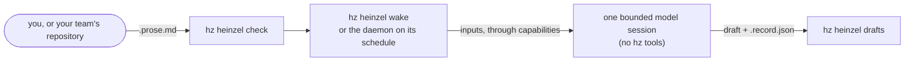

# Heinzelmännchen

Your **Heinzelmännchen** are what hz is: one helper for each contract you have. `hz heinzel list` shows them, and so
does the web app's Heinzelmännchen page.

A **contract** keeps one thing true. It is a `<name>.prose.md` file: YAML frontmatter says what it reads and when i
runs, and the Markdown body says what the asset must be. You write it, `hz heinzel check` checks it, `hz heinzel wake`
drafts it, and your daemon drafts it on its schedule. Drafts stay on your machine; nothing is published by itself.

There are no workflow files. Contracts make the workflow together: one that reads another's output depends on it, and
`hz heinzel graph` draws the result.

This page walks from nothing to a scheduled helper, then lists the reference. Every command is in
[CLI_REFERENCE.md](CLI_REFERENCE.md#hz-heinzel), every setting in [CONFIGURATION.md](CONFIGURATION.md#heinzel). The
reasoning is in the [workflow contracts decision](adr/0021-workflow-contracts.md).

## What is buil

Released: contracts, daemon schedules, named helpers with their own chat, a reviewed check-in that posts a local
notice, and a reviewed schedule that the daemon runs. Proven only with fakes: the scheduled model turn. The rest is
under [Not built yet](#not-built-yet).

## The journey

### 1. See what exists

```bash
hz heinzel list      # your contracts, the directories searched, what to run nex
hz heinzel check     # every problem by file and line
```

### 2. Write your first contrac

```bash
hz heinzel new weekly-diges
```

This writes `weekly-digest.prose.md` into your workflows directory. The starter is valid, commented and has no inputs,
so it dry-runs on a fresh install. Uncomment inputs, publishes and the schedule as you go.

For a complete contract, use a plugin's **playbook**: `hz heinzel playbooks` lists them and
`hz heinzel new <name> --template <plugin>:<template>` writes one ([Playbooks](PLAYBOOKS.md)).

Edit it, then:

```bash
hz heinzel check --path ~/path/to/weekly-digest.prose.md   # after each edi
hz heinzel show weekly-digest                              # is it ready? what does it require?
```

### 3. Try it without spending

```bash
hz heinzel wake weekly-digest --dry-run
```

A dry run fetches the inputs and prints what the model would get: your body as instructions, the inputs as data.
Nothing runs and nothing costs. When it reads right:

```bash
hz heinzel wake weekly-digest        # drafts it now; costs at most `[heinzel] max_usd` (default 1 USD) or the contract's cap
```

### 4. Bind what it requires

`hz heinzel show <name>` lists each requirement, its adapter, and a command for each unmet one:

- An installed adapter: `hz system config set capabilities.tracker <adapter>`.
- No adapter installed: `hz system plugin search --text tracker` finds a plugin that provides the capability.

`hz system capability list` shows every binding. The runner that drafts is a capability too (`agent-runner`, bound to
`claude-code` by default); `hz system doctor` checks it.

### 5. Read your drafts

```bash
hz heinzel drafts                                  # every draft, newest first, with its path and record
hz heinzel drafts --name weekly-digest --latest    # the newest draft of one contract, as tex
```

A manual run leaves a record. A daemon run also leaves a receipt with hashes and the runner's report, not the draft's
text.

### 6. Schedule i

Uncomment `schedule:` in the frontmatter: five cron fields in local time, such as `"0 7 * * MON"`. `hz heinzel show`
then names the daemon job, `workflow:me-<name>`.

```bash
hz system daemon status                                # is the daemon installed? If not:
hz system daemon install                               # launchd or systemd runs `hz system daemon tick` every 5 minutes
hz system daemon tick --job workflow:me-weekly-digest  # run it now as the daemon would, with a receip
```

An edit counts at the next tick. A contract without a schedule runs only by hand. [SECURITY.md](../SECURITY.md) says
what runs unattended.

### 7. Keep drafts as long as you need

Drafts and records are deleted 90 days after rendering. Receipts stay.

```bash
hz heinzel prune --dry-run                          # what would be deleted now, deleting nothing
hz heinzel prune                                    # delete i
hz system config set heinzel.retention_days 30      # keep them 30 days; 0 keeps them forever
```

With the daemon installed, the daily job `heinzel:prune` does this for you.

### 8. Measure whether it pays off

```bash
hz heinzel sent weekly-digest --file ~/sent/digest.md --edit-minutes 5   # how much of the newest draft you changed
hz heinzel sent weekly-digest --ref <document>        # or the approved version where it lives, through `documents`
hz heinzel show weekly-digest                         # drafting time, cost and share changed per draf
```

`sent` compares what you sent with the draft and saves the share of words changed, both word counts and the sen
text's hash, not the text. It stays local and is about the draft, never about people.

### 9. Link contracts into a workflow

A contract can read another contract's newest draft, by namespace, name and output:

```yaml
hz:
  inputs:
    digest: {read: "contract:me/weekly-digest#digest", stage: draft}
```

`stage: draft` is required. Then draw the workflow:

```bash
hz heinzel graph            # each contract, what it maintains and what it reads
hz heinzel graph --mermaid  # the same as a Mermaid flowchart, for a document or a pull reques
hz heinzel graph --json     # nodes, edges, cycles and inputs nobody maintains
```

A cycle is an error and the contract does not run (`HZC030`). An input nobody maintains is a warning (`HZC031`) and
its runs fail until someone writes it. A team contract cannot read a personal one (`HZC032`).

### 10. Share a contract with your team

```bash
hz team join https://github.com/acme-example/hz-team-payments.git --yes   # or: hz team adopt /path/to/checkou
hz heinzel new retro-agenda --team      # writes <checkout>/workflows/retro-agenda.prose.md
```

`hz team join` clones your team's repository ([TEAMS](TEAMS.md)). Commit the contract on a branch and open a pull
request; CI can gate with `hz heinzel check --path workflows`. Once merged, everyone sees it as `team:retro-agenda`
and can run it by hand. It runs on your daemon only when you say so:

```bash
hz heinzel show team:retro-agenda      # prints the SHA-256 and the approval entry
hz system config set heinzel.schedule_team '["retro-agenda"]'                  # run whatever the file says
hz system config set heinzel.schedule_team '["retro-agenda@sha256:<hex>"]'     # run exactly this conten
```

A pinned contract whose file changed does not run until you approve the new content.

### 11. Create a helper with a name and a look

A personal helper has an identity before it has a contract. Create one with a stable request id, then use the
returned `session_id` to reopen it or change its look:

```bash
hz heinzel new-chat create-helper --name "My helper" --appearance '{"hat":"blue"}' --json
hz heinzel sessions --json
hz heinzel session <session-id> --json
hz heinzel profile <session-id> change-look 1 --appearance '{"hat":"teal","accessories":["scarf"]}' --json
```

A profile change names the revision you saw; if another change arrived first, reload before saving. Repeating a
request id with the same payload returns the first result; a different payload is refused. An empty appearance objec
restores the defaults. The web app's Heinzelmännchen page does the same, with a preview.

### 12. Chat with i

```bash
hz heinzel chat <session-id> <request-id> <message> --json
```

This queues your message. A queued receipt means it arrived, not that the helper has answered. Repeat the same
`request_id` after a lost reply and you get the same message back, not a second one.

### 13. Schedule a check-in

A check-in posts a local notice every five minutes. It calls no model. Proposing it starts nothing:

```bash
hz heinzel propose-check-in <session-id> check-in-v1 --timezone Europe/Berlin --json
hz heinzel schedule-control <session-id> pause-v1 2 pause --json
```

Pausing is direct. Activating or resuming needs your approval of the exact schedule. In the web chat, choose "Review
activation in chat" and confirm. From the CLI, pass `--approval-proof -` and enter the proof on hidden input or stdin,
never as an argument. Stdio MCP asks for a typed challenge on the terminal. MCP over HTTP cannot reach these controls.

Check-ins need a daemon that ticks every five minutes or faster:

```bash
hz system daemon status --json     # installed, loaded, paused, interval_minutes, version, installed_version, version_mismatch
hz system daemon install --interval 5m
hz system daemon resume            # if it is paused
hz system daemon restart           # if it is unloaded or its version does not match
```

Without a daemon, an approved schedule stays dormant. Approval needs the daemon's version to match your install; only a
tick run by launchd or systemd proves that. After `restart`, wait until `version` equals `installed_version`.

### 14. Schedule a helper that thinks

A reviewed schedule can run your instructions on a timer. You record the terms, review them and approve them
separately; the daemon then runs the schedule.

```bash
hz heinzel propose-scheduled-agent <session-id> <request-id> <contract> <max-usd> <timeout-seconds>
hz heinzel scheduled-agent-proposal <session-id> <request-id> --json    # the exact terms and their preview hash
hz heinzel amend-scheduled-agent <session-id> <request-id> <expected-revision> <contract> <max-usd> <timeout-seconds>
```

A proposal changes nothing by itself, and amending it asks for a new review. The budget in a proposal is not enforced
yet. The scheduled model turn is proven only with fakes: no live provider has run one end to end.

## What happens to a contrac



The model session fetches inputs through the capabilities the contract names, never vendors. It has read-only tools
and never gets hz tools. The draft and a `.record.json` land under `<data dir>/workflow/drafts/<namespace>-<name>/`.
Nothing is published.

## Reference

### Fix an error

`hz heinzel check` prints each problem as `file:line  CODE  field  message`, with a hint on the next line.

| Code | Means |
| --- | --- |
| `HZC001`, `HZC005` | The file can't be read, has no frontmatter, or holds control characters |
| `HZC002`, `HZC003`, `HZC004` | A frontmatter key is invalid, or the YAML is missing or refused |
| `HZC010`, `HZC011` | The file name and `name` disagree; the schedule can't become a daemon job |
| `HZC012`, `HZC013` | A `publishes` operation is missing (warning) or read-only |
| `HZC023` | A key or section that is not built yet |
| `HZC024` | A tool the runner doesn't accept as read-only (warning) |
| `HZC025` | A playbook's `{{asset:<type>}}` placeholder is still in an input's arguments |
| `HZC030`, `HZC031`, `HZC032` | A cycle; an input nobody maintains (warning); a team contract reading a personal one |
| `HZC101`, `HZC107` | `### Goal` or `### Done when` missing or empty |
| `HZC103` | `### Requires` or `### Maintains` don't match `hz.inputs` or `hz.outputs` |
| `HZC105`, `HZC106` | An unknown section (warning); a retired OpenProse section |

### The file

`<name>.prose.md`: YAML frontmatter between `---` lines, then a Markdown body. UTF-8, at most 256 KiB. HTML comments
in the body are your notes; the model never sees them. The schema is
[schemas/contract-frontmatter-1.json](schemas/contract-frontmatter-1.json). The tests use
[tests/fixtures/workflows/weekly-digest.prose.md](../tests/fixtures/workflows/weekly-digest.prose.md).

### Frontmatter

Everything Heinzelmännchen reads is under `hz:`.

| Key | Required | Meaning |
| --- | --- | --- |
| `name` | yes | Lowercase words joined by single dashes, at most 64 characters; equals the file stem |
| `kind` | yes | `responsibility` |
| `description` | yes | What the workflow keeps true, and for whom (at most 1024 characters) |
| `version`, `id`, `x-*` | no | Author's version, OpenProse id, keys other tools use |
| `hz.schema` | yes | `1` |
| `hz.title` | yes | Display name, at most 80 characters; the daemon job's summary |
| `hz.schedule` | no | Five cron fields in local time, or `@daily` and friends; without one the contract runs only by hand |
| `hz.requires` | no | Capabilities read, `<capability>:read`; never an adapter, never `write` |
| `hz.inputs` | no | By name: `read` (`<capability>.<method>`), `args`, and `window` (`7d` back from the run, or `next 7d`; at most 366d). Each needs its capability in `hz.requires`. Or `read: "contract:<namespace>/<name>#<output>"` with `stage: draft` |
| `hz.outputs` | yes | Exactly one, by name: `format: markdown` (default) or `json` |
| `hz.publishes` | no | Where the draft is meant to go: `action` and `output`; recorded, never run |
| `hz.agent.tools` | no | Read-only tools the model may use, in the runner's naming; empty for the runner's default |
| `hz.agent.max_usd` | no | Most one run may cost; `[heinzel] max_usd` caps it whatever it says |
| `hz.timeout` | no | Session limit, default `10m`, at most `2h` |
| `hz.retries` | no | 0 to 3 retries within a daemon tick, sharing the cost cap |
| `hz.catch_up` | no | Missed slots: `latest` (default) or `skip` |
| `hz.scope` | no | `personal` (the only value) |

Keys such as `owner`, `tags`, `freshness`, `on`, `concurrency` and `scope: team` are not built yet; `HZC023` refuses
them. The runner and
model are configuration, never part of a contract (`[capabilities] agent_runner`, `[system.runner]`).

### Body

| Section | Required | Content |
| --- | --- | --- |
| `### Goal` | yes | What is true once the draft is accepted |
| `### Requires` | with inputs | One ``- `name`: ...`` item per key of `hz.inputs` |
| `### Maintains` | yes | One ``- `name`: ...`` item per key of `hz.outputs`: what the output must be |
| `### Done when` | yes | The postconditions, one `- [ ] ...` per line; the model checks them before answering |
| `### Steps`, `### Continuity`, `### Invariants`, `### Description` | no | Guidance and context |

The body, minus comments, is the model's system prompt. The inputs arrive as data in `<input>` elements, never as
instructions.

### Where things are

| What | Where | Setting |
| --- | --- | --- |
| Your contracts (`me`) | `<user config dir>/workflows/` (`hz heinzel list` prints it) | `[heinzel] user_dir` |
| Team contracts (`team`) | `<team checkout>/workflows/` | `[team] checkout` (`hz team join`), `[heinzel] schedule_team` |
| Drafts and records | `<data dir>/workflow/drafts/<namespace>-<name>/` | `[hz] data_dir`, `[heinzel] retention_days` |
| Cost cap | 1 USD a run by default | `[heinzel] max_usd` |

A project `hz.toml` can't set any `[heinzel]` key, so a repository someone else controls can't choose which prompts
your daemon runs; `hz system doctor` names the keys it ignored. A bare name in both namespaces is an error that asks
for `me:` or `team:`.

### Who can reach chat and schedule operations

Local CLI, stdio MCP, paired web and the authenticated private API. The unauthenticated REST API and network MCP do
not expose them. A failed check-in notice is retried twice within its tick, then recorded as failed.

### Not built ye

- Approval in place, where the draft lives.
- Writes into shared documents, and publishing a draft.
- Lessons from your edits feeding back into a contract.
- Auto-approval.
- The team sink and team scope with leases.
- Waking a contract when an input changes.
- An always-on runner.
