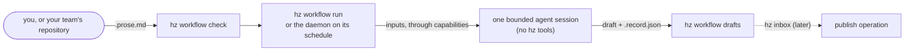

# Workflows

A workflow is a **contract**: a `<name>.prose.md` file whose YAML frontmatter says what it reads and when it runs,
and whose Markdown body says what an agent must draft. You write it, `hz workflow check` checks it, `hz workflow run`
drafts it, and your daemon drafts it on its schedule. Drafts are saved locally; nothing is published by itself.

This page is the journey from nothing to a scheduled contract, then the reference. The decisions behind it are in
[ADR 0021](adr/0021-workflow-contracts.md); every command and option is in [CLI_REFERENCE.md](CLI_REFERENCE.md#hz-workflow),
every setting in [CONFIGURATION.md](CONFIGURATION.md#workflow).

## What happens to a contract



1. **Found**: contracts are read from your workflows directory (`me`) and, when configured, from `workflows/` in a
   checkout of your team's state repository (`team`). `hz workflow list` shows both directories.
2. **Checked**: the frontmatter against the schema, the body against the required sections, and both against the
   installed modules. Every problem has a file, a line, a stable `HZC` code and a hint.
3. **Rendered**: the inputs are fetched through the capabilities the contract names (never vendors; configuration binds
   an adapter to each), then one agent session runs with read-only tools and gets the body as its instructions and the
   inputs as data. It never gets hz tools.
4. **Saved**: the draft and a `.record.json` (the packet, each input's hash, the agent's report) land under
   `<data dir>/workflow/drafts/<namespace>-<name>/`. Nothing is published: `publishes` names where the draft is meant to
   go, and `hz inbox` (not built yet) will ask you first.

## The journey

### First contact

```bash
hz workflow list      # what a contract is, the directories searched (and whether they exist yet), what to run
hz workflow check     # every problem by file and line; the same empty state when there is nothing yet
```

### Write your first contract

```bash
hz workflow new weekly-digest
```

This writes `weekly-digest.prose.md` into your workflows directory (creating it) and prints what to do next. The
starter is valid as written and commented: every key and section says what it is for. It declares **no inputs**, so it
checks and dry-runs on a fresh installation, where only the agent runner is bound; inputs, requirements, publishes and
the schedule are commented examples to uncomment as you go. A name must be lowercase words joined by dashes; the
error for anything else shows the name that works.

Edit it in any editor, then:

```bash
hz workflow check --path ~/path/to/weekly-digest.prose.md   # after each edit
hz workflow show weekly-digest                              # is it ready? what does it require?
```

### Try it without spending

```bash
hz workflow run weekly-digest --dry-run
```

A dry run fetches the inputs and prints the packet exactly as the agent would get it: the instructions (the body) and
the prompt with the inputs as data. No agent runs and nothing is spent. When the packet reads right:

```bash
hz workflow run weekly-digest        # drafts it now; at most `[workflow] max_usd` (default 1 USD) or the contract's own cap
```

### Bind what it requires

`hz workflow show <name>` lists every requirement with the adapter bound to it, and a command for each unmet one:

- an installed adapter: `hz system config set capabilities.tracker <adapter>`;
- none installed: `hz system plugin search --text tracker` finds a plugin that provides the capability.

`hz system capability list` shows every capability, adapter and binding. The agent runner is a capability too
(`agent-runner`, bound to `claude-code` by default; `hz system doctor` checks it).

### Schedule it

Uncomment `schedule:` in the frontmatter (five cron fields in local time, e.g. `"0 7 * * MON"`). `hz workflow show`
then names the daemon job, `workflow:me-<name>`, and:

```bash
hz system daemon status                                # is the daemon installed? If not:
hz system daemon install                               # launchd or systemd runs `hz system daemon tick` every 5 minutes
hz system daemon tick --job workflow:me-weekly-digest  # run it now as the daemon would, with a receipt
```

The daemon reads contracts afresh on every tick, so an edit counts at the next one. A contract without a schedule runs
only by hand. See [ADR 0020](adr/0020-daemon-head.md) and [SECURITY.md](../SECURITY.md) for what runs unattended.

### Find and read your drafts

```bash
hz workflow drafts                                  # every draft, newest first, with its path and record
hz workflow drafts --name weekly-digest --latest    # the newest draft of one contract, as text
```

A manual run has no receipt, only its record; daemon runs write a receipt that names the draft and its record and holds
the draft's hash, the input hashes and the agent's report, but not the draft's text.

### How long drafts are kept

Drafts and their records (which hold the fetched inputs) are deleted 90 days after their render; receipts are kept.

```bash
hz workflow prune --dry-run                          # what would be deleted now, deleting nothing
hz workflow prune                                    # delete it; running it again deletes nothing more
hz system config set workflow.retention_days 30      # keep them 30 days; 0 keeps them forever
```

The daemon runs the job `workflow:prune` daily, so with the daemon installed you don't run it yourself; `hz system
doctor` says how much would be deleted, and degrades when expired drafts are more than a day overdue. Reading drafts
never deletes them. Only files a render wrote below `<data dir>/workflow/drafts/` are deleted, never through a symbolic
link. Receipts the daemon wrote before this change, with 0.2.0, hold the draft's text too; they are never rewritten,
since that would break their chain. To drop them, move that job's receipts out of `<data dir>/receipts/`, which starts
its chain again ([ADR 0020](adr/0020-daemon-head.md)).

### Contribute a contract to your team's repository

```bash
hz system config set workflow.team_repository /path/to/your/teams/checkout
hz workflow new retro-agenda --team      # writes <checkout>/workflows/retro-agenda.prose.md
```

Commit it on a branch and open a pull request; the repository's CI can gate with `hz workflow check --path workflows`
(it exits with 1 on errors). Once merged, everyone with the checkout sees it as `team:retro-agenda` and can run it by
hand. It runs on **your** daemon only when you say so:

```bash
hz workflow show team:retro-agenda      # prints the SHA-256 and the approval entry
hz system config set workflow.schedule_team '["retro-agenda"]'                  # run whatever the file says
hz system config set workflow.schedule_team '["retro-agenda@sha256:<hex>"]'     # run exactly this content
```

A pinned contract whose file changed doesn't run, and `hz system doctor` says so until you approve the new content.

### Fix an error

`hz workflow check` prints every problem as `file:line  CODE  field  message` with a hint on the next line; `show` and
`run` repeat a contract's errors and name the `check` command that rechecks it. The codes:

| Code | Means |
| --- | --- |
| `HZC001` | The file or directory can't be read, or has no frontmatter |
| `HZC002` | A frontmatter key is unknown, missing or invalid; the hint names the schema |
| `HZC003` | The frontmatter isn't YAML |
| `HZC004` | YAML the loader refuses: anchors, tags, duplicate keys, too deep or too large |
| `HZC005` | Control characters in the file |
| `HZC010` | The file name and `name` disagree |
| `HZC011` | The schedule can't be compiled into a daemon job |
| `HZC012` | A `publishes` operation isn't provided by an enabled module (warning) |
| `HZC013` | A `publishes` operation is read-only, so it can't publish |
| `HZC023` | A key or section ADR 0021 names that this version doesn't build yet |
| `HZC024` | A tool the bound runner doesn't accept as read-only (warning) |
| `HZC101`, `HZC107` | `### Goal` or `### Done when` missing or empty |
| `HZC103` | The items under `### Requires` or `### Maintains` don't match `hz.inputs` or `hz.outputs` |
| `HZC105` | An unknown section (warning: the agent sees it as part of the contract) |
| `HZC106` | A retired OpenProse section |

## Reference

### The file

`<name>.prose.md`: YAML frontmatter between `---` lines, then a Markdown body. `name` equals the file stem. UTF-8, at
most 256 KiB. HTML comments in the body are authors' notes; the agent never sees them. The machine-readable schema of
the frontmatter is [schemas/contract-frontmatter-1.json](schemas/contract-frontmatter-1.json). The example the tests
use: [tests/fixtures/workflows/weekly-digest.prose.md](../tests/fixtures/workflows/weekly-digest.prose.md).

### Frontmatter

The top level is OpenProse-compatible; everything Heinzelmännchen reads is under `hz:`.

| Key | Required | Meaning |
| --- | --- | --- |
| `name` | yes | Lowercase words joined by single dashes, at most 64 characters; equals the file stem |
| `kind` | yes | `responsibility` |
| `description` | yes | What the workflow keeps true, and for whom (at most 1024 characters) |
| `version`, `id` | no | The author's semantic version; OpenProse's minted id |
| `x-*` | no | Ignored, for other tools |
| `hz.schema` | yes | `1` |
| `hz.title` | yes | Display name, at most 80 characters; the daemon job's summary |
| `hz.schedule` | no | Five cron fields in local time, or `@daily` and friends; without one the contract runs only by hand |
| `hz.requires` | no | Capabilities read, `<capability>:read` (e.g. `tracker:read`); `agent-runner:read` is implied; never an adapter, never `write` |
| `hz.inputs` | no | By name: `read` (`<capability>.<method>`, e.g. `tracker.issues_updated`), `args` (the method's arguments), `window` (e.g. `7d`, for methods that take one). Each needs its capability in `hz.requires` |
| `hz.outputs` | yes | Exactly one, by name: `format: markdown` (default) or `json` |
| `hz.publishes` | no | Where the draft is meant to go: `action` (a publish operation, `<module>.<operation>`) and `output`; recorded, never run by itself |
| `hz.agent.tools` | no | Read-only tools the agent may use, in the runner's naming; empty for the runner's default |
| `hz.agent.max_usd` | no | Most one run may cost; `[workflow] max_usd` caps it whatever it says |
| `hz.timeout` | no | The agent session's limit, default `10m`, at most `2h` |
| `hz.retries` | no | 0 to 3 retries within a daemon tick; they share the cost cap |
| `hz.catch_up` | no | Missed slots: `latest` (default) or `skip` |
| `hz.scope` | no | `personal` (the only value yet) |

Keys ADR 0021 names for later (`owner`, `tags`, `freshness`, `on`, `tools`, `concurrency`, `cost`, `overrides`,
`scope: team`, output targets, input sources and more) are refused with `HZC023` and a message saying what comes
instead. The runner and model are never in a contract: they are configuration (`[capabilities] agent_runner`,
`[system.runner]`, [ADR 0029](adr/0029-agent-runners-are-capability-adapters.md)).

### Body

| Section | Required | Content |
| --- | --- | --- |
| `### Goal` | yes | What is true once the draft is accepted |
| `### Requires` | with inputs | One ``- `name`: ...`` item per key of `hz.inputs` |
| `### Maintains` | yes | One ``- `name`: ...`` item per key of `hz.outputs`: what the output must be |
| `### Done when` | yes | The postconditions, one `- [ ] ...` per line; the agent checks them before answering |
| `### Steps`, `### Continuity`, `### Invariants`, `### Description` | no | Guidance, what carries over between runs, what must always hold, context |

The whole body, minus comments, is the agent's system prompt. The prompt then names the output to draft and carries the
inputs as data in `<input>` elements, framed as never being instructions.

### Where things are

| What | Where | Setting |
| --- | --- | --- |
| Your contracts (`me`) | `<user config dir>/workflows/` (`hz workflow list` prints it) | `[workflow] user_dir` |
| Team contracts (`team`) | `<team_repository>/workflows/` | `[workflow] team_repository`, `[workflow] schedule_team` |
| Drafts and records | `<data dir>/workflow/drafts/<namespace>-<name>/`, kept 90 days by default | `[hz] data_dir`, `[workflow] retention_days` |
| Cost cap | 1 USD a run by default, in every head | `[workflow] max_usd` |

A project `hz.toml` can't set any `[workflow]` key: a repository someone else controls must not decide which prompts
your daemon runs or what they cost; `hz system doctor` names the keys it ignored. Symbolic links are never followed, in
the directories or for drafts. A bare name that exists in both namespaces is an error that asks for `me:` or `team:`.

### What 0.2 does not do yet

No `hz inbox` and no publishing; no fingerprints, memo keys or contract graph; no input wakes (`on`), no team scope
with leases, no embedded contracts, no `hz workflow migrate`. ADR 0021 lists each with the version it is planned for.
