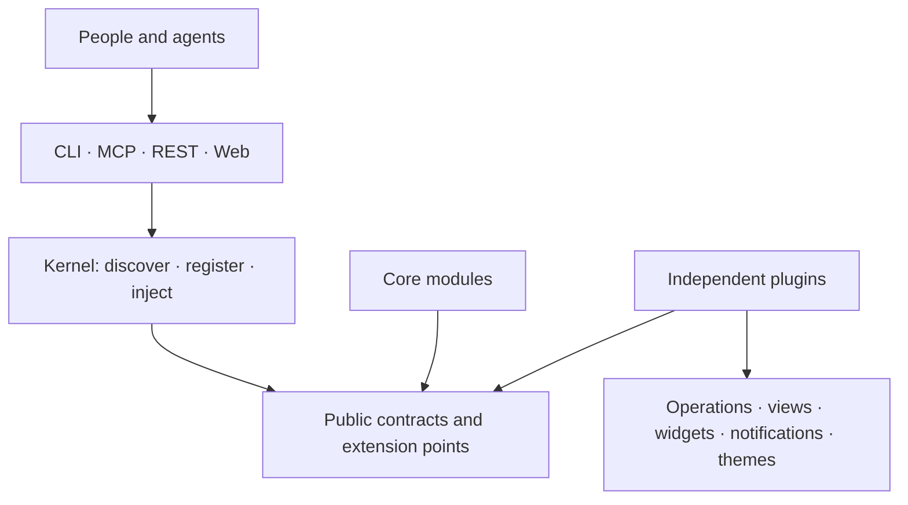

# One capability. Every head.

Heinzel is built around a small kernel, typed operations and public contracts. A feature should not need a
second implementation to reach a person in a terminal, an agent through MCP, or an application through REST.

The arrows show use of shared contracts. Core and heads do not depend on concrete provider plugins.
A plugin implements contracts and owns its representations in every surface it contributes to.

## Operations are the common language

A module declares a typed Python function once. Discovery registers it; heads turn its inputs, output and
docstring into commands, tools and endpoints, subject to declared privacy and head restrictions. Dependency injection supplies settings and services through
public interfaces. The kernel knows neither a head nor a concrete module.

[Read the kernel and module design →](../ARCHITECTURE.md)

## Extension points make ownership complete

A plugin can bring navigation entries, header and footer actions, sidebar views and tickers, Today widgets,
notifications and theme data. Priority controls placement within a slot. Removing a plugin removes its
contributions without leaving provider-specific branches in a head.

Themes can own artwork, palettes and soundscapes. The engines remain generic; a new theme does not require
a catalog entry hardcoded in core. Some built-in modules retain private integration paths where a generic
contract would add unnecessary complexity. That is a deliberate exception, not the extension default.

[Inspect the extension contracts →](../PLUGINS.md) · [Read the boundary decision →](../adr/0094-plugins-own-features-and-independent-delivery.md)

## Small feedback loops, confidence at the boundaries

| Layer | Build and test | Release |
| --- | --- | --- |
| Core | Without real provider plugins; contract fixtures exercise extension points | Core SDK artifact |
| One plugin | Its behavior, own dependencies and installed-wheel acceptance against the SDK | Its own distribution and version |
| Standard app | Verify an exact profile of accepted artifacts | Versioned composition profile |
| Public website | Bounded public metadata, static rendering and browser behavior; no provider execution | GitHub Pages |

This keeps plugin development parallel: a clock improvement does not require rebuilding core or running another
connector's suite. Shared behavior belongs in versioned contracts and tooling rather than copied integration code.

[Architecture decisions](../adr/README.md) record the reasoning and tradeoffs. For the implementation map, see
[technical architecture](../ARCHITECTURE.md) and [coding standards](../CODING_STANDARDS.md).
