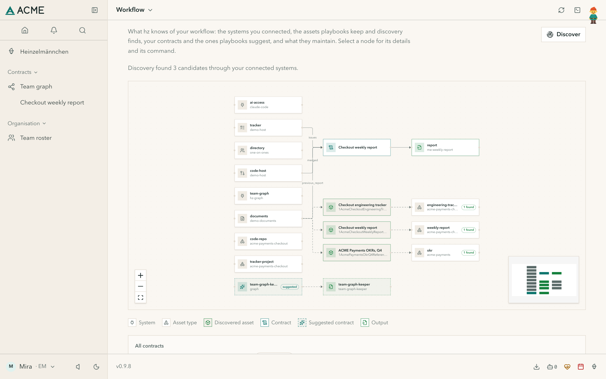
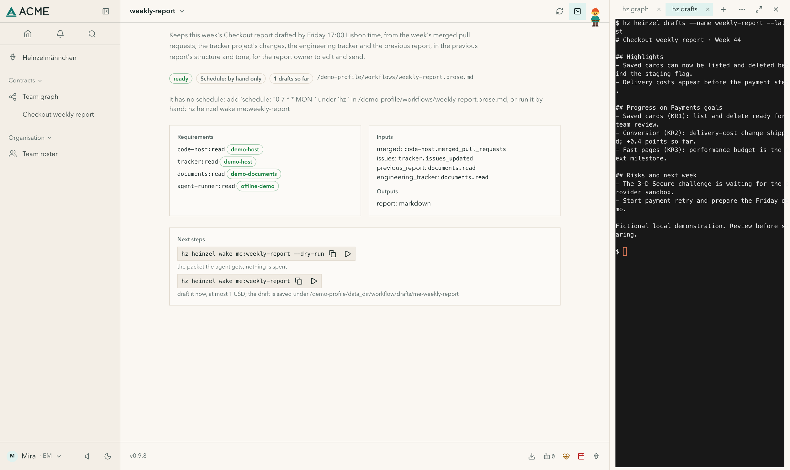
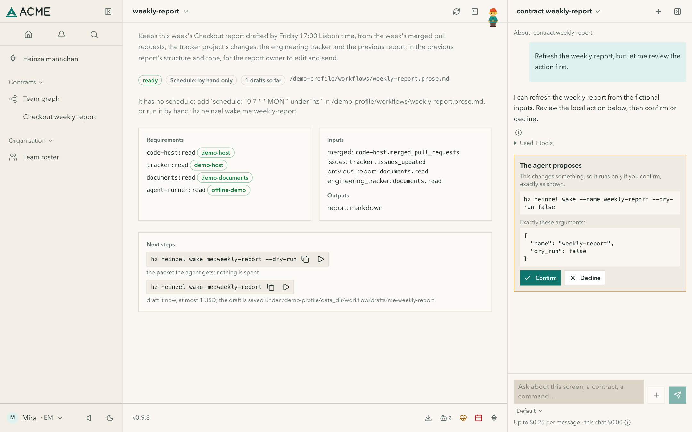

# Product tour

Real screens from the released app, captured with fictional ACME data in a disposable profile. Swipe each strip for a
zoomed detail and a dark view, and select an image to inspect it.

## See what feeds the next piece of work.

The workflow graph shows the systems you connected, the assets found through them, a contract and the output it
maintains.

<!-- hz:tour-story graph -->

<!-- /hz:tour-story -->

## Keep useful commands beside the work.

The terminal opens beside the page you are on, with a tab for each command.

<!-- hz:tour-story terminal -->

<!-- /hz:tour-story -->

## Ask here. Review the action before it runs.

Chat knows which contract you are looking at. When it proposes a change, you see the exact command first. This demo
uses a scripted local runner: no model is called.

<!-- hz:tour-story chat -->

<!-- /hz:tour-story -->

Characters speak in an imagined voice; the screens are real. [Install Heinzelmännchen](install.md) to try them with your own
tools, or read [what your Heinzelmännchen does](../HEINZELMAENNCHEN.md).
