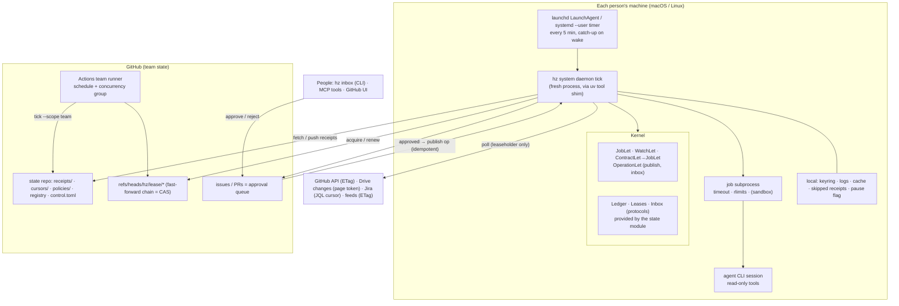

# Research report: a daemon head for Heinzelmännchen

- Date: 2026-10-23
- Scope: research only. Decision record: [ADR 0020](../adr/0020-daemon-head.md) (proposed). Nothing is built
  before 0.1.0 is released.
- Read first: `INTENT.md`, `docs/ARCHITECTURE.md`, ADRs 0003, 0004, 0010, 0015, 0018, 0019,
  `src/heinzel/kernel/_lets.py`, `_module.py`, `_installation.py`, `src/heinzel/heads/` (`_exposure.py`, `cli/_serve.py`, `mcp`).

## TL;DR

1. **Let the OS supervise and the daemon tick.** `hz system daemon install` writes a launchd LaunchAgent on macOS
   or a systemd `--user` service plus timer on Linux. Every few minutes it runs `hz system daemon tick`: a
   short-lived process that boots the kernel, finds what is due or changed, runs it under a lease, writes receipts and
   exits. launchd's `StartCalendarInterval` and systemd's `Persistent=true` catch up after sleep, so catching up is
   the OS's job. A fresh process per tick also survives `hz system update`. That command replaces the uv tool
   environment, and a resident Python process would be left running code that is no longer on disk.
   `hz system serve daemon` is the same loop in the foreground. A resident mode (KeepAlive) for file watching comes later.
2. **GitHub is the shared state, the lock service and the approval inbox.** A team state repository holds receipts
   (one file per receipt, so concurrent writers never conflict), cursors and policies. Leases are Git refs whose
   commits form a chain, so a rejected push is the compare-and-swap. Approvals are issues and pull requests, in the
   style of Renovate's Dependency Dashboard. Team-scoped jobs can run as a scheduled GitHub Actions workflow with a
   `concurrency` group instead of on laptops, and both runners write to the same ledger.
3. **New lets: `WatchLet` and `JobLet`.** A `ContractLet` (ADR 0010) compiles to them, so the daemon head knows only two
   new kinds. Jobs declare schedule, triggers, scope, idempotency key, timeout, retries, concurrency and the action
   types they publish. Jobs only draft. Publishing is a separate, approved step, and every step leaves a hash-chained
   receipt with lineage, as Reactor does.
4. **Untrusted input is data until a human registers it.** Workflows embedded in a Google Doc or Sheet tab
   ("🧝 Heinzel") run only after an owner registers them and pins a fingerprint. Plugins run only from an allowlist,
   one subprocess per job with limits. OS sandboxing (Seatbelt, bubblewrap) comes in a later phase.

---

## 1. Process model

### What comparable tools do

| Tool | macOS | Linux | Install / uninstall | Logs | Notes |
| --- | --- | --- | --- | --- | --- |
| **Homebrew services** | LaunchAgent in `~/Library/LaunchAgents`, or a LaunchDaemon with `sudo` | unit in `~/.config/systemd/user`, or system-wide with `sudo` | `brew services start|stop|restart|kill|run|list|info|cleanup` | Whatever the formula declares | `start` = run now and register at login; `run` = run without registering; `kill` = stop but stay registered. The vocabulary is worth borrowing. [brew manpage](https://docs.brew.sh/Manpage) |
| **Syncthing** | User LaunchAgent plist in `~/Library/LaunchAgents` | **user** unit for desktops (starts at login), system template `syncthing@.service` for servers; `loginctl enable-linger` to start user units at boot | Documented manual steps | `journalctl --user-unit=syncthing.service` | The usual split: user units on desktops, system units on servers. [docs](https://docs.syncthing.net/users/autostart.html) |
| **Ollama** | Menu-bar app registered as a login item | System unit `/etc/systemd/system/ollama.service`, dedicated `ollama` user, restart always | Updated by rerunning the install script; the unit stays | `journalctl -e -u ollama` | System scope because it serves a local API. [linux docs](https://github.com/ollama/ollama/blob/main/docs/linux.mdx) |
| **Tailscale** | GUI variants (standalone app, App Store Network Extension); open-source `tailscaled` installs itself with `sudo tailscaled install-system-daemon` → `/Library/LaunchDaemons/com.tailscale.tailscaled.plist` | system `tailscaled` unit | `install-system-daemon` / `uninstall-system-daemon`: **the binary installs and removes its own unit** | journald | The precedent for `hz system daemon install|uninstall`. [wiki](https://github.com/tailscale/tailscale/wiki/Tailscaled-on-macOS) |
| **Docker Desktop** | App setting "start when you sign in" (login item) plus a privileged helper LaunchDaemon | Desktop app or a user service | Managed by the app | App diagnostics | A GUI app, not a template for a CLI. |
| **gh-dash** | none | none | none | none | A TUI that refreshes only while open; it has no background mode. |
| **pipx / uv tools** | none | none | none | none | They install executables and leave services to the tool. uv puts environments in `~/.local/share/uv/tools` (`UV_TOOL_DIR`) and executables in `~/.local/bin` (`UV_TOOL_BIN_DIR`/`XDG_BIN_HOME`); `uv tool dir --bin` prints it. [storage](https://docs.astral.sh/uv/reference/storage/), [tools](https://docs.astral.sh/uv/concepts/tools/) |

### Facts that decide it

- **Sleep.** `StartCalendarInterval` jobs whose time passes during sleep run on wake, and missed intervals are
  "coalesced into one event". `StartInterval` firings that fall during sleep are lost. `KeepAlive` restarts are
  throttled (10 s by default, `ThrottleInterval`). `ProcessType=Background`, `LowPriorityIO`, `Nice` and
  `SoftResourceLimits` keep a job from disturbing the user. `WatchPaths` can miss modifications
  ([launchd.plist(5)](https://keith.github.io/xcode-man-pages/launchd.plist.5.html)). On systemd, `OnCalendar=` timers
  catch up after suspend and coalesce, `Persistent=true` catches up after downtime, `RandomizedDelaySec=` spreads load,
  and `WakeSystem=` is available only to the system manager
  ([systemd.timer](https://www.freedesktop.org/software/systemd/man/latest/systemd.timer.html)).
- **Modern launchctl verbs.** Use `bootstrap gui/$UID <plist>`, `bootout`, `enable`/`disable` (persistent),
  `kickstart -k` (restart a running service) and `print`. The output of `print` is not a stable API
  ([launchctl(1)](https://keith.github.io/xcode-man-pages/launchctl.1.html)).
- **macOS 13+ background items.** A new LaunchAgent triggers "Background Items Added" and appears under System
  Settings → General → Login Items → *Allow in the Background*, where users can switch it off
  ([Eclectic Light](https://eclecticlight.co/2023/02/15/controlling-login-and-background-items-in-ventura/)).
  `SMAppService` needs an app bundle, so a uv-installed CLI uses a plain plist. The item may show up under the name of
  the executable or interpreter. `doctor` must detect "loaded but disabled in Login Items".
- **`hz system update` replaces the environment** (`uv tool upgrade` / `uv tool install --force` in `_installation.py`).
  A long-lived process that imports lazily (heads already do, ADR 0019) would load new code into an old process or
  miss deleted files. The executable directory holds symlinks that uv recreates on every install, so the shim path
  stays stable.
- **Monotonic clocks.** On macOS, `mach_absolute_time` does not advance during sleep
  ([PEP 418](https://peps.python.org/pep-0418/)). A resident `asyncio.sleep` loop must recheck wall-clock deadlines
  after wake. The OS schedulers already do.

### Options

| Option | Upgrade-safe | Sleep / catch-up | Crash restart | Latency | Effort |
| --- | --- | --- | --- | --- | --- |
| A. Self-daemonizing process (double fork, pidfile) | no | must be built | must be built | low | high; nothing starts it at login |
| B. Resident `hz system serve daemon` under `KeepAlive` / `Restart=always` | needs a restart hook | the process must handle wall-clock time | OS | seconds; can watch files | medium |
| **C. OS timer → short-lived `hz system daemon tick`** | **yes, by construction** | **OS** | not needed | one tick (default 5 min) | **low** |
| D. cron | yes | macOS cron skips runs during sleep | n/a | 1 min | low; no unit, logs or limits |

### Recommendation

**Option C as the default. Option B as an opt-in `--resident` mode later**, for file watching and a local
notification or inbox server. Both run the same `tick()`.

- **macOS:** `~/Library/LaunchAgents/<label>.plist`, `ProgramArguments=[<uv tool bin>/hz, system, daemon, tick]`,
  a `StartCalendarInterval` array (every 5 min), `ProcessType=Background`, `LowPriorityIO`, `Nice=10`, stdout and
  stderr into the log directory (crash output only), minimal `EnvironmentVariables`. Load it with
  `launchctl bootstrap gui/$UID`.
- **Linux:** `~/.config/systemd/user/hz-daemon.service` (`Type=oneshot`, `ExecStart=<bin>/hz system daemon tick`,
  `Nice=10`, `TimeoutStartSec=`) plus `hz-daemon.timer` (`OnCalendar=*:0/5`, `Persistent=true`,
  `RandomizedDelaySec=60`), enabled with `systemctl --user enable --now hz-daemon.timer`. `--linger` is optional.
- Resolve `uv tool dir --bin` at install time and write the absolute shim path, never the environment's own `python`.
  Outside a uv tool environment, refuse unless `--executable` is given.

| Command | Does | read_only |
| --- | --- | --- |
| `hz system daemon install [--interval 5m] [--resident] [--linger] [--dry-run]` | Writes the unit or plist, loads and enables it, runs one tick. Idempotent. `--dry-run` prints the unit. | False |
| `hz system daemon uninstall [--keep-state]` | `bootout` / `disable --now`, then removes the files | False |
| `hz system daemon status` | Installed, loaded, enabled in Login Items, last and next tick, last receipt per job, leases, paused; mirrored as a `HealthLet` | True |
| `hz system daemon logs [--follow] [--lines N] [--job X]` | Tails the JSON-lines log; on Linux, `journalctl --user -u` as a fallback | True |
| `hz system daemon tick [--dry-run] [--job X] [--scope team]` | One reconciliation pass | False |
| `hz system daemon pause` / `resume [--team]` | Kill switch | False |
| `hz system daemon jobs` | Jobs and watches with schedule, triggers, scope, owner, last disposition | True |
| `hz system serve daemon` | Foreground loop calling `tick()` (development, containers, CI) | – |

**Surviving `hz system update`.** In tick mode nothing is needed: the next tick runs the new code through the same shim.
`update` should still take the local tick lock (so it never replaces the environment under a running tick), restart
resident mode (`launchctl kickstart -k` / `systemctl --user restart`), and verify with `hz system daemon status --json`
in a fresh interpreter, as it already does with `hz --version`. `doctor` flags a stale shim path.

## 2. Triggers

| Source | Push | Why push fails on a laptop | Pull (recommended) |
| --- | --- | --- | --- |
| Clock | – | – | Cron string on the job, evaluated per tick against **the ledger's last run**, not local memory |
| GitHub | Webhooks / GitHub App (Probot uses a smee.io relay in development: [probot](https://probot.github.io/docs/development/)) | Needs a public HTTPS endpoint; laptops sit behind NAT and sleep | Conditional `GET` with `ETag`: "a 304 doesn't count against your primary rate limit"; honour `x-poll-interval`; make requests serially; follow `retry-after`, else wait ≥ 1 min and back off exponentially ([best practices](https://docs.github.com/en/rest/using-the-rest-api/best-practices-for-using-the-rest-api), [rate limits](https://docs.github.com/en/rest/using-the-rest-api/rate-limits-for-the-rest-api)) |
| GitHub Actions | `push`/`issues`/`pull_request` workflows run `hz system daemon tick --job X`; `repository_dispatch` lets anything wake a workflow ([events](https://docs.github.com/en/actions/reference/workflows-and-actions/events-that-trigger-workflows)) | n/a: runs on GitHub | Event latency without a server; laptops read the result from the ledger |
| Google Drive | `changes.watch`/`files.watch` need HTTPS with a CA-signed certificate; channels expire (files ≤ 1 day, changes ≤ 1 week, default 1 h) and need manual renewal ([push](https://developers.google.com/workspace/drive/api/guides/push)) | No public endpoint | `getStartPageToken` once, then `changes.list(pageToken)`; save `newStartPageToken` after the last page ([changes](https://developers.google.com/workspace/drive/api/guides/manage-changes)) |
| Jira / Confluence | Webhooks: HTTPS with a CA-signed certificate; REST-registered ones expire after 30 days (5 per OAuth app per user); at-least-once delivery ([webhooks](https://developer.atlassian.com/cloud/jira/platform/webhooks/)) | No public endpoint | JQL `updated >= cursor` ordered by `updated`; cost-based limits ([rate limiting](https://developer.atlassian.com/cloud/jira/platform/rate-limiting/)) |
| Feeds | WebSub on some feeds | Same | Conditional `GET` (`ETag`/`Last-Modified`) with feedparser ([docs](https://feedparser.readthedocs.io/en/latest/http-etag.html)); items fingerprinted by `guid` |
| Local files | FSEvents/inotify (`watchfiles`) | Needs a resident process | `stat` and hash at each tick |

**Push or pull.** Pull wins for a laptop daemon. Push needs a public endpoint (a tunnel or relay adds infrastructure
and attack surface), channel renewal, signature checks, and delivery to a machine that is asleep. Pull with conditional
requests costs almost nothing when idle. Where latency matters, push lands in GitHub Actions. Reactor ships the same:
"local cron-poll and HTTP, plus gateway poll connectors with a durable idempotency cursor", with provider
subscriptions and webhook auth "not yet shipped"
([pattern spec](https://github.com/openprose/reactor/blob/main/spec/03-ReactorPattern.md)).

**Backoff and offline handling.** Keep backoff state per source in `user_cache_dir`. With no network, a tick logs
"offline" once and exits 0. Honour `retry-after` and 429s; otherwise exponential backoff with jitter, capped at the job
period. **Only the leaseholder of a source polls it**, so a fleet of laptops does not multiply traffic or renders.

**Catching up missed schedules.** The OS coalesces missed ticks. Each job then computes its missed slots from its last
receipt in the **shared** ledger, so a run done by another daemon or by Actions counts. The `catch_up` policy is
`latest` (default, one run), `all` (one run per slot) or `skip`. This mirrors APScheduler's `coalesce` and
`misfire_grace_time` ([docs](https://apscheduler.readthedocs.io/en/3.x/userguide.html#missed-job-executions-and-coalescing));
`croniter` suffices.

**Fingerprints decide; clocks only wake** (Reactor). The memo key is
`(contract fingerprint, input facet fingerprints[, freshness epoch])`. Volatile fields (timestamps, request IDs,
ordering, headers) are stripped before hashing. An unchanged key gives a cheap `skipped` disposition. The schedule
only advances the freshness epoch (Reactor's `valid_until` in `### Continuity`).

## 3. Team coordination through GitHub

**Prior art**

- **Renovate**: per-repository runs on a schedule. All durable state lives on the platform (branches, PRs, a
  Dependency Dashboard issue whose checkboxes are the approval UI, `dependencyDashboardApproval`)
  ([dashboard](https://docs.renovatebot.com/key-concepts/dashboard/), [how it works](https://docs.renovatebot.com/key-concepts/how-renovate-works/)).
  The closest model.
- **Dependabot**: hosted, configured in the repository, output as PRs.
- **Mergify**: a hosted GitHub App driven by webhooks; needs a server.
- **Probot apps**: webhook apps with an always-on public endpoint; right for a later org service, wrong for laptops.
- **git-bug**: issues as operations in Git refs that merge like a CRDT ([repo](https://github.com/git-bug/git-bug)).
  It shows that an append-only log in Git merges cleanly.

**State repository** (`[state] repo = "org/hz-state"`):

```
control.toml                        # paused, disabled jobs, cost ceilings (changed by PR → owned)
policies/auto-approve.toml          # owner, action type, scope, expiry (CODEOWNERS)
workflows/registry.toml             # registered artefact-embedded workflows: source, owner, pinned fingerprint
receipts/2026/10/<receipt-id>.json  # one file per receipt; never edited
cursors/<source>/<key>.json         # ETags, page tokens: written by the source's leaseholder only
fleet/<person>@<host>.json          # heartbeat: hz version, plugins, last tick
refs/heads/hz/lease/<job-or-source> # leases, not files on main
```

- **Receipts never conflict.** One new file per receipt, one commit per tick. A push rejected as non-fast-forward
  means fetch, rebase and push again; the rebase cannot conflict
  ([git-push](https://git-scm.com/docs/git-push): branch pushes must fast-forward). `skipped` receipts stay local by
  default (open question).
- **Leases as a chain of commits on a ref per job or source.** Acquire, renew and release are each a **child commit**
  of the lease commit just read. The commit records holder, `expires_at` and the fencing token; a release commit has
  holder `null`, and the ref is never deleted. Every update is therefore a fast-forward, and if someone else moved the
  ref first, the ordinary non-fast-forward rejection *is* the compare-and-swap. No force push is needed.
  `--force-with-lease=<ref>:<sha>` (marked experimental in the git docs) is kept only for repairing a broken chain.
  - Alternatives: a lease file updated through the Contents API (the update requires the replaced blob `sha`, which
    is optimistic concurrency, but it shares the branch with receipts and GitHub warns that parallel calls conflict:
    [contents API](https://docs.github.com/en/rest/repos/contents)), and issue labels or assignees (readable, not
    atomic; fine for human claims of approvals).
- **Expiry and skew.** `ttl = job timeout + 2 × tick interval`. Renew at half the TTL during long work. Take over only
  when `now > expires_at + 60 s`. Receipts record the lease commit sha as a fencing token, and every external write
  carries an idempotency key, so a slow former holder is harmless. This is the Kubernetes Lease pattern
  ([leases](https://kubernetes.io/docs/concepts/architecture/leases/)) with Git as the store.
- **Hot standby** (ADR 0010) follows: every daemon ticks, the leaseholder works, and an expired lease is taken over
  at the next tick.

**When the team daemon should be GitHub Actions.** Every job declares a `scope`:

- `personal`: needs one person's credentials or machine. It runs only on that person's daemon.
- `team`: needs only team credentials. It runs in Actions when the team configures it: a scheduled workflow running
  `hz system daemon tick --scope team` with `concurrency: {group: hz-team, cancel-in-progress: false}` (one running
  and one pending per group,
  [concurrency](https://docs.github.com/en/actions/how-tos/write-workflows/choose-when-workflows-run/control-workflow-concurrency)).
  Otherwise it is leased among laptops.

Prefer Actions for team jobs: always on, no NAT, no fleet to coordinate. Its limits: an interval of at least 5 minutes;
delays "during periods of high loads"; queued jobs that "may be dropped"; peaks at the top of the hour; public
repositories disabled after 60 days without activity
([schedule](https://docs.github.com/en/actions/reference/workflows-and-actions/events-that-trigger-workflows#schedule)).
Ledger-based catch-up and lease takeover make a dropped run harmless. Ship the workflow as a template.

## 4. Extension point

```python
@module.watch(every="5m", scope="team")
def releases(github: GitHub, cursor: Cursor) -> Facets:
    """New releases of the repositories the team follows."""


@module.job(
    schedule="0 9 * * MON",
    on=["releases"],
    scope="team",
    publishes={"newsletter.send"},
    timeout="15m",
    retries=Retry(max=3),
    concurrency=1,
    catch_up="latest",
    idempotency=lambda inputs: inputs.week,
)
def weekly_digest(feeds: Feeds, releases: Facets) -> Proposal:
    """Draft this week's learning newsletter."""
```

| Let | Fields | Notes |
| --- | --- | --- |
| `WatchLet` | name, provider (injected), period, scope, source id, canonicalizer | Returns facets; the kernel fingerprints them (`sha256` of canonical JSON); cursor injected and persisted by the head |
| `JobLet` | name, func, summary, schedule, triggers, scope, publishes, timeout, retries, concurrency, catch_up, idempotency, owner; later sandbox profile | `func` is injected like an operation and never prints (ADR 0003); returns a `Proposal` or a result model |
| `ContractLet` (later) | a `*.prose.md`-style file: Goal, Requires, Maintains, Continuity, Schedule | Compiled at boot to a `JobLet` whose func runs an agent session; artefact-embedded workflows use the same path |
| Publish | an ordinary `OperationLet` with `read_only=False` | CLI, MCP and REST get it free; the job's `publishes` names its action type |

**Consumption.** `heinzel.heads.daemon` does what `_exposure.exposed()` does: `kernel.lets(JobLet)` and
`kernel.lets(WatchLet)`, with `kernel.available()` filtering out disabled modules, and invocation through kernel
injection. It must not import modules ("heads only know what the kernel discovered"). Shared state is reached by type:
the kernel defines `Ledger`, `Leases` and `Inbox` protocols, the `state` module provides them, and local fallbacks
in `user_data_dir` apply when it is disabled.

**Tick:**

1. Check the kill switch. Take the local tick lock.
2. Fetch the state repository (shallow, sparse).
3. Poll the watches this daemon holds leases for.
4. For each due or triggered job in scope, compute the memo key. If unchanged, the disposition is `skipped`.
   Otherwise take the lease and run the job in a subprocess with a timeout; the disposition is `rendered` or
   `failed`, and proposals go to the inbox.
5. Publish approved proposals with their idempotency keys.
6. Push receipts, release leases, write the heartbeat.

**Retries and idempotency.** Within a tick, retry only transient errors. Across ticks, a `failed` receipt with
`retry_at` counts toward `retries.max`; after that the job is parked and the owner notified. A failed render commits
nothing (Reactor). The idempotency key defaults to the memo key; for publishing it is
`hash(job, proposal, target)`, checked at the target before writing
([Stripe's semantics](https://docs.stripe.com/api/idempotent_requests)).

## 5. Safety and observability

- **The approval queue lives in GitHub.** Each proposal is an issue in the state repository, or a PR when the draft
  is a diffable file (newsletter, skill, ADR). It carries the draft, the sources, the receipt id and checkboxes
  (approve, reject, approve and always auto-approve this for me). Labels are `hz:awaiting-approval`, `hz:approved`
  and `hz:published`. `hz inbox list|show|approve|reject` are ordinary operations, so the inbox is also a CLI
  command, an MCP tool and a REST endpoint.
- **Auto-approval** is a policy entry (`owner`, `action_type`, `scope`, `until`) added by PR under CODEOWNERS.
  Receipts name the policy and its owner.
- **Receipts** are modelled on Reactor (content-addressed, chain-verifiable, dispositions, wake cause, fingerprints,
  cost) and extended with approval, publishing, runner and time. Reactor omits time and actor; we need both for
  tenet 4, outside the memo key. Field list (the real receipt is plain JSON):
  - `id`, `prev`: content hash and the previous receipt of the same job (the chain)
  - `job`, `contract`, `inputs` (facet → fingerprint), `memo_key`
  - `wake`: schedule | input | external | manual
  - `disposition`: rendered | skipped | failed | awaiting_approval | approved | rejected | published
  - `runner`: who, host hash, hz and plugin versions, laptop | actions
  - `lease` (fencing token), `idempotency_key`
  - `draft.ref`, `approval` {by, via: issue | policy:id, ref}, `published` {target, ref}, `sources`
  - `cost` {tokens, seconds}, `as_of`, `error`

  Git history is a second chain; signed commits come later. Reactor calls its chain "tamper-evident, not
  tamper-proof". Receipts map onto [W3C PROV](https://www.w3.org/TR/prov-overview/) (entities, activities, agents),
  so `hz receipts verify|show|lineage` follows.
- **Logs** are JSON lines in `platformdirs.user_log_dir("heinzel")` (`~/Library/Logs/heinzel`,
  `~/.local/state/heinzel/log`) ([platformdirs](https://platformdirs.readthedocs.io/)), rotated with
  `RotatingFileHandler` ([logging.handlers](https://docs.python.org/3/library/logging.handlers.html)), because launchd
  never rotates `StandardOutPath`. Lines carry `tick_id`, `job` and `receipt`. journald also captures crash output on
  Linux.
- **Secrets** go through `keyring` (macOS Keychain, Secret Service, KWallet). Caveats
  ([keyring](https://pypi.org/project/keyring/)):
  - On macOS, any script run by the same Python executable can read them.
  - On Linux, Secret Service needs D-Bus: present for a login user unit, maybe absent under linger. The fallback is
    `keyrings.alt` or an environment variable, with a `doctor` warning.
  - Never put tokens in the unit file. In Actions, use repository secrets.
- **Resource limits**: a per-job subprocess timeout; per-day cost ceilings in `control.toml`. launchd provides
  `ProcessType=Background`, `LowPriorityIO`, `Nice` and `SoftResourceLimits`. systemd provides `Nice=`, `MemoryMax=`,
  `CPUQuota=` and `TasksMax=`, provided the controllers are delegated to the user manager
  ([resource-control](https://www.freedesktop.org/software/systemd/man/latest/systemd.resource-control.html)).
  Optionally skip heavy jobs on battery.
- **Kill switch**: a local flag (`pause`), team-wide `control.toml` `paused = true` (`pause --team`), per-job
  `disabled`. All three are checked at tick start and again before every publish. `uninstall` is the hard stop.
- **Dry run**: `tick --dry-run` (evaluate only: no leases, no renders), `--no-publish` (drafts to the local inbox
  only), `install --dry-run` (print the unit).

## 6. Security

- **Least privilege.**
  - Personal daemons: fine-grained personal access tokens scoped to the state repository plus read-only access to the
    repositories jobs read ([fine-grained PATs](https://docs.github.com/en/authentication/keeping-your-account-and-data-secure/managing-your-personal-access-tokens)).
    `gh auth token` usually carries the broad classic `repo` scope; allow it with a warning.
  - Team runner: a GitHub App with installation tokens that expire after one hour and are scoped to repositories and
    permissions ([installation tokens](https://docs.github.com/en/apps/creating-github-apps/authenticating-with-a-github-app/generating-an-installation-access-token-for-a-github-app)).
  - Google: `drive.file`, `drive.readonly`, `documents.readonly`. Restricted scopes require Google's verification for
    a public client ([restricted scopes](https://developers.google.com/identity/protocols/oauth2/production-readiness/restricted-scope-verification)),
    so each org likely brings its own OAuth client.
- **Workflows embedded in artefacts are a prompt-injection surface.** A "🧝 Heinzel" tab runs only after it is
  registered by PR in `workflows/registry.toml` with an owner and a pinned fingerprint of the tab text. Discovery only
  *proposes* a registration. When the text changes, the workflow pauses with a diff for approval, similar to GitHub
  requiring approval before running workflows from first-time contributors. Discovery uses Drive `changes.list`, then
  `documents.get(includeTabsContent=true)`, walking nested `childTabs` ([tabs](https://developers.google.com/workspace/docs/api/how-tos/tabs)),
  or sheet titles for Sheets. Google-native files lack `md5Checksum`, so hash the extracted text and use the file
  `version` as a pre-check. Source content goes to renders as data, with read-only tools. Writes happen only through
  the approval and publish path.
- **Plugins** run in-process with full user privileges (ADR 0004), and nothing makes them safe in-process. Limits:
  - a module allowlist for unattended runs;
  - one subprocess per job with timeout and rlimits;
  - later, per-job OS sandbox profiles (Seatbelt, bubblewrap, and a proxy with a domain allowlist), as Claude Code
    does with its open-source `sandbox-runtime` ([sandboxing](https://code.claude.com/docs/en/sandboxing),
    [bubblewrap](https://github.com/containers/bubblewrap)), with the let declaring `network=[…]` and `writes=[…]`.

  Agent CLIs used for renders run non-interactively, with read-only tool profiles.
- **Supply chain**: the daemon never runs `hz system update` or plugin updates itself. It may *propose* them for approval.

## Recommended architecture



## Phased plan

| Version | Scope | Done when |
| --- | --- | --- |
| **0.2: the daemon runs locally** | `JobLet` (schedule, `personal`); `hz system daemon install|uninstall|status|logs|tick|pause|resume|jobs`; `hz system serve daemon`; plist and unit writers; local hash-chained receipts; rotating logs; `HealthLet`; `update` takes the tick lock and restarts resident mode; `--dry-run`; example job: learning feeds → local weekly digest draft (no publishing) | Catch-up after sleep works once; golden-file tests for plist and unit; tick tested with a fake clock |
| **0.3: the team** | `state` module with `Ledger`/`Leases`/`Inbox`; shared receipts; lease refs; `WatchLet` with conditional GitHub polling; approvals as issues and PRs plus `hz inbox`; owned auto-approval; idempotent publishing; `scope=team` and the Actions template; team kill switch; the newsletter published after approval | Two daemons plus Actions against one repository: exactly one render per slot, no lost receipts |
| **0.4: contracts and artefacts** | `ContractLet` (Heinzelmännchen dialect, a subset of OpenProse) → `JobLet`; facets and memo-skip; agent-agnostic renders; Drive watcher; discovery, registry and pinning of "🧝 Heinzel" tabs; self-improvement loop proposing issues and PRs (skills, ADRs, plugins) from digests and friction notes | A Sheet tab is discovered, registered, runs, and pauses when edited |
| **0.5+** | Resident mode with file watching; per-job sandbox profiles; GitHub App; Atlassian watchers; signed receipts; ledger compaction; optional push relay into Actions | — |

## Risks

- **API rate limits across a fleet.** Leaseholder-only polling, free 304s, serial requests, backoff, heartbeats.
- **Ledger growth.** Monthly directories, sparse checkout, `skipped` receipts kept local, archiving later.
- **Clock skew and slow holders.** Skew margin, fencing tokens, idempotent publishing.
- **macOS background item UX.** Users may switch it off, or see an interpreter name. `doctor` detects it and install
  explains it.
- **Headless Linux keyring.** Documented fallback.
- **Google restricted-scope verification.** Narrow scopes, per-org OAuth clients.
- **Prompt injection through artefacts and feeds.** Registration, pinning, read-only renders, approval before writes.
- **In-process plugin code in the background.** Allowlist and subprocesses now; sandboxing later.
- **Unreliable Actions schedules.** Ledger catch-up and laptop fallback.
- **Reactor is alpha and TypeScript.** Borrow the concepts, keep the dialect compatible (ADR 0010).

## Open questions

1. State repository per team, or per org with directories?
2. Team jobs on Actions by default, or on laptops?
3. `skipped` receipts and draft text in the shared ledger, or pointers only?
4. Fine-grained PATs, a GitHub App, `gh auth token`?
5. Google OAuth client: per org or project-registered?
6. Which agent CLIs first, who pays, cost ceilings?
7. Approvals in issues and PRs only, or also chat?
8. Names: `hz system daemon` or `service`; launchd label; unit name.
9. Default interval; battery; linger.
10. Who may register artefact-embedded workflows?

## Sources

Fetched and read directly for this report: [Reactor README](https://github.com/openprose/reactor) ·
[Reactor spec 03](https://github.com/openprose/reactor/blob/main/spec/03-ReactorPattern.md) ·
[launchd.plist(5)](https://keith.github.io/xcode-man-pages/launchd.plist.5.html) ·
[launchctl(1)](https://keith.github.io/xcode-man-pages/launchctl.1.html) ·
[systemd.timer](https://www.freedesktop.org/software/systemd/man/latest/systemd.timer.html) ·
[GitHub REST best practices](https://docs.github.com/en/rest/using-the-rest-api/best-practices-for-using-the-rest-api) ·
[Actions events](https://docs.github.com/en/actions/reference/workflows-and-actions/events-that-trigger-workflows) ·
[Actions concurrency](https://docs.github.com/en/actions/how-tos/write-workflows/choose-when-workflows-run/control-workflow-concurrency) ·
[contents API](https://docs.github.com/en/rest/repos/contents) · [git-push](https://git-scm.com/docs/git-push) ·
[Drive push](https://developers.google.com/workspace/drive/api/guides/push) ·
[Drive changes](https://developers.google.com/workspace/drive/api/guides/manage-changes) ·
[Jira webhooks](https://developer.atlassian.com/cloud/jira/platform/webhooks/) ·
[uv tools](https://docs.astral.sh/uv/concepts/tools/) · [uv storage](https://docs.astral.sh/uv/reference/storage/) ·
[Syncthing autostart](https://docs.syncthing.net/users/autostart.html) · [Homebrew manpage](https://docs.brew.sh/Manpage) ·
[Ollama Linux](https://github.com/ollama/ollama/blob/main/docs/linux.mdx) ·
[tailscaled on macOS](https://github.com/tailscale/tailscale/wiki/Tailscaled-on-macOS) ·
[Renovate dashboard](https://docs.renovatebot.com/key-concepts/dashboard/) ·
[How Renovate works](https://docs.renovatebot.com/key-concepts/how-renovate-works/) ·
[keyring](https://pypi.org/project/keyring/) · [Claude Code sandboxing](https://code.claude.com/docs/en/sandboxing) ·
[Docs tabs](https://developers.google.com/workspace/docs/api/how-tos/tabs) ·
[Ventura background items](https://eclecticlight.co/2023/02/15/controlling-login-and-background-items-in-ventura/).

Cited but not re-fetched (canonical documentation; check before quoting in the ADR):
[GitHub rate limits](https://docs.github.com/en/rest/using-the-rest-api/rate-limits-for-the-rest-api) (the 5,000 and
1,000 req/h figures) · [Jira rate limiting](https://developer.atlassian.com/cloud/jira/platform/rate-limiting/) ·
[systemd.resource-control](https://www.freedesktop.org/software/systemd/man/latest/systemd.resource-control.html) ·
[PEP 418](https://peps.python.org/pep-0418/) · [feedparser ETag](https://feedparser.readthedocs.io/en/latest/http-etag.html) ·
[APScheduler](https://apscheduler.readthedocs.io/en/3.x/userguide.html#missed-job-executions-and-coalescing) ·
[Probot](https://probot.github.io/docs/development/) · [git-bug](https://github.com/git-bug/git-bug) ·
[Kubernetes leases](https://kubernetes.io/docs/concepts/architecture/leases/) ·
[platformdirs](https://platformdirs.readthedocs.io/) · [logging.handlers](https://docs.python.org/3/library/logging.handlers.html) ·
[bubblewrap](https://github.com/containers/bubblewrap) ·
[fine-grained PATs](https://docs.github.com/en/authentication/keeping-your-account-and-data-secure/managing-your-personal-access-tokens) ·
[installation tokens](https://docs.github.com/en/apps/creating-github-apps/authenticating-with-a-github-app/generating-an-installation-access-token-for-a-github-app) ·
[Google restricted scopes](https://developers.google.com/identity/protocols/oauth2/production-readiness/restricted-scope-verification) ·
[W3C PROV](https://www.w3.org/TR/prov-overview/) · [Stripe idempotency](https://docs.stripe.com/api/idempotent_requests).
