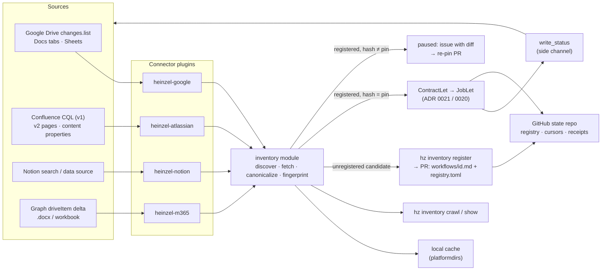

# Research report: workflows embedded in documents

> Historical design research, not current documentation. The linked decision record and the README describe what is
> available today.

- Date: 2026-10-23
- Scope: research only. Decision record: [ADR 0022](../adr/0022-embedded-workflows.md) (proposed). Contract format: ADR 0021 (assumed: YAML frontmatter
  plus Markdown sections). Registration, pinning and approvals: ADR 0020 §5, §7, §9; docs/research/daemon-head.md.
- Examples use made-up names (the Owl team, Acme).

## TL;DR

1. **One convention on every platform.** Mark the block with the 🧝 emoji and the word `Heinzel`, plus whatever native
   marker the platform has (tab, sheet, label, content control). Inside the block is the ADR 0021 contract text,
   verbatim.
2. **Discovery is cheap; registration is the gate.** Connectors list candidates. `hz inventory register` opens a pull
   request that adds `workflows/<id>.md` (the extracted text) and an entry in `workflows/registry.toml`: source,
   owner, fingerprint and allowed actions. Reviewers read a normal GitHub diff, not a Doc.
3. **Pin the extracted text, not platform revision IDs.** The fingerprint is the SHA-256 of the normalized text.
   Platform version numbers only decide whether to fetch again.
4. **Write status beside the content, not into it.** Use Confluence content properties, Sheets developer metadata,
   Notion database properties or SharePoint columns. In Google Docs, use a named range that hashing ignores. This
   never overwrites a user's edits and never makes a job wake itself up.
5. **Polling with cursors everywhere.** Every platform's webhooks need a public HTTPS endpoint, which laptops don't
   have (ADR 0020).

## 1. How workflows are embedded, per platform

### Google Docs

**What the API offers**
- `documents.get` with `includeTabsContent=true` fills `document.tabs[]`. Without it, only the first tab is returned
  and other tabs' content is not.
- Each tab has `tabProperties` and a `documentTab` whose `body` holds the content. Nested tabs are in `childTabs` and
  must be walked recursively.
  Source: https://developers.google.com/workspace/docs/api/how-tos/tabs
- `TabProperties` fields: `tabId` (immutable), `title`, `parentTabId`, `index`, `nestingLevel`, `iconEmoji`.
  An invalid emoji returns a 400 error.
  Source: https://developers.google.com/workspace/docs/api/reference/rest/v1/documents
- `DocumentTab` also carries `namedRanges`, which is a map keyed by name.
- `ReplaceNamedRangeContentRequest` and `ReplaceAllTextRequest` apply to all tabs unless a tab is named
  (how-tos/tabs page).
- `revisionId` is opaque, valid for 24 hours, cannot be shared across users, and is only returned to editors
  (documents reference). It is unusable as a pin.
- The documents resource has no code-block element type. Structural elements are paragraph, table, sectionBreak and
  tableOfContents.
  - *Unverified:* how the Docs "Code block" building block appears in the API. Don't rely on it.
- Quotas: 300 reads and 60 writes per minute per user per project.
  Source: https://developers.google.com/workspace/docs/api/limits

**Recommended authoring form**
- A top-level tab titled `Heinzel` with `iconEmoji` set to 🧝, containing the contract as plain paragraphs.
- Example of the tab content, as written by the Owl team:

```
---
name: weekly-status
owner: owl-lead@example.com
schedule: "0 8 * * MON"
publishes: [doc.append_section]
---
## Goal
Keep the "This week" section current from the Owl board.
## Requires
- tracker: project OWL, updated since last run
## Maintains
- section "This week" in this document
```

**Parsing into the canonical text**
1. Flatten the tab tree in UI order.
2. Pick tabs whose `title` contains `Heinzel` or whose `iconEmoji` is 🧝. Never select by body text.
3. Turn paragraphs into lines. Map `paragraphStyle.namedStyleType` HEADING_n to `#` × n and bullet lists to `- `.
4. Skip the content of the named range `hz-status`.
5. Read with `suggestionsViewMode=PREVIEW_WITHOUT_SUGGESTIONS`, so that unaccepted suggestions are never part of the
   contract. *Enum value from the reference; not re-fetched.*

**Writing status back**
- Default: status lives in GitHub (receipt, issue). The Doc only gets a link.
- Opt-in:
  - The template has a short paragraph, wrapped in a named range `hz-status`, that holds last run, next run and the
    approval link.
  - hz rewrites it with `ReplaceNamedRangeContentRequest` scoped to the tab. That changes only the named range and
    leaves everything else untouched.
  - Use `WriteControl.requiredRevisionId` so the write fails, rather than merges, if the user edited in between.
    *Not re-fetched.*
  - Record the Drive `version` after the write, so the next tick recognizes its own edit.
- Writing requires the `documents` scope, which Google classes as sensitive.

### Google Sheets

**What the API offers**
- Developer metadata can attach to the spreadsheet, a sheet, or row and column ranges.
  - Visibility is `DOCUMENT` or `PROJECT`. The limit is 30,000 characters per spreadsheet plus 30,000 per sheet.
  - It "remains associated at those locations as the spreadsheet is edited".
  - Google's guidance: "Don't use project-visible developer metadata as a security mechanism".
  - Search uses `developerMetadata.search` with `DataFilter`.
  - Source: https://developers.google.com/workspace/sheets/api/guides/metadata
- Tables (`addTable`, `columnProperties` with `columnType`, including DROPDOWN) can give a typed key/value form.
  Source: https://developers.google.com/workspace/sheets/api/guides/tables
- Quotas: 60 reads and 60 writes per minute per user, and 300 per minute per project. On 429, use truncated
  exponential backoff.
  Source: https://developers.google.com/workspace/sheets/api/limits
- Sheets has no revision ID of its own. Use the Drive file `version`.

**Recommended authoring form**
- A sheet titled `🧝 Heinzel` with a two-column table:
  - Column A holds frontmatter keys (`name`, `owner`, `schedule`, `publishes`) followed by section rows (`## Goal`,
    `## Requires`, …).
  - Column B holds the values. Multi-line text is allowed in a cell.
- This is friendlier than one large text cell: values are easy to edit, can carry validation, and can have dropdowns
  for `publishes`.

**Parsing**
- Read with `values.get` on `'🧝 Heinzel'!A:B`.
- Rows before the first `##` key become YAML frontmatter. `## X` rows become sections with column B as the body.
- Ignore rows below a `--- status ---` marker row.

**Writing status back**
- Developer metadata on the Heinzel sheet, for example `hz.status` holding `{last_run, next_run, approval_url,
  receipt}` with `DOCUMENT` visibility. It is invisible in the UI and outside the hashed range.
- Optionally, a protected status block below the marker row. Its cells are excluded from the hash.

### Confluence Cloud

**What the API offers**
- v2 `GET /pages/{id}` returns `body-format` in `storage`, `atlas_doc_format` (ADF), `view` and other forms.
- `PUT /pages/{id}` requires `version.number` set to the current version plus one, so concurrent overwrites fail.
- Content properties: `GET`/`POST` on `/pages/{page-id}/properties` and `PUT /pages/{page-id}/properties/{property-id}`.
  - The body is `{key, value (JSON), version {number, message}}`.
  - Scopes: `read:page:confluence` and `write:page:confluence`. Requires permission to update the page.
- Also available: `/pages/{id}/labels`, `/labels/{id}/pages`, and `/pages/{id}/direct-children`
  (`/pages/{id}/children` is deprecated).
- Source: v2 OpenAPI spec https://dac-static.atlassian.com/cloud/confluence/openapi-v2.v3.json and
  https://developer.atlassian.com/cloud/confluence/rest/v2/api-group-page/
- The v2 API has **no CQL search**. CQL is v1: `/wiki/rest/api/content/search?cql=…`.
  - Fields: `label` (`=`, `IN`), `text` (`~` over title, body and labels), `title`, `type`, `space`, `ancestor`,
    `lastmodified` (`>`, `>=`). You cannot order by label.
  - Source: https://developer.atlassian.com/cloud/confluence/advanced-searching-using-cql/
- ADF has `heading`, `codeBlock`, `expand`/`nestedExpand`, `panel` and `table` nodes.
  Source: https://developer.atlassian.com/cloud/jira/platform/apis/document/structure/
  - *Unverified:* how ADF represents macros (extension nodes) and their attributes.
- The Page Properties macro holds a two-column key/value table and adds a label to the page. The Page Properties
  Report macro turns all labelled pages into a summary table.
  Source: https://confluence.atlassian.com/doc/page-properties-macro-184550024.html
  - *Unverified:* the storage-format macro name `details`.
- Rate limits are points-based:
  - The global pool is 65,000 points per hour. Per-tenant pools are 100,000 to 500,000 per hour.
  - Throttled requests get 429 with `Retry-After`. Headers `X-RateLimit-Remaining` and `X-RateLimit-NearLimit` show
    remaining capacity.
  - Atlassian asks clients to back off with jitter and to cache with ETags.
  - Source: https://developer.atlassian.com/cloud/confluence/rate-limiting/

**Recommended authoring form**
- Label the page `heinzel`.
- Add an **expand macro titled "🧝 Heinzel"** containing **one code block** that holds the contract verbatim. This
  keeps the text exactly as written, with no rich-text ambiguity.
- Optionally, put a Page Properties macro inside, labelled `heinzel`, holding the frontmatter keys (owner, schedule).
  The team then gets a "workflow inventory" page for free from the Page Properties Report.
- Alternative: a child page titled `🧝 Heinzel` that holds only the contract.

**Parsing**
- Fetch ADF.
- Find the `expand` node whose `attrs.title` contains `Heinzel`.
- Take the text of its first `codeBlock`. If there is no code block, render its headings and paragraphs to Markdown.

**Writing status back**
- A content property `heinzel.status` holding `{last_run, next_run, approval_url, receipt, pinned}`.
- It has its own version, never touches the page body, and does not bump the page version.
- Visible alternative: a footer comment by the hz account with the approval link.
  - *Unverified:* whether creating a comment changes the page's `lastmodified` in CQL. If it does, the crawler must
    ignore its own comments.

### Notion (briefly)

**What the API offers**
- `POST /v1/search` matches **titles only**. It can filter by `object` and sort by `last_edited_time`, and it only
  sees pages shared with the integration.
  Source: https://developers.notion.com/reference/post-search
- Block types (source: https://developers.notion.com/reference/block):
  - `toggle`, and toggleable headings (`is_toggleable`).
  - `code`, with `language` and `rich_text`.
  - `callout`, with an `icon` emoji.
  - Synced blocks, whose content cannot be updated through the API.
  - Every block has `last_edited_time`.
- Rate limits: an average of 3 requests per second (10 on Business and Enterprise plans). Throttled requests get 429
  with `Retry-After`. Rich text is limited to 2,000 characters per object, and payloads to 100 elements per array.
  Source: https://developers.notion.com/reference/request-limits
- Webhooks need a public HTTPS endpoint, are batched, and carry no content.
  Source: https://developers.notion.com/reference/webhooks

**Recommended form**
- A toggle heading `🧝 Heinzel` containing one `code` block.
- The page lives in a "Heinzel workflows" database (or carries 🧝 Heinzel in its title), because search cannot find
  body text.
- Status goes into database properties (Last run, Next run, Approval), never into blocks.
- Code blocks split text into 2,000-character rich-text chunks, so concatenate the chunks before hashing.

### Microsoft 365 (briefly)

**What the API offers**
- Word content controls have a `tag` (hidden, meant for programs), a `title`, and the flags
  `cannotDelete`/`cannotEdit`.
  - These are Office.js APIs (https://learn.microsoft.com/en-us/javascript/api/word/word.contentcontrol). **Graph
    has no API for Word content.**
  - So hz downloads the file with `GET /drives/{id}/items/{id}/content`, which answers 302 and supports
    `if-none-match` (304 when unchanged).
    Source: https://learn.microsoft.com/en-us/graph/api/driveitem-get-content
  - hz then parses `w:sdt` elements with `w:tag w:val="heinzel"` in the OOXML.
- Excel: Graph exposes `/workbook/worksheets`, `/workbook/names` and `/workbook/tables`.
  - Only for .xlsx files in OneDrive for Business or SharePoint. Not consumer OneDrive.
  - Scopes `Files.Read` or `Files.ReadWrite`.
  - Source: https://learn.microsoft.com/en-us/graph/api/resources/excel
- Discovery:
  - `GET /drives/{id}/root/delta` follows `@odata.nextLink` until it gets a `@odata.deltaLink`.
  - `?token=latest` starts from now. `410 Gone` means a full resync. The delta shows each item's latest state, and
    the same item can appear more than once.
  - Least-privileged permission: `Files.Read`.
  - Source: https://learn.microsoft.com/en-us/graph/api/driveitem-delta and
    https://learn.microsoft.com/en-us/graph/delta-query-overview
  - Initial discovery: `POST /search/query` with `entityTypes: ["driveItem"]` and KQL such as
    `Heinzel filetype:docx`.
    Source: https://learn.microsoft.com/en-us/graph/search-concept-files

**Recommended form**
- Word: a rich-text content control with tag `heinzel` and title `🧝 Heinzel`.
- Excel: a worksheet named `🧝 Heinzel` laid out like the Google Sheets form.

**Writing status back**
- SharePoint library columns through `listItem/fields`. *Not fetched; verify before relying on it.*
- Never write into the .docx itself.

## 2. Discovery and crawling

### Google Drive

**Bootstrap search**
- Query: `files.list q="fullText contains 'Heinzel' and (mimeType='application/vnd.google-apps.document' or
  mimeType='application/vnd.google-apps.spreadsheet') and trashed=false"`.
  - Use `corpora=allDrives`, `includeItemsFromAllDrives=true`, `supportsAllDrives=true` and `pageSize` up to 1000.
  - If the result says `incompleteSearch`, narrow to `user` or `drive`.
- `fullText` matches "name, description, indexableText properties, or text in the file's content". `contains`
  matches whole tokens only, so search for the ASCII word, not the emoji.
- Sources: https://developers.google.com/workspace/drive/api/guides/ref-search-terms ·
  https://developers.google.com/workspace/drive/api/guides/search-files ·
  https://developers.google.com/workspace/drive/api/reference/rest/v3/files/list

**Incremental crawl**
1. Call `changes.getStartPageToken` once.
2. Call `changes.list(pageToken, includeItemsFromAllDrives, supportsAllDrives, spaces=drive, pageSize ≤ 1000)`.
3. Follow `nextPageToken`. Persist `newStartPageToken` only after the last page.

- Sources: https://developers.google.com/workspace/drive/api/guides/manage-changes ·
  https://developers.google.com/workspace/drive/api/reference/rest/v3/changes/list

**Checking a candidate**
- Use a field mask so only tab titles come back:
  - Docs: `documents.get(includeTabsContent=true, fields="tabs(tabProperties,childTabs)")`.
  - Sheets: `spreadsheets.get(fields="sheets.properties.title")`.
- Fetch full content only when a Heinzel tab or sheet exists, or when the file is in the registry.

**Tagging (optional)**
- `appProperties` are private to the OAuth client, allow at most 30 per app and 124 bytes per key plus value, and are
  searchable with `appProperties has {key='hz' and value='…'}`.
  Source: https://developers.google.com/workspace/drive/api/guides/properties
- Setting them needs write access. **The registry in Git stays the source of truth.**

**Scopes and verification**
- `drive.file` (non-sensitive) reaches only files the user opened with the app or picked. **It cannot crawl.**
- `drive.readonly`, `drive` and even `drive.metadata.readonly` are **restricted**.
  Source: https://developers.google.com/workspace/drive/api/guides/api-specific-auth
- `documents.readonly` and `documents` are sensitive.
  Source: https://developers.google.com/workspace/docs/api/auth
- Restricted scopes need verification, and a CASA security assessment when data passes through a third-party server.
  Reassessment is yearly.
- Exempt: internal use (only users in one Workspace organization), personal use, and development or testing.
  Source: https://developers.google.com/identity/protocols/oauth2/production-readiness/restricted-scope-verification
- Consequence: **each organization creates an internal OAuth client.** hz has no server, so data never passes through
  a third-party server.

**Whose credentials**
- **User OAuth** (installed-app loopback flow, refresh token in the keyring): this is the personal daemon. It sees
  exactly what the person can see.
- **Service account without domain-wide delegation**: for the team runner. It reads only files shared with it, for
  example as a shared-drive member. That is narrow and auditable.
- **Domain-wide delegation**: needs a Super Admin grant and can impersonate any user. Rejected as the default.
  Source: https://developers.google.com/workspace/guides/create-credentials

### Confluence

- CQL cursor query:

```
label = "heinzel" and type = page and lastmodified >= "2026-10-23 08:00" order by lastmodified asc
```

- Store the highest `lastmodified` seen, minus a few minutes of overlap, and remove duplicates by
  `(id, version.number)`.
- Bootstrap with `text ~ "Heinzel"` to suggest labels for pages that have the block but not the label.
- *Check against the CQL page before relying on it:* `now("-15m")` with `lastmodified`, and the exact date-literal
  format.

**Authentication**
- Scoped API tokens:
  - Use basic auth (email plus token) against `https://api.atlassian.com/ex/confluence/{cloudId}`, not the site URL.
  - Tokens expire after 1–365 days (default one year).
  - Source: https://support.atlassian.com/atlassian-account/docs/manage-api-tokens-for-your-atlassian-account/
- Or OAuth 2.0 (3LO):
  - Uses `auth.atlassian.com`, `accessible-resources` for the cloudId, and `offline_access`.
  - Refresh tokens rotate (the old one is disabled), with a 90-day inactivity expiry.
  - Unapproved apps show users a warning.
  - Source: https://developer.atlassian.com/cloud/confluence/oauth-2-3lo-apps/
- Minimum scopes: `read:page:confluence`, `write:page:confluence` (for content properties only), and search and
  label scopes. *Check the exact granular scope names for v1 search.*

**Webhooks**
- *Unverified* for 3LO and API-token clients. Connect and Forge apps get events but need app hosting. Poll.

### Notion

- Search with `sort: last_edited_time descending` and stop paging once results are older than the cursor.
- Or query the "Heinzel workflows" data source with a `last_edited_time` filter.
- An integration sees only the pages it was shared with: least privilege by construction.

### Microsoft 365

- Keep one `deltaLink` per drive, and run search for bootstrap.
- Delegated `Files.Read` (or `Files.Read.All` for shared libraries). Application permissions only for a team runner.

### Webhooks or polling

Every platform's push mechanism needs a public HTTPS endpoint:
- Drive channels expire.
- Notion webhooks are batched and carry no content.
- Atlassian webhooks are tied to apps.

This matches ADR 0020: poll per tick, and let only the leaseholder poll. Pushes could later be relayed into Actions.

### Personal and shared files

- Discovery depends on whose credentials run it. Two people's daemons see different sets of files.
- Leases and cursors are therefore keyed by **(connector, principal)**, not just by connector.
- Files on shared drives that a team service account can read go to the team runner.

## 3. Change detection, pinning, provenance

**Normalized text (`canonical-v1`)**
1. Extract only the Heinzel block.
2. Apply Unicode NFC, use `\n` line endings, and strip trailing whitespace on each line.
3. Remove invisible characters (Unicode category Cf: zero-width and bidi controls, tag characters) and **record that
   they were present**.
4. Render to Markdown deterministically.
5. Fingerprint = `sha256("hz-contract/canonical-v1\n" + text)`.

**Version hints (decide whether to fetch, never pinned)**

| Platform | Hint | Note |
| --- | --- | --- |
| Drive | `version` | Monotonic for every file type. `md5Checksum` and `headRevisionId` exist only for binary files. |
| Docs | `revisionId` | Valid for 24 hours, one user only. |
| Confluence | `version.number` | |
| Notion | `last_edited_time` | |
| Graph | `eTag`/`cTag` | |

Source for Drive: https://developers.google.com/workspace/drive/api/reference/rest/v3/files

**What happens on a tick**

| Fingerprint compared with the registry | Result |
| --- | --- |
| Equal | The job runs normally. Edits to the rest of the document are input facets: they trigger a render, not a pause. |
| Different | The job pauses (`awaiting_approval`, cause `contract_changed`). hz opens an issue with the canonical diff, the editor (`lastModifyingUser`, version author) and any invisible characters made visible. |

Approving a change is a pull request that updates `workflows/<id>.md` and the pin.

**Parser upgrades**
- Changing the parser changes the fingerprint version (`canonical-v2`).
- The registry keeps the version a pin was made with.
- On an upgrade, hz re-pins automatically **only if** the source version hint is unchanged since the last approval.
  Otherwise it pauses as usual.

**Provenance in every receipt**
- Source URI, for example `gdoc://<fileId>#tab=<tabId>`, `confluence://<cloudId>/page/<id>`.
- Version hint, editor, `fetched_at`.
- Connector and parser versions.
- Contract fingerprint, and the commit SHA of the registry entry that authorized the run.

**Not waking itself up**
- Status goes to side channels: content properties, developer metadata, database properties, columns.
- Where status must sit inside the document (the Docs named range), it is left out of the hash. hz records the
  version hint after its write and treats that version as its own.

## 4. Security

- **Prompt injection.**
  - The contract *is* instructions. That is exactly why only the **pinned text** runs.
  - Everything else the workflow reads (the rest of the doc, comments, linked pages) is passed as quoted data.
  - Renders get read-only tools (ADR 0020 §9). Unaccepted suggestions are excluded. Hidden characters are stripped
    and shown in the diff.
  - Hidden *formatting*, such as white or 1-pt text, survives extraction as visible text in the diff. That is the
    point of reviewing the extracted text instead of the rendered document.
- **Who may register.**
  - The pull request author must hold edit rights on the source. The connector checks Drive `permissions` or
    Confluence update permission.
  - The approver must be a CODEOWNER of `workflows/`.
  - The `owner` field must name a person who has both (*open question:* mapping GitHub identities to Workspace or
    Atlassian identities).
- **Capability ceiling.**
  - The registry entry lists the allowed `publishes` action types and targets.
  - A contract cannot widen them. Asking for more means a new registration.
  - Default target: the source document itself.
- **Least privilege.**
  - Read scopes for crawling. Write scopes only when status write-back or publishing is enabled.
  - Notion pages shared one by one.
  - Service accounts reach only shared drives, never domain-wide delegation.
  - Scoped Atlassian tokens with an expiry.
- **Audit.** Receipts, plus registry history in Git, plus the platform's own version history.

## 5. Crawl architecture

**Connector interface** (one plugin per platform: `heinzel-google`, `heinzel-atlassian`, `heinzel-notion`,
`heinzel-m365`):

```python
class DocumentConnector(Protocol):
    name: str  # "google", "atlassian", …

    def discover(self, cursor: Cursor) -> tuple[list[Candidate], Cursor]: ...
    def fetch(self, ref: SourceRef) -> Extract:  # canonical text, version hint, provenance, raw snapshot
        ...
    def write_status(self, ref: SourceRef, status: Status) -> VersionHint: ...
```

**Cursors**

| Connector | Cursor |
| --- | --- |
| Google | Drive `newStartPageToken` (one per principal; one per shared drive when `driveId` is used) |
| Atlassian | CQL `lastmodified` high-water mark plus the set of `(id, version)` already seen |
| Notion | `last_edited_time` plus IDs already seen |
| M365 | `deltaLink` per drive |

**Operations** (CLI, MCP and REST, ADR 0003):
- `hz inventory crawl [--source …] [--since …] [--dry-run] [--json]` lists candidates with the state `unregistered`,
  `registered`, `changed`, `paused` or `unreachable`.
- `hz inventory show <ref>` prints the canonical text and the diff against the pin.
- `hz inventory register <ref>` opens the pull request.
- `hz inventory unregister <ref>`.

**Daemon**
- Each connector contributes one `WatchLet` (`google.drive.changes`, `atlassian.confluence.cql`, `notion.search`,
  `m365.drive.delta`).
- The facets are `(ref, version_hint, fingerprint)`.
- Registered entries compile through ADR 0021 into `ContractLet` and then `JobLet`.

**Cache**
- Kept under `platformdirs.user_cache_dir/hz/inventory/<connector>/<ref>.json`: last version hint, canonical text,
  fingerprint, raw snapshot of the approved revision.
- A fetch is skipped when the version hint is unchanged.

**Offline**
- When a connector raises `Unavailable`, the tick writes a local `skipped` receipt with cause `offline`.
- Cursors are left untouched. Back off with jitter and honour `Retry-After`.
- Registered jobs whose inputs can't be fetched are skipped, never run on stale contract text.



## Risks

- **Restricted Google scopes.** Without an internal OAuth client per organization, crawling Drive is blocked.
  Fallback: `drive.file` plus `hz inventory add <url>` or the Picker, which means no crawling.
- **Search indexing.** It is unclear whether Drive `fullText` covers all tabs, and how quickly. Treat it as a hint.
  `changes.list` plus tab-title checks is the reliable path.
- **Quotas.** Sheets allows 60 reads per minute per user and Notion averages 3 requests per second. Use field masks,
  version-hint skipping and the leaseholder rule.
- **Identity mapping.** Linking a GitHub reviewer to the document's editor needs a mapping table.
- **Parser drift.** Mitigated by versioned canonicalization and re-pinning against raw snapshots.
- **Users deleting the block or renaming the tab.** The workflow becomes `unreachable` and pauses. It does not run
  from the cached text.

## Open questions

1. Does the connector protocol live in a core `inventory` module, or as a kernel protocol? Should connectors be a new
   let kind (`SourceLet`, which would need its own ADR) or services found by type?
2. Status write-back on by default, or opt-in per registration?
3. Which identity-mapping file maps GitHub logins to Google, Atlassian and Microsoft accounts, and who maintains it?
4. Should Confluence Page Properties be part of the contract (frontmatter) or only an index?
5. Notion and M365 in the first release, or later?
6. Should the Docs "Code block" building block be supported once its API representation is verified?
