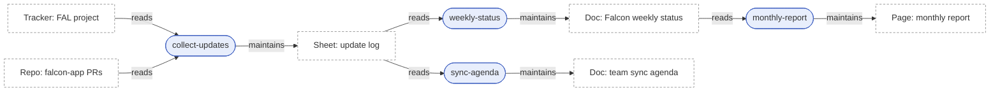
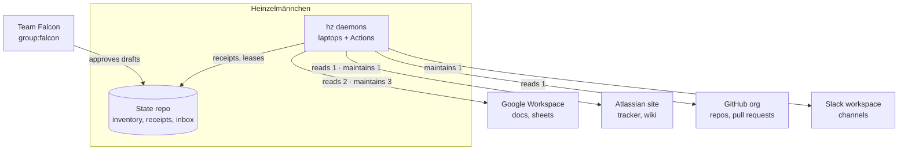

# Research: the inventory, its graphs and how they are published

> Historical design research, not current documentation. The linked decision record and the README describe what is
> available today.

Status: research for [ADR 0023](../adr/0023-inventory.md) (proposed). Aligns with ADR 0020 (daemon head, state repository) and with the parallel
work on ADR 0021 (contract format), ADR 0022 (workflows embedded in Docs, Sheets and Confluence) and ADR 0024 (people
and org model). It only *references* those three and does not define them.

## 1. What the inventory is

The inventory is a **typed graph of everything Heinzelmännchen works on, with, and for**. It answers:
- Which workflows exist, what they read and maintain, and in what order they run.
- Which documents, sheets, tracker projects, repositories and channels a team depends on, and who owns them.
- Which external systems are involved, and with which scopes.
- Who approves what.

It is the map. Receipts (ADR 0020 §8) record what actually happened.

### Entities

| Kind | What it is | Examples | Identity |
| --- | --- | --- | --- |
| `artefact` | A thing people read or that Heinzelmännchen maintains | Google Doc or Sheet (or a tab of one), Confluence page, tracker project or board, repository, Slack channel, dashboard, feed, calendar | ref + canonical `uri` |
| `workflow` | A contract (ADR 0021); embedded ones per ADR 0022 | `weekly-status`, `monthly-report` | ref; the contract file path or embedding `uri` |
| `system` | One instance of an integration | the team's Google Workspace domain, an Atlassian site, a GitHub org, a Slack workspace, the state repository | ref + base `uri` |
| `group`, `person` | **Only by reference to ADR 0024** | `group:falcon`, `person:avery` | as ADR 0024 defines |
| `domain` (optional) | A grouping of systems and artefacts for landscape views | `delivery`, `planning` | ref |

Refs follow Backstage's entity references: `kind:name` inside the team's namespace and `kind:namespace/name` across
teams. The `uri` is the **canonical external locator**, normalised per system by its connector: for example, strip
`/edit`, query strings and fragments from a Docs URL, but keep the tab id. Two entries with the same canonical `uri` are
the same entity. That is how discovered entries match declared ones. Where an IRI-style id is needed (JSON-LD export,
MCP resources), it is `hz://<state-repo>/<kind>/<name>`.

### Edges (typed, with inverses, as in Backstage's well-known relations)

| Edge | Inverse | From → to | Where it comes from |
| --- | --- | --- | --- |
| `reads` | `readBy` | workflow → artefact | contract `Requires` (ADR 0021); `WatchLet` source |
| `maintains` | `maintainedBy` | workflow → artefact | contract `Maintains` (ADR 0021); `JobLet.publishes` |
| `triggers` | `triggeredBy` | artefact or workflow → workflow | `JobLet.on` (watch facets); schedules are attributes, not nodes |
| `owns` | `ownedBy` | group or person → anything | declared; ADR 0024 resolves people and groups |
| `approves` | `approvedBy` | group or person → workflow | contract or registry approvers; auto-approve policies (ADR 0020 §7) |
| `hostedIn` | `hosts` | artefact → system | URI scheme or host, through the connector |
| `uses` | `usedBy` | workflow → system | the connectors a workflow needs (scopes) |
| `embeddedIn` | `embeds` | workflow → artefact | ADR 0022 discovery |
| `partOf` | `hasPart` | tab → doc; system → domain | declared or discovered |

The **workflow DAG** is derived, not stored. W2 `dependsOn` W1 when W2 `reads` an artefact that W1 `maintains`. This is
how Reactor-style contracts wire their graph (ADR 0010), and how dbt and Dagster derive lineage from declared inputs.

### Storage (team state repository, ADR 0020 §5)

```
inventory/
  systems.yaml            # declared, changed by PR (CODEOWNERS)
  artefacts/*.yaml        # declared; one file per area or team keeps PR conflicts small
  overrides.yaml          # corrections to derived or discovered entries (e.g. owner, title, ignore)
inventory.lock.json       # compiled snapshot: canonical JSON, sorted, fingerprinted (generated)
INVENTORY.md              # generated views (Mermaid), between markers
site/                     # optional generated HTML for GitHub Pages
workflows/registry.toml   # unchanged: ADR 0020's trust gate (owner + pinned fingerprint)
```

`workflows/registry.toml` stays the **security gate** for workflows embedded in artefacts. The inventory *reads* it as a
declared source; it does not duplicate or replace it.

### Example (invented team, invented documents)

```yaml
# inventory/systems.yaml
apiVersion: hz.inventory/v1
kind: System
metadata: {name: workspace, title: Google Workspace (example.org)}
spec: {type: google-workspace, uri: "https://docs.google.com/", owner: group:it-ops}
---
apiVersion: hz.inventory/v1
kind: System
metadata: {name: tracker, title: Atlassian site}
spec: {type: atlassian, uri: "https://example.atlassian.net/", owner: group:it-ops}
---
# inventory/artefacts/falcon.yaml
apiVersion: hz.inventory/v1
kind: Artefact
metadata:
  name: falcon-weekly-status
  title: Falcon weekly status
  tags: [status]
spec:
  type: google-doc
  uri: "https://docs.google.com/document/d/1ExampleExampleExample"
  system: system:workspace
  owner: group:falcon            # ADR 0024 ref
  classification: internal       # controls where views may be published
  stale_after: P30D              # optional; default per type
---
apiVersion: hz.inventory/v1
kind: Artefact
metadata: {name: falcon-tracker, title: FAL project}
spec:
  type: tracker-project
  uri: "https://example.atlassian.net/browse/FAL"
  system: system:tracker
  owner: group:falcon
```

Workflows are not declared here. They come from their contracts (ADR 0021), whose frontmatter supplies `name`,
`Requires`, `Maintains`, the owner and approvers *as ADR 0021 defines them*. `Requires` and `Maintains` entries are
either refs (`artefact:falcon-weekly-status`) or URIs; an unknown URI becomes an implicit artefact flagged by
`validate`.

### The four origins and how they merge

| Origin | Source | Trust | Written by |
| --- | --- | --- | --- |
| `declared` | `inventory/**/*.yaml`, `workflows/registry.toml` | authoritative | humans, by PR |
| `derived` | lets in the running kernel: `ContractLet` → workflow and reads/maintains; `JobLet.publishes`, `.on`, `.scope`; `WatchLet` source → reads | authoritative for what code declares | `compile` |
| `discovered` | `InventoryLet` providers (plugins and connectors): Drive folders, Confluence spaces, GitHub org repos, Slack channels, "🧝 Heinzel" tabs (ADR 0022) | **data until accepted**: proposals only (ADR 0020 §9) | `discover`, then PR |
| `observed` | receipts' `sources` and publish references (ADR 0020 §8) | evidence of runtime lineage | the ledger |

Merge rules:
1. **Key:** canonical `uri` if present, otherwise the ref. Same key means one entity with a `provenance` list of origins.
2. **Attributes:** declared, then `overrides.yaml`, then derived, then discovered. Conflicts between declared and derived
   (for example, two different owners) are validation errors, not silent overwrites.
3. **Edges:** the union of all origins, each edge carrying its provenance. An edge only *observed* (a render read a doc
   that its contract does not `Require`) is **drift**. So is an edge only declared that has not been observed for N runs.
4. **Discovered:** never merged into `declared` automatically. `discover` opens a proposal (an issue or a PR adding YAML),
   handled in `hz inbox` like any other draft. Discovered-but-unaccepted entries appear in views greyed out, with
   `origin=discovered`.
5. **Staleness:** discovered and observed entries carry `last_seen`. Declared entries are checked with
   `validate --online`, a HEAD or metadata call through the connector. Past `stale_after` they are flagged. A deleted
   or inaccessible artefact becomes a `tombstone` in the lock; it is not removed until a PR removes the declaration.

## 2. Commands

`inventory` is a **top-level module**: it is about the team's work, not about operating Heinzelmännchen, so it does not
belong under `hz system` (ADR 0018). `hz landscape` is a view, `hz inventory graph --view landscape`, not a second
module. An alias can be added later if people ask for it.

| Command | read_only | What it does |
| --- | --- | --- |
| `hz inventory compile [--check] [--offline]` | no (writes files) | Gather declared, derived, discovered-but-accepted and observed entries, merge, validate, and write `inventory.lock.json` and generated views. `--check` exits 1 if anything is stale, the precedent being `scripts/generate_docs.py --check`. Meant for the state repository's CI. |
| `hz inventory validate [--online] [--strict]` | yes | Returns `Check`s (`kernel/_lets.py`). Also contributed as a `HealthLet`, so `hz system doctor` reports it. |
| `hz inventory list [--kind] [--owner] [--origin] [--stale]` | yes | A table, or JSON with `--json`. |
| `hz inventory show REF` | yes | One entity with its incoming and outgoing edges, provenance, `last_seen` and receipts. |
| `hz inventory diff [BASE] [HEAD]` | yes | Semantic diff of two locks (git revisions of the state repo, default `HEAD~1..HEAD`): added, removed or changed entities and edges, new cycles, owner changes. Used in PR bodies. |
| `hz inventory graph --view workflows\|landscape\|ownership\|lineage --format mermaid\|dot\|json\|html\|d2\|svg [--focus REF --depth N] [--group-by system\|owner\|domain]` | yes | Renders a view. |
| `hz inventory discover [--source NAME] [--dry-run]` | no | Runs `discover`-mode `InventoryLet`s and opens registration proposals. |
| `hz inventory publish [--target repo\|pages\|doc\|page]` | no | A publish operation, so it goes through the approval inbox (ADR 0020 §7). |

Every command is an operation, so the MCP and REST heads expose them unchanged (ADR 0019).

### Validation

- **Schema:** `apiVersion`, known `kind` and `spec.type`, pydantic models.
- **Duplicates:** two refs with the same canonical `uri`.
- **Dangling refs:** to artefacts, systems, and to people or groups resolved through ADR 0024.
- **Cycles** in the derived workflow DAG, using stdlib `graphlib.TopologicalSorter`, whose `CycleError` names the cycle.
  No dependency needed.
- **Single writer:** an artefact maintained by more than one workflow is an error unless an `allow_shared_writer` with an
  owner says otherwise.
- **Owners present** on every artefact, workflow and system.
- **Approvers** present for workflows whose `publishes` has no auto-approve policy.
- **Embedded workflows** without a registry entry (ADR 0022 and ADR 0020 §9).
- **Drift:** declared versus observed edges.
- **Staleness** and tombstones.
- **Classification:** a view published to a target less private than its most restrictive entity is an error.

### Lock (snapshot)

`inventory.lock.json` is canonical JSON (sorted keys, UTF-8, no floats), using the same canonicalisation as ADR 0020's
facet fingerprints:

```json
{"schema": "hz.inventory.lock/v1", "fingerprint": "sha256:9f2c…",
 "inputs": {"declared": "sha256:…", "contracts": "sha256:…", "registry": "sha256:…", "ledger_upto": "receipt:…"},
 "entities": [{"ref": "artefact:falcon-weekly-status", "uri": "https://docs.google.com/document/d/1Example…",
               "origin": ["declared", "observed"], "owner": "group:falcon", "last_seen": "2026-10-22T07:00:00Z",
               "fingerprint": "sha256:…"}],
 "edges": [{"from": "workflow:weekly-status", "type": "maintains", "to": "artefact:falcon-weekly-status",
            "origin": ["derived", "observed"]}]}
```

The inventory fingerprint is a facet in its own right. The publish job memo-skips when it has not changed, and
workflows can `Require` the inventory.

### How plugins contribute: a new let

```python
@dataclass(frozen=True, kw_only=True, slots=True)
class InventoryLet(Let):
    """Entries a module contributes to the inventory. The provider may ask for injected services."""

    provider: Callable[..., InventoryContribution]  # entities + edges, each with origin and last_seen
    mode: Literal["static", "discover"] = "static"  # discover: network, only in `discover` and daemon jobs
    systems: tuple[str, ...] = ()  # system types it understands, e.g. ("atlassian",)
    canonicalize: Callable[[str], str] | None = None  # URI normaliser for those systems
```

- It is declared with `@module.inventory`, like `@module.info` and `@module.health`. The kernel stores it without
  interpreting it, as it does every let. The `inventory` module reads `kernel.lets(InventoryLet)` the way `system info`
  reads `InfoLet`s. Heads never see it, so the import-linter layering is unchanged.
- **Static** providers describe what a plugin brings, for example "the tracker plugin adds `system:tracker` and
  canonicalises `*.atlassian.net/browse/KEY`". **Discover** providers scan, and their output is proposals only.
- Derived entries need no new let: the `inventory` module reads `ContractLet`, `JobLet` and `WatchLet` (ADR 0020 §2)
  directly.

## 3. Graphs and rendering

### Views (model once, many views, as in Structurizr and C4)

| View | Nodes | Edges | Like |
| --- | --- | --- | --- |
| `workflows` | workflows (optionally with their artefacts) | derived `dependsOn`, or reads/maintains | dbt's lineage graph, Dagster's asset graph |
| `landscape` | systems, groups, the Heinzelmännchen daemon and state repo | artefact edges aggregated per system ("reads 3 · maintains 2") | C4 system context and container views |
| `ownership` | groups and people → what they own or approve | owns, approves | Backstage's ownership |
| `lineage` | artefacts ↔ workflows, observed versus declared | colour-coded drift | OpenLineage |

Slicing: `--focus REF --depth N`, `--group-by`, and collapsing a system's artefacts into one node. This is how the views
stay within renderer limits.

### Renderer comparison

| Renderer | Install | Licence | Layout at 50–500 nodes | Inline on GitHub | Python story | Verdict |
| --- | --- | --- | --- | --- | --- | --- |
| **Mermaid** text | none to emit; renders in GitHub Markdown | MIT | dagre or ELK; poor above about 100 nodes | **yes** | string generation | **Default for Markdown.** Mind the defaults `maxEdges` 500 and `maxTextSize` 50,000; GitHub runs its own instance, so treat these as the practical ceiling |
| **mermaid-cli (`mmdc`)** for SVG/PNG | Node ≥ 22.13 + Puppeteer (Chromium), or the Docker image | MIT | as Mermaid | n/a | subprocess | Optional, detected on PATH; heavy |
| **Graphviz `dot`** | system package (`brew`/`apt install graphviz`) | EPL | **best layered layout**, clusters, scales to thousands | no (images only) | emit DOT as text; the `graphviz` and `pydot` packages are wrappers that still need the binary | **Optional SVG renderer**; also the format for exchange |
| **D2** | Go single binary | MPL-2.0; TALA layout is **paid, closed source** (watermark without a licence) | dagre or ELK bundled; TALA good for architecture | no | subprocess | Optional; nice C4-like landscapes |
| **Structurizr DSL / C4-PlantUML** | Java (Structurizr) or PlantUML + Java | Apache / MIT | good C4 views | no | export a `.dsl` text | Export target for teams already on C4, not a core renderer |
| **ELK** (elkjs) | JS (or Java) | EPL | excellent layered and orthogonal | no | only in the browser | Use inside the HTML viewer |
| **Cytoscape.js / Graphviz WASM** in static HTML | CDN `<script>` with a pinned version | MIT / Apache | interactive zoom, pan, filter | no | write JSON + HTML template | **Viewer for large graphs** |
| Python-only (`grandalf`, `networkx`+matplotlib) | pip | GPL / BSD | grandalf: Sugiyama but little maintenance; networkx: force layouts, matplotlib is heavy | no | native | Not recommended |
| Kroki (HTTP rendering service) | self-host or public | MIT | many engines | no | HTTP | Only self-hosted: the public instance would receive internal URLs and names |

### Recommendation

- **Core emits text only:** Mermaid (`.mmd` and fenced in Markdown), DOT, JSON graph (node-link, compatible with the
  JSON Graph Format), D2, and a single-file **HTML** viewer. The viewer embeds the JSON and loads Cytoscape.js with ELK,
  or Mermaid, from a CDN at pinned versions, and offers zoom, pan, search and a focus filter. Zero new Python
  dependencies; cycle checks use stdlib `graphlib`.
- **SVG/PNG:** `--format svg` looks for `dot`, then `d2`, then `mmdc` on PATH (`--renderer` to choose). If none is
  found, it fails with a clear fix. `hz system doctor` reports which renderers are present. No Python extra is needed;
  at most a `heinzel[graph]` extra later, if a wrapper earns its place.
- **Size discipline:** if a Mermaid view exceeds 400 edges or 40,000 characters, `graph` refuses inline Mermaid and
  suggests `--focus` or `--group-by`, or links to the HTML. Labels are escaped: titles come from artefacts and are
  untrusted.

### Example: the workflow DAG (invented team)



### Example: the landscape (C4 system context style, artefact edges aggregated)



## 4. Publishing and keeping it current

| Target | How | Notes |
| --- | --- | --- |
| **State repo** (default) | `INVENTORY.md` with Mermaid views between markers, and `inventory.lock.json`, as a **pull request** (file-like drafts are PRs, ADR 0020 §7) | Diffable twice over: the lock diff and `hz inventory diff` in the PR body |
| **GitHub Pages** | the `site/` HTML viewer, published by the team runner's Actions workflow | Must be **private** Pages, or nothing above `public` classification: the inventory exposes internal URLs and people |
| **Google Doc** | connector plugin replaces a marked section | The Docs API has no Mermaid and no SVG: `insertInlineImage` needs PNG, JPEG or GIF from a **publicly reachable** URL under 50 MB, so use a table and link the HTML, or a PNG at an access-controlled-but-public URL (a risk) |
| **Confluence page** | connector plugin; storage-format page with an attached SVG or PNG (`ac:image` with `ri:attachment`) plus tables | No native Mermaid without a marketplace app |
| **Agents (MCP)** | already free: `inventory_show`, `inventory_graph` and the others are MCP tools (ADR 0019) | Later, an MCP resource (`hz://…/inventory/lock.json`) once a resource let exists (ADR 0019 consequences) |

Keeping it current is dogfooding: the inventory ships its own contract, `inventory-refresh`.
- It is a `JobLet` with `scope=team`, run daily and on watch of `inventory/**`, `contracts/**` and `workflows/registry.toml`.
- It runs `compile`, then `discover` (proposals), then `publish`.
- Its memo key includes the inventory fingerprint, so an unchanged inventory produces a `skipped` receipt and no new PR.
- The state repo's CI runs `hz inventory compile --check` and `validate --strict` on every PR.
- Auto-approval for publishing to the state repo is a sensible default *policy*, with an owner and an expiry. For
  Docs, Confluence and Pages it stays manual.

## 5. Prior art: what to borrow

| Prior art | Borrow | Leave |
| --- | --- | --- |
| **Backstage software catalog** | `apiVersion/kind/metadata/spec` envelope; refs `kind:namespace/name`; inverse relation pairs (ownedBy/ownerOf, partOf/hasPart, dependsOn/dependencyOf); **required owner**; Location entities and entity providers (our `InventoryLet`); orphan detection (our tombstones) | the database and portal; the software-centric kinds (Component/API/Resource map loosely to artefact/system) |
| **OpsLevel, Port** | descriptor files in repos (OpsLevel); Port's user-defined **blueprints with relations** (our `spec.type` vocabulary that plugins extend); scorecards, as validation reported in doctor | a SaaS source of truth |
| **LeanIX / ArchiMate** | landscape views per capability or domain; ArchiMate's *triggering*, *access* (read/write) and *serving* relations confirm our edge set | the enterprise metamodel |
| **C4 model, Structurizr** | **model once, many views**; system context and container as the landscape's two zoom levels; export `.dsl` | the Java toolchain in the core |
| **dbt docs** | the lineage DAG derived from declared refs; a compiled `manifest.json` as the **lock**; static site docs | — |
| **Dagster** | the asset graph: the artefact is the node people care about and workflows are how it is materialised; observed versus declared materialisations | the orchestrator |
| **OpenLineage** | job, run and dataset with **namespace + name** naming (our canonical URI); runtime lineage from run events, which are our receipts | the event server |
| **Reactor** (ADR 0010) | the Requires/Maintains DAG, fingerprints and memo keys | — |

## Risks

- **Inventory rot.** Mitigated by derived and observed origins, `validate --online`, staleness, drift checks, and the
  daily job.
- **Confidential map.** An inventory is a high-value recon target: it lists doc URLs, owners and approvers. Mitigated by
  classification, private publication targets only, and no people beyond refs (ADR 0024 decides what is shown).
- **Untrusted text.** Titles and tab names flow into Mermaid, HTML and PR bodies. Escape every label, keep a strict CSP
  in the HTML viewer, and never treat discovered text as configuration.
- **Discovery cost and rate limits.** Discover-mode lets run only under a lease (ADR 0020), conditionally, and scoped
  to configured folders, spaces and orgs.
- **Renderer limits.** Mermaid's defaults of 500 edges and 50,000 characters, and GitHub's lagging Mermaid version.
  Mitigated by slicing, aggregation and the HTML fallback.
- **Google Docs images** need a public URL (see Publishing).
- **A YAML parser** is a new core dependency (safe loading only) unless ADR 0021 already brings one.
- **Merge conflicts** in the state repo: one file per area, and generated files written only by the job.
- **Schema evolution:** `apiVersion` and a migration in `compile`.

## Open questions

1. YAML (shared with ADR 0021's frontmatter, Backstage-compatible) or TOML (consistent with the other state files,
   tomlkit already a dependency)?
2. Is the lock committed, or only produced in CI? Committed is recommended, because it makes it diffable.
3. Team inventories federated into an org view: Backstage-style `Location` includes of other teams' locks?
4. Should `workflows/registry.toml` eventually become `kind: Workflow` entries in the inventory, keeping its pinning
   semantics?
5. Which people attributes may appear in published views? This is decided with ADR 0024.
6. Export to Backstage `catalog-info.yaml` for orgs that already run Backstage?
7. Default auto-approval for publishing to the state repo: on or off?

## Sources

- Repository: `INTENT.md`; `docs/ARCHITECTURE.md`; `docs/adr/0010`, `0018`, `0019`, `0020`; `docs/research/daemon-head.md`
  (state repo layout, registry, receipts); `src/heinzel/kernel/_lets.py`; `scripts/generate_docs.py` (`--check`
  precedent); `pyproject.toml` (no YAML parser in the core).
- Mermaid config schema (`maxEdges` 500, `maxTextSize` 50000): https://mermaid.js.org/config/schema-docs/config.html
- GitHub diagrams in Markdown: https://docs.github.com/en/get-started/writing-on-github/working-with-advanced-formatting/creating-diagrams
- mermaid-cli (Node ≥ 22.13, Puppeteer, Docker images): https://github.com/mermaid-js/mermaid-cli and its `package.json`
- Graphviz: https://graphviz.org/ · Python wrapper: https://pypi.org/project/graphviz/ · pydot: https://github.com/pydot/pydot
- D2 layouts: https://d2lang.com/tour/layouts/ · TALA (paid, closed source, watermark without a licence): https://github.com/terrastruct/TALA
- Structurizr DSL: https://docs.structurizr.com/dsl · C4-PlantUML: https://github.com/plantuml-stdlib/C4-PlantUML · C4 model: https://c4model.com/
- ELK: https://eclipse.dev/elk/ · elkjs: https://github.com/kieler/elkjs · Cytoscape.js: https://js.cytoscape.org/ · Graphviz WASM: https://github.com/hpcc-systems/hpcc-js-wasm
- grandalf: https://github.com/bdcht/grandalf · Kroki: https://kroki.io/ · JSON Graph Format: https://jsongraphformat.info/
- Python `graphlib`: https://docs.python.org/3/library/graphlib.html
- Backstage system model: https://backstage.io/docs/features/software-catalog/system-model · well-known relations: https://backstage.io/docs/features/software-catalog/well-known-relations · descriptor format: https://backstage.io/docs/features/software-catalog/descriptor-format
- Port: https://docs.port.io/ · OpsLevel: https://docs.opslevel.com/
- SAP LeanIX: https://docs-eam.leanix.net/ · ArchiMate 3: https://pubs.opengroup.org/architecture/archimate3-doc/
- dbt manifest: https://docs.getdbt.com/reference/artifacts/manifest-json · dbt docs: https://docs.getdbt.com/docs/build/documentation
- Dagster assets: https://docs.dagster.io/guides/build/assets · OpenLineage naming: https://openlineage.io/docs/spec/naming
- Google Docs API `InsertInlineImageRequest`: https://developers.google.com/workspace/docs/api/reference/rest/v1/documents/request#InsertInlineImageRequest
- Confluence storage format: https://confluence.atlassian.com/doc/confluence-storage-format-790796544.html
- GitHub Pages: https://docs.github.com/en/pages · OpenProse Reactor: https://github.com/openprose/reactor
